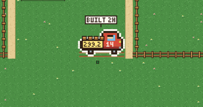
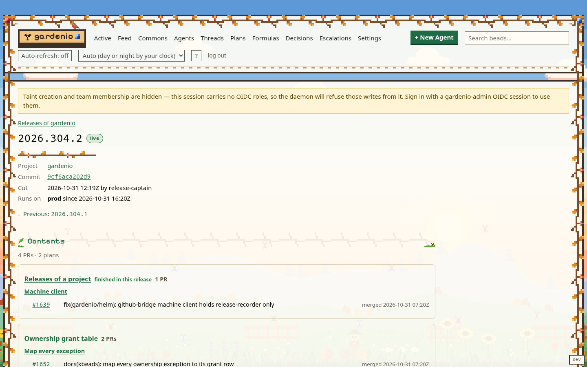

# Where did my change ship?

You merged a PR. This page shows how to find the release that carries it and
where that release runs.

A **release** is one tag of one project, for example gardenio `2026.306.3`. It
records the PRs merged since the release before it, grouped by the plan and step
they came from, and every place it has run. Its status is one of:

| Status | Meaning |
|---|---|
| `cut` | the tag exists; nothing runs it yet |
| `built` | its images exist; nothing runs it yet |
| `live` | it runs on at least one target, such as `prod` |
| `superseded` | it ran, and a newer release has replaced it everywhere |

A release is recorded when the release captain or the operator cuts it, and its
deployments are recorded when it rolls out. You do not record anything yourself.
The design is in
[`gardenio/docs/releases-design.md`](../../gardenio/docs/releases-design.md).

## On /garden: the truck



1. Open `/garden` and go to your project. Its sign stands above its home strip.
   At the Project level the sign says how many releases it has, and "1 shipping"
   while one is on its way.
2. Zoom in to the Plan level. Your project's **release truck** stands in the
   loading bay at the foot of its barn, in the home strip under the sign. A
   project with no releases has no truck.
3. Read the truck:
   - **Crates** on the bed: one per plan the release carries, most PRs first,
     plus one for PRs that are not in a plan. At most 8.
   - **The side plate**: the end of the tag, such as `306.3` for `2026.306.3`.
   - **The door**: how many PRs the release carries.
   - **The board over the cab**: where it runs and for how long (`PROD 2H`), or
     its status and age (`CUT 40M`) while it is not deployed.
4. Hover over the truck, or focus it with the keyboard, for its tip: the full
   tag, whether it is loading or live, when it was cut, its PR and plan counts,
   and which target runs it.
5. Click the truck, or press Enter on it, to open the **changelog**: the release's
   PRs by plan, then by step, with links to each plan, step and PR, to the release
   before and after it, and to the release bead.

The truck is loaded while the newest release is `cut` or `built`. When that
release goes live, the truck drives out of the farm and comes back empty, and the
page shows "Released <tag> to prod (gardenio)".

### Your plan's plot

A plot whose newest merged PR is in a release has a **shipped stamp**: a small
crate on a plate at the top-left of its fence. With the cursor on the plot, its
sign ends with a line such as:

```text
shipped in 2026.306.3 · prod
```

The targets are the ones running that release or a newer one. Before the release
is deployed, the line is "shipped in <tag>" with no target.

## In beads-viewer: the Release pages



- **`/releases`** lists every project's releases, newest first, with their
  status. A release that was never deployed because a newer one went out first
  reads `skipped`.
- **`/release/<id>`** is one release:
  - the header: status, project, commit, when it was cut and by whom, when it
    was built, and where it runs now;
  - **Contents**: the PRs by plan and step. Plans this release finished come
    first; PRs with no plan come last, under "Unplanned";
  - **Deployments**: a timeline of every target it ran on, one row per Helm
    revision, with since when and either "running now" or when it was
    superseded;
  - **Previous** and **Next**: the releases before and after it.

The page of your step, your merge request or your plan in beads-viewer also
says "Shipped in <tag>" once a release carries it.

## The release bead

Every release is a bead of type `release`, titled `<project> <tag>`. Open it in
the `/garden` bead view (the changelog links to it as "the release bead"). Its
face shows the status, where it runs and where it ran, when it was cut and
built, the release before it, and its PRs by plan, with "Open the changelog"
to go back to the truck's view.

From a terminal:

```bash
kd release list --project gardenio                  # newest first, with where each runs
kd release show 2026.306.3 --project gardenio       # one release: contents and deployments
```

## If your change does not show

- **No release yet.** Your PR merged after the newest cut. It ships in the next
  one; the release captain cuts in two daily windows.
- **The plot has no stamp, but your PR is in a release.** The stamp follows the
  plan's newest merged PR. If a newer PR of the plan has not shipped yet, the
  plot waits for it.
- **The release says `cut` for a long time.** It has not been deployed. A newer
  release may go out first, and this one then reads `skipped`.
- **Your task should close only when the change runs.** Set
  `kd update <task> -f awaits_release=true`. The task stays open after the merge
  and closes, with a comment naming the release and target, when a release that
  carries it is deployed.
