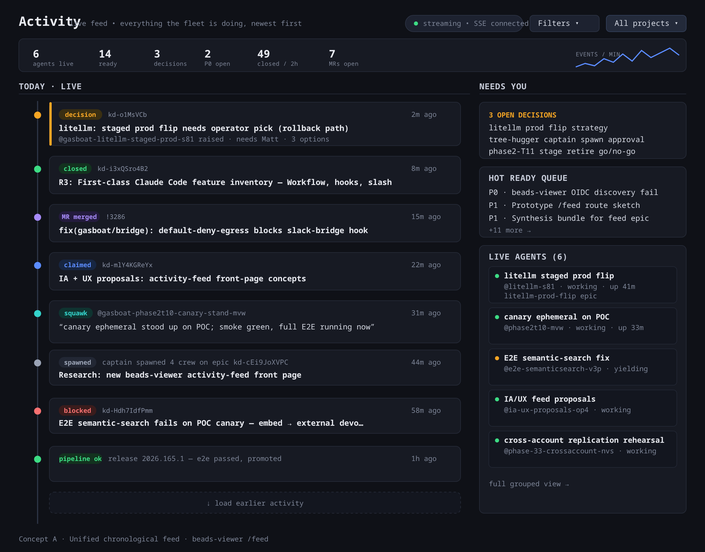
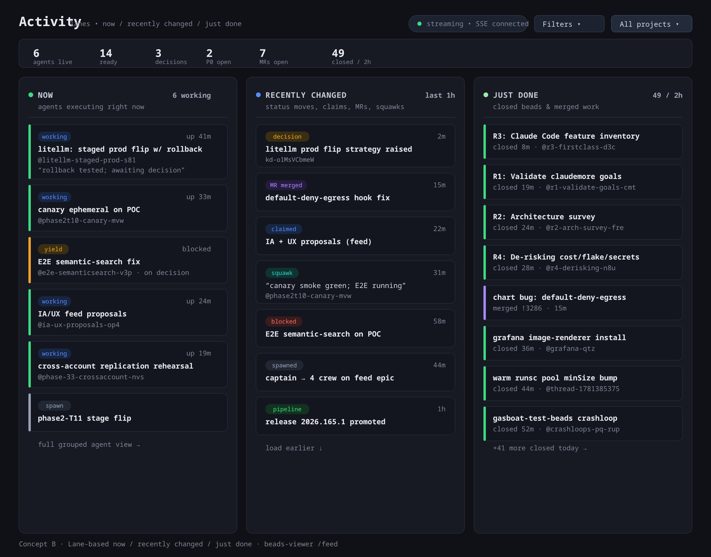
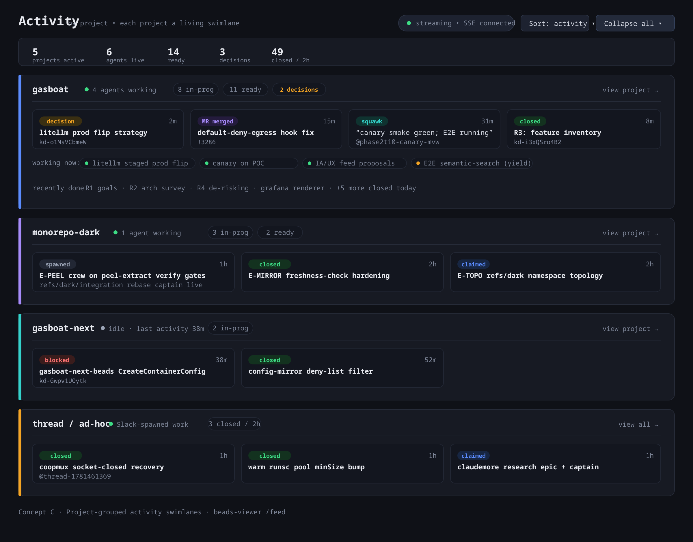

# Activity-feed front page — IA + UX proposals

**Task:** [ka-0000002322](https://beads.gardenio.e2e.example.com/ka-0000002322) ·
**Epic:** [ka-0000003263](https://beads.gardenio.e2e.example.com/ka-0000003263) ·
**Operator:** Matt Baker

This doc proposes **three distinct information-architecture concepts** for a new
beads-viewer activity-feed front page (behind `/feed` — *not* a replacement of `/`
until Matt approves promotion). Each concept is a full-page wireframe.

> Mockups are committed as **SVG sources** with **rendered PNGs** alongside, per
> advice [ka-0000000334](https://beads.gardenio.e2e.example.com/ka-0000000334).
> The PNGs are embedded below; the SVG is linked beneath each as the source.
> Re-render with `node gardenio/docs/feed-mockups/render.mjs` (see
> [Regenerating the PNGs](#regenerating-the-pngs)).

## Design constraints (shared by all three)

Grounded in the audit/data-source/realtime sibling tasks and the current
`handleIndex` implementation:

- **Reuse what works.** The current front page already computes a dense stat
  banner (`computeIndexStats`), 20 recent in-progress beads (`computeIndexRecent`),
  a live-agents grid (promoted out of the rail per ka-0000007459), and a rail
  (`computeIndexRail`). All three concepts keep a **compact stat strip** and the
  **live-agents** signal — they differ in how they *arrange the activity stream*.
- **Realtime-first.** Each concept assumes htmx `EventSource` over the existing
  SSE infra (`/agents/events`, `/telepathy/events`, kbeads bead-lifecycle SSE) —
  the established client pattern in `agent_events.go`. A "streaming · SSE
  connected" status chip is shown top-right so a stale connection is obvious.
- **Event taxonomy** (color-coded consistently across concepts):
  `decision` (amber, "needs you"), `closed`/`pipeline ok` (green), `MR merged`
  (purple), `claimed` (blue), `squawk` (teal), `spawned` (grey), `blocked` (red).
- **"Needs you" is never buried.** Open decisions, P0s, and escalations are the
  one thing a human must act on — every concept surfaces them above the fold.
- **Project scoping.** A project filter (or grouping) is first-class, since the
  fleet runs many projects (`gardenio`, `monorepo-dark`, `gardenio-next`, …).

---

## Concept A — Unified chronological feed

**One stream, newest-first, everything interleaved.** A single timeline spine down
the left with a typed event card per bead lifecycle event (decision raised, bead
closed, MR merged, claim, squawk, spawn, status change, pipeline). A right rail
pins the three "needs you" things: open decisions, the hot ready queue, and live
agents.



*Source: [`feed-mockups/concept-a-chronological.svg`](feed-mockups/concept-a-chronological.svg)*

**Why it works**
- **Lowest cognitive load** — it reads like a social feed / git activity log. The
  mental model is "scroll to see what just happened," which is exactly the
  "living feed of what the fleet is doing right now" the epic asks for.
- **Cheapest realtime** — a single SSE stream prepends one card. No per-lane or
  per-project fan-out logic on the client.
- **Decisions ride the same stream** but get an amber left-border + a pinned
  "Needs you" rail copy, so they're impossible to miss without leaving the flow.

**Trade-offs**
- A busy fleet produces a *firehose*; high-signal events (decisions, P0 blocks)
  can scroll past. Mitigation: the right rail pins them, plus a `Filters` control
  to mute event types (e.g. hide `spawned`/`squawk` noise).
- No structural sense of "how many projects are active" at a glance — that lives
  only in the stat strip.

**Best for:** an operator who wants a single "what is happening" pulse and is
comfortable with a scrolling stream.

---

## Concept B — Lane-based: now / recently changed / just done

**Three fixed columns** that map to the lifecycle of work:
- **NOW** — agents executing right now (the live-agents grid, vertical).
- **RECENTLY CHANGED** — status moves, claims, MRs, squawks, decisions (last ~1h).
- **JUST DONE** — closed beads and merged work (the satisfying "completed" column).



*Source: [`feed-mockups/concept-b-lanes.svg`](feed-mockups/concept-b-lanes.svg)*

**Why it works**
- **Spatial stability.** Unlike a single stream, each kind of activity has a fixed
  home, so the eye learns where to look. "What's done?" → always the right column.
- **Kanban-familiar.** Reads like a board flowing left→right toward completion,
  which matches how people reason about work in flight.
- **Backpressure-friendly.** Each lane caps independently and has its own "load
  earlier / +N more" affordance, so one noisy category can't drown the others.

**Trade-offs**
- **Loses strict global chronology** — a fresh squawk and an older claim sit in the
  same lane sorted by time, but you can't read a single causal timeline across
  lanes (event X in NOW caused event Y in DONE) the way Concept A allows.
- Three independent SSE-routed lists = slightly more client wiring (route each
  event type to its lane) and three scroll regions to manage.

**Best for:** a triage-oriented operator who thinks in "in-flight vs. landed" and
wants completion to feel visible and rewarding.

---

## Concept C — Project-grouped activity swimlanes

**One horizontal swimlane per active project**, sorted by recency of activity.
Each lane is a self-contained mini-dashboard: project name + live-agent count +
mini stat chips (in-prog / ready / decisions), a horizontal strip of its most
recent events, an inline "working now" agent row, and a "recently done" summary.
Lanes collapse/expand.



*Source: [`feed-mockups/concept-c-project-grouped.svg`](feed-mockups/concept-c-project-grouped.svg)*

**Why it works**
- **Matches the org reality** — the fleet runs many projects at once. This is the
  only concept where "which projects are hot, which are idle, which are blocked"
  is answerable in one glance.
- **Natural scoping** — each lane links straight to its `/p/{project}` page, so the
  feed is a launchpad into per-project detail.
- **Idle/blocked projects surface structurally** — an idle lane (grey dot, "last
  activity 38m ago") or a blocked one (red event) stands out against active ones.

**Trade-offs**
- **Highest data cost** — needs per-project aggregation (counts + recent events +
  agents) on every render/update, i.e. an N×(stats+recent) fan-out. Likely wants a
  cached projects summary rather than live recompute per SSE tick.
- **Vertical budget** — with many projects, lanes push real-time activity below the
  fold. Mitigation: sort lanes by activity, collapse idle ones by default, cap
  events-per-lane.
- Cross-project chronology is sacrificed entirely (the opposite extreme from A).

**Best for:** a fleet lead / portfolio view — "give me the health of every project
at once," accepting that you drill into a lane for detail.

---

## Comparison

| Dimension | A · Chronological | B · Lanes | C · Project swimlanes |
|---|---|---|---|
| Mental model | social/git feed | kanban board | portfolio dashboard |
| Global chronology | ✅ strict | ⚠️ per-lane only | ❌ per-project only |
| "Needs you" visibility | rail-pinned | NOW + decision cards | per-lane chips |
| Cross-project at a glance | ❌ (filter only) | ❌ | ✅ |
| Completion satisfaction | mixed in | ✅ dedicated lane | summarized |
| Realtime client cost | 🟢 lowest (1 stream) | 🟡 medium (3 lists) | 🔴 highest (N×agg) |
| Scales with fleet size | scroll firehose | lane caps absorb it | vertical pressure |
| Reuses current building blocks | stat strip + rail + recent | stat strip + agents grid | stat strip + project beads + agents |

## Recommendation (for the synthesis task)

These are **complementary, not mutually exclusive** — the IA decision is really
*"what is the default arrangement, and what are the toggles?"*

- **Ship Concept A as the `/feed` default.** It is the lowest-risk, lowest-cost,
  highest-fidelity answer to "a living feed of what the fleet is doing right now,"
  reuses the most existing code, and needs only one SSE stream.
- **Offer Concept B as a view toggle** (`group by: stream | lanes | project`).
  The lane layout is a pure client-side re-bucketing of the *same* event stream —
  cheap to add once A exists, and it's the better triage surface.
- **Treat Concept C as a distinct "Projects" mode / or fold it into the existing
  `/active` & per-project pages.** Its data cost is real; it is most valuable as a
  portfolio overview rather than the realtime default. A cached project-summary
  feed makes it viable.

A single `?view=` query param + a segmented control lets all three share one
handler and one SSE subscription, with the bucketing differing only in the
template — which keeps the prototype (ka-0000003020) small.

## Open questions for Matt / synthesis

1. **Default view** — stream (A), lanes (B), or projects (C)?
2. **Event scope** — all projects, or default-scoped to the viewer's project(s)?
3. **Noise floor** — should `spawned`/`squawk`/routine `claimed` events be on by
   default, or opt-in via Filters?
4. **Retention/backfill** — how far back does the feed load on first paint, and do
   we backfill missed events on SSE reconnect (see realtime task ka-0000002760)?

## Regenerating the PNGs

The PNGs are rendered from the SVG sources with headless Chromium via Playwright:

```sh
cd gardenio/docs/feed-mockups
CHROME_BIN=$(find ~/.cache/ms-playwright -name chrome-headless-shell -type f | head -1) \
  node render.mjs
```

`render.mjs` rasterizes every `*.svg` in the directory (except `_`-prefixed) to a
same-named `*.png` at 2× device scale. Edit the `.svg`, re-run, and commit both.
