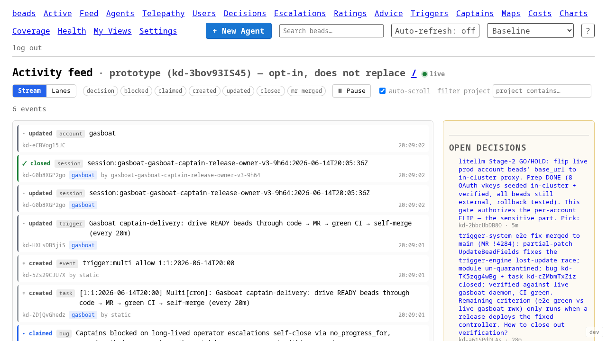
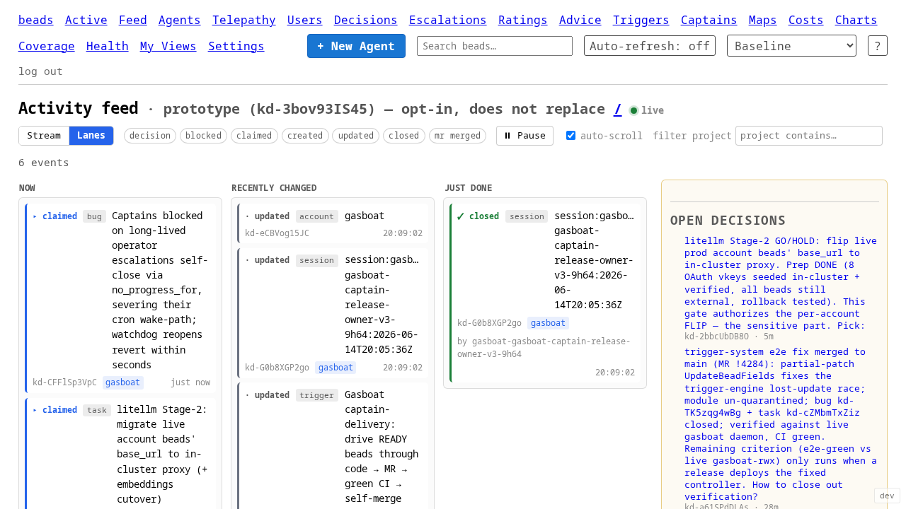

# Activity-feed front page — working prototype (`/feed`)

**Task:** [ka-0000003020](https://beads.gardenio.e2e.example.com/ka-0000003020) ·
**Epic:** [ka-0000003263](https://beads.gardenio.e2e.example.com/ka-0000003263) ·
**Operator:** Matt Baker

This is the **prototype sketch** child of the activity-feed research epic. It
lands a minimal-but-working activity feed behind a **new `/feed` route** and
does **not** touch the `/` landing page. Promotion to `/` is a small follow-up,
gated on Matt's explicit go-ahead.

## What shipped

A live, opt-in activity-feed page at `/feed`, built directly on the design of
record ([`beads-viewer-activity-feed-ux-proposals.md`](beads-viewer-activity-feed-ux-proposals.md)):

- **Concept A (unified chronological feed)** is the default arrangement — one
  newest-first stream of typed, color-coded cards.
- **Concept B (now / recently changed / just done lanes)** is a `?view=lanes`
  toggle. Per the proposal's recommendation, it is a pure **client-side
  re-bucketing of the same event stream** — toggling never re-subscribes.
- A right **"needs you" rail** pins the three signals the proposal calls out:
  open decisions, the hot ready queue, and live agents.

### Screenshots (live data, against the in-cluster daemon)

**Concept A — chronological stream (default):**



**Concept B — lanes (`?view=lanes`):**



## How it works

| Layer | File | Notes |
|---|---|---|
| Routes | `cmd/beads-viewer/server.go` | `GET /feed`, `GET /feed/events` (SSE). Added `feed.html` to the page set; added a `Feed` nav link. |
| Handler + SSE + card renderer | `cmd/beads-viewer/feed.go` | `handleFeed` (shell + first-paint + rail), `handleFeedEvents` (SSE), `renderFeedCard` (one HTML card per event). |
| Page shell + CSS | `cmd/beads-viewer/templates/feed.html` | Scoped under `.feed-page`. View toggle, mute chips, rail, lane containers. |
| Client | `cmd/beads-viewer/templates/static/feed.js` | EventSource lifecycle (backoff + auth-probe, mirrors `telepathy.js`), view toggle, per-type mute, project filter, pause/buffer, lane mirroring. |
| Tests | `cmd/beads-viewer/feed_test.go` | Kind classification, card render/escaping, `/feed` + `?view=lanes` route renders. |

### Realtime

First paint reuses the landing page's `computeIndexRecent` (recent in-progress
beads as backfill cards) and `computeIndexRail` (the rail). The client then
opens an `EventSource` on `/feed/events`, which subscribes to the kbeads
bead-lifecycle stream (`beads.bead.>`) via the existing `beadAPI.EventStream` —
the one stream the viewer already consumes — and writes one pre-rendered HTML
card per event. This is the same idiom as `agent_events.go` / `telepathy.go`,
so **no htmx-sse extension is needed**.

### Event taxonomy

Cards are classified into the proposal's color-coded taxonomy from the bead's
topic + type + status:

| Kind | Color | Derived from |
|---|---|---|
| `decision` · needs you | amber | `type=decision` bead, any event |
| `mr-merged` | purple | `type=merge-request` bead with `mr_state=merged` |
| `claimed` | blue | update → `status=in_progress` |
| `blocked` | red | update → `status=blocked` |
| `created` | grey | bead created |
| `closed` | green | bead closed |
| `updated` | grey | any other update |

Concept-B lane assignment (`now` / `recent` / `done`) is carried on each card as
`data-lane`, so the client buckets without re-classifying.

## Deliberately out of scope (follow-up)

The signal-inventory task
([`activity-feed-signal-inventory.md`](../../docs/activity-feed-signal-inventory.md))
recommends a richer multi-family `/feed/events` that multiplexes
`decisions.*`, `agents.*`, `mail`, `gate`, etc. off `/v1/bus/events`, plus
typed MR-merge and pipeline events from the GitLab bridge. That needs a new
viewer-side bus multiplexer and bridge changes — out of scope for proving the
end-to-end shape. This prototype runs on the bead-lifecycle stream the viewer
already has, which already covers create / claim / close / decision / MR-bead
updates. Tracked as follow-up under the epic.

Other follow-ups for a promotion-ready version:

- **Backfill on reconnect** — replay missed events via `Last-Event-ID` /
  `?since=` (realtime task ka-AfvODelivery options doc).
- **Squawk text, agent spawn/stop reasons, pipeline status** — bus-only
  families not on the bead stream.
- **Concept C (project swimlanes)** — the proposal recommends folding this into
  `/active` / per-project pages rather than the realtime default; not built here.

## Default per-viewer scoping (Matt, 2026-06-14, ka-0000003403)

After seeing the prototype, Matt set the product direction: the feed must be a
stream that is **(a) relevant**, **(b) legible**, and **(c) complete** — and
specifically that it should **filter by user and by project by default**, with
**a default project per user**. Folded in:

- **Scope toggle — Mine / Everyone (default: Mine).** An identified viewer opens
  the feed scoped to events *they* operated (matched on the bead's resolved
  `operated_by_email`, falling back to the raw `operated_by` id). "Everyone" is
  one click away. Anonymous viewers (no OIDC identity) default to "Everyone",
  since "Mine" with no identity is an empty page, and the toggle is hidden.
  This is goal **(a) relevance**: the front page is about *your* recent
  interactions, not the whole-fleet firehose.
- **Project filter — a dropdown (default: your default project).** The project
  filter is now a real dropdown of known projects (replacing the old free-text
  "contains" box). Its default is the viewer's **`default_spawn_project`**
  preference — the same per-user default the spawn flow already uses, so "a
  default project for each user" needs no new field. The default project is
  marked with a ★ in the dropdown. `?project=` (explicit empty) means
  "all projects" and overrides the stored default.
- **Both filters seed server-side** so the *first paint* already reflects the
  viewer's defaults — the backfill cards are filtered client-side immediately on
  load, and the live stream applies the same predicate to each arriving card.
  The chosen scope + project are reflected into the URL (`?scope=`, `?project=`)
  so a reload or shared link preserves the view without re-navigating (the SSE
  connection stays open).
- **Filtered-empty affordance.** When the active scope/project hide every card,
  the stream shows "No recent activity matches your filters" with a one-click
  "Show everyone, all projects" widen button — so a quiet "Mine" view explains
  itself instead of looking broken.

Cards now carry `data-operator` / `data-operator-email` (lower-cased) for the
client-side "Mine" predicate; the operator identity is threaded through both the
live SSE path (`feedEventBead`) and the first-paint backfill (`indexRecentItem`).

Goals (b) legibility and (c) completeness are partly served by the existing
typed cards + right rail (each event in its kind's best light; bead links +
"needs you" rail click through to where work stands) and remain the focus of
follow-up polish (richer per-kind card bodies, click-through to live agent /
decision context).

## Promotion gate

`/` is untouched. `/feed` is reachable only via the nav link / direct URL and
is clearly labelled a prototype. Promotion to the default landing experience is
a small follow-up once Matt picks a direction.

## Running it locally

```sh
# In an agent pod, against the in-cluster daemon (loopback-only):
TOKEN=$(kubectl -n gardenio get secret kd-beads-token -o jsonpath='{.data.token}' | base64 -d)
BEADS_VIEWER_DEV_AUTH_BYPASS=1 BEADS_VIEWER_DEV_AUTH_BYPASS_ACK_AGENT_POD=1 \
  LISTEN_ADDR=:8095 BEADS_HTTP_ADDR=http://<gardenio-beads-clusterip>:8080 \
  BEADS_DAEMON_TOKEN=$TOKEN ./beads-viewer
# then open http://127.0.0.1:8095/feed  (and /feed?view=lanes)
```

See [`beads-viewer-dev.md`](beads-viewer-dev.md) for the full dev loop.
