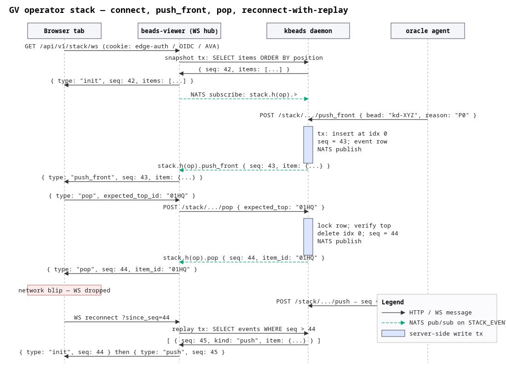

# PRD — GV operator stack: data model + WebSocket transport

**Bead:** ka-0000005517 · **Epic:** ka-0000006841 (GV / next-up)
**Author:** gardenio-gv-research-stack-85r · **Status:** Draft for review
**Companions:** UX PRD (ka-0000003264), Oracle PRD (ka-0000003894)

---

## 1. Summary

The GV view shows the operator **one bead at a time** and advances on every action; browser-back is the only history primitive. Behind it sits a **per-operator ordered stack** of bead IDs that an autonomous **oracle agent** writes to (push to back; push to front for interrupts) while the operator pops from the top. This PRD specifies (a) the **data model** for that stack, (b) the **WebSocket transport** that streams stack mutations from server to UI, and (c) the **server-side fan-out** that turns oracle/operator state into WS frames. No code is proposed beyond contracts; phase 2 (build) is gated on review of this PRD plus the UX and Oracle PRDs.

## 2. Scope and non-goals

In-scope: storage layout, mutation semantics, sequencing/conflict rules, WS endpoint + message schema, auth handshake, reconnect/replay, backpressure, browser-back URL encoding, sequence diagram.

Out-of-scope: ranking logic (Oracle PRD), card layout / action vocabulary (UX PRD), chatbox protocol (Oracle PRD references this; the chatbox rides bead comments / mention syntax, not the stack WS).

## 3. Background — what we are building on

- **beads-viewer** is plain `net/http` + `ServeMux` (`gardenio/controller/cmd/beads-viewer/main.go:175`, routes wired in `server.go:660–780`). No third-party HTTP framework.
- It already streams real-time bead-lifecycle data via **SSE** (`GET /agents/{id}/events`, `agent_events.go:51`) by calling `beadsapi.Client.EventStream(ctx, "beads.bead.>")` (`internal/beadsapi/client_events.go:51`). That client opens an HTTP/SSE connection to kbeads `/v1/events/stream`, which is itself a NATS→SSE bridge sitting on the `MUTATION_EVENTS` JetStream stream (subjects `beads.>`; helm `controller/deployment.yaml:65–73`, retention 72 h).
- **Auth.** Operator identity is the authenticated user from OIDC/AVA middleware. `oidcauth.EmailFromContext(r.Context())` returns the operator's email; `oidcauth.RolesFromContext` returns roles including `RoleOperator = "gardenio-operator"` (`oidcauth/oidcauth.go:35,294`). AVA mode pins `X-Amzn-Ava-User-Context` against `AVA_TRUST_SIGNER` (`oidcauth/ava.go:28,207`).
- The parent task explicitly names the edge-auth **`X-Operator`** header (`ka-0000001595`, merge `716f5ebd`). That header is materialised by the **gardenio-edge-auth reverse-proxy** that fronts in-cluster Services; the in-cluster server (beads-viewer) trusts it because edge-auth signs it with HMAC (`X-Edge-Auth-Sig`). Today the viewer does not parse `X-Operator`; under edge-auth it will, and that becomes the canonical operator id for the stack.
- **No PostgreSQL LISTEN/NOTIFY** is in use in kbeads. Events flow `mutation → events row → NATS publish → SSE`. There is no existing per-operator queue endpoint.
- **No WebSocket endpoint exists in beads-viewer.** The agent terminal opens a `wss://` to **coopmux**, not the viewer (`templates/static/agent_terminal.js:62`). `gorilla/websocket` is not yet in `go.mod`; we will add `nhooyr.io/websocket` (smaller surface, std-lib `http.Hijacker` upgrade — see §11).

## 4. Data model

### 4.1 Logical model

A **stack** is an ordered list of **items**, scoped to exactly one operator. Each item is a reference to a bead plus thin presentation metadata the oracle can attach (a one-line "why this is on top", a confidence score, optional pinned flag). The stack is **strict order** — index 0 is the top (next to work). The oracle may insert anywhere but in practice writes only `push` (append) and `push_front` (interrupt at index 0). The operator pops index 0 to advance.

```text
Stack {
  operator:   string        // canonical operator id (email)
  seq:        uint64        // monotonic, server-assigned, +1 per mutation
  updated_at: timestamp
  items: [
    StackItem {
      id:         ulid       // server-assigned, opaque to UI; stable across reorders
      bead_id:    string     // e.g. ka-0000005517
      reason:     string     // short oracle annotation, ≤140 chars
      score:      float?     // optional ranking signal (0..1)
      pinned:     bool       // operator-locked; oracle may not displace
      added_by:   string     // "oracle" | "operator" | "<agent-id>"
      added_at:   timestamp
    }
  ]
}
```

Notes:
- `seq` is the **only** ordering authority. Every mutation that succeeds increments it. Both snapshot and delta carry it.
- `id` (per-item) lets the UI animate moves without a key collision when the same bead appears, gets removed, and is re-pushed.
- `bead_id` is **not unique** in the stack at the type level, but the server **enforces uniqueness** at write time: pushing a bead that already exists is collapsed into a `reorder`. This avoids "10 copies of the same urgent bead" pathologies.

### 4.2 Operations

| Op | Origin | Semantics |
|---|---|---|
| `push` | oracle | append to tail; no-op if `bead_id` already present (server emits `reorder` to existing position with refreshed `reason`/`score`) |
| `push_front` | oracle | insert at index 0; if `bead_id` already present, reorder it to 0 and refresh metadata |
| `pop` | operator UI | remove index 0 (the bead the operator just acted on) |
| `remove` | operator UI or oracle | remove by item `id` (skip / dismiss) |
| `reorder` | oracle | move item `id` to a new index; bounded by `0..len-1` |
| `pin` / `unpin` | operator | toggle `pinned`; oracle pushes cannot displace pinned top |
| `clear` | operator | drop everything; oracle may begin filling again immediately |

Operator-only ops require `RoleOperator` (existing role check). Oracle-only ops are gated on a service identity (agent-id from controller-issued token) — we do **not** accept oracle pushes from a browser session.

### 4.3 Stack size and TTL

- Hard cap: **50 items** per stack. Beyond that, oracle pushes evict the tail (FIFO), emitting `remove` events.
- Pruning: items older than **7 days** without movement are evicted on next mutation. The oracle is expected to keep the stack fresh; staleness sweeps prevent a forgotten browser tab from showing a week-old card.
- A stack is created lazily on first push or first WS connect.

## 5. Persistence

### 5.1 Decision: **Postgres table in the kbeads database**, NATS for fan-out

We considered four storage options. Trade-offs:

| Option | Pros | Cons | Verdict |
|---|---|---|---|
| **Postgres table** alongside `beads` (e.g. `operator_stacks`, `operator_stack_items`) | Strong consistency; trivial joins to `beads`; existing migration discipline; durable; queryable for ops/debug | One more migration; needs a small write-path service | **Chosen** |
| Per-operator **bead** with stack as a JSONB field | Reuses beads CRUD; auto-replicates via NATS `beads.>` already | Pollutes the bead namespace with non-issue records; concurrent writes on the same bead are awful for high-rate `push_front`; bead history isn't a stack-history primitive | Rejected |
| **Redis** (sorted set per operator) | Cheap, atomic ZADD/ZPOPMIN; native ordering by score | New infra; no current Redis dependency in the stack; persistence/HA story to design from scratch; would still need a Postgres "source of truth" for restart safety | Rejected — premature infra |
| **NATS subject only** (`stack.<op>` JetStream stream) | Reuses existing NATS; fan-out is free; durable via JetStream | JetStream is a log, not a mutable list — `reorder` and `remove` require server-side materialised view anyway; we'd be back to the table option, just hidden | Rejected — table is honest about what we need |
| Bundle of bead IDs on a "stack" bead | Reuses the bundles affordance | Bundles are append-only documentation; not designed for reorder semantics | Rejected |

**Chosen layout** (illustrative; SQL will be in build phase, migrations directory `kbeads/internal/store/postgres/migrations/`):

```text
operator_stacks
  operator    TEXT PRIMARY KEY                 -- canonical email
  seq         BIGINT NOT NULL DEFAULT 0        -- monotonic
  updated_at  TIMESTAMPTZ NOT NULL DEFAULT now()

operator_stack_items
  id          TEXT PRIMARY KEY                 -- ulid
  operator    TEXT NOT NULL REFERENCES operator_stacks(operator) ON DELETE CASCADE
  bead_id     TEXT NOT NULL                    -- not a hard FK; bead may be deleted
  position    INTEGER NOT NULL                 -- 0 = top; densely packed
  reason      TEXT NOT NULL DEFAULT ''
  score       DOUBLE PRECISION
  pinned      BOOLEAN NOT NULL DEFAULT false
  added_by    TEXT NOT NULL
  added_at    TIMESTAMPTZ NOT NULL DEFAULT now()
  UNIQUE(operator, bead_id)
  INDEX (operator, position)

operator_stack_events             -- mutation log; cap'd / TTL'd
  id          BIGSERIAL PRIMARY KEY
  operator    TEXT NOT NULL
  seq         BIGINT NOT NULL                  -- the post-mutation seq
  kind        TEXT NOT NULL                    -- push|push_front|pop|remove|reorder|pin|...
  payload     JSONB NOT NULL                   -- the delta (item, from/to index, etc.)
  created_at  TIMESTAMPTZ NOT NULL DEFAULT now()
  INDEX (operator, seq)
```

All mutations execute in a **single transaction** that:
1. Locks `operator_stacks` row `FOR UPDATE` (per-operator serialisation).
2. Performs the structural change.
3. Bumps `seq`.
4. Inserts an `operator_stack_events` row.
5. Publishes the delta to NATS subject `stack.<operator-hash>` (see §6.4).

`operator_stack_events` is retained for **24 hours** (cron prunes older rows). That bounds the replay window. Beyond that, a reconnecting client receives a fresh snapshot.

### 5.2 Why Postgres + NATS rather than just NATS

The stack is **small, mutable, and durable** — three things JetStream is fine at but not great at. Postgres gives us:
- Trivial `SELECT * FROM operator_stack_items WHERE operator=$1 ORDER BY position` for snapshots and admin dumps.
- A single, obvious row to lock for serialisation (no distributed consensus needed: one operator's stack is one row).
- A migration story consistent with everything else in kbeads.

NATS gives us:
- Fan-out to all WS connections for that operator (multi-tab).
- Free integration with the existing controller/SSE bridge.

## 6. Per-operator scoping

### 6.1 Identifying the operator

Three layers in priority order:

1. **`X-Operator` header** from gardenio-edge-auth (HMAC-verified against `X-Edge-Auth-Sig` with the shared secret). Adopted post-merge `716f5ebd`. This is the canonical id once edge-auth is in front of beads-viewer.
2. **OIDC/AVA email** from `oidcauth.EmailFromContext(ctx)` (current production path).
3. **`X-Auth-Request-Email`** ForwardAuth fallback.

The server picks the first present. Mixing — e.g. an `X-Operator` set without a valid signature — must hard-fail (`401`) so a misconfigured ingress cannot impersonate an operator. **All three sources are normalised** to a canonicalised lowercase email; the storage key is the canonical form.

### 6.2 Authorisation

- **Operator-bound ops** (`pop`, `remove`, `pin`, `clear`, `reorder` initiated from UI): allowed only when the request's operator id equals the stack's `operator`. No cross-operator pokes.
- **Oracle ops** (`push`, `push_front`, `reorder`, `remove`): rejected from a browser-auth session. Accepted only when the request carries a controller-minted agent token (`Authorization: Bearer <agent JWT>`) whose subject is the oracle agent for that operator. Issuance is the controller's existing pattern (already used for hook publishing).

## 7. Authoritative ordering and conflict resolution

Single-writer per stack is enforced by the `FOR UPDATE` row lock. All mutations linearise through that lock; the server-assigned `seq` is the canonical order. Clients **never** assign `seq`.

The interesting collision is: **operator pops the top while the oracle is mid-`push_front`**. Three sub-cases:

1. Oracle wins the lock first. UI sees `push_front` (new item at 0) before the pop. The operator's pop then targets the (new) top — which may not be what they intended. Solution: every UI op carries the **expected top item `id`**; if it does not match, the server rejects with `STALE_TOP` and the UI re-renders with the new top before retrying. This is optimistic concurrency on the smallest unit that matters (the top item).
2. Operator wins the lock first. Pop succeeds; oracle's subsequent `push_front` lands cleanly.
3. Concurrent ops from two operator tabs: both carry the same expected top `id`; first wins, second gets `STALE_TOP`. UI tab refreshes silently.

We deliberately do **not** use a CRDT. Centralised serialisation on a single Postgres row is simpler, has no merge-conflict semantics to debug, and is fast enough for human-scale mutation rates (peak realistic load: ~10 ops/min per operator).

## 8. WebSocket protocol

### 8.1 Endpoint

```
GET /api/v1/stack/ws         Host: beads.gardenio.e2e.example.com
Upgrade: websocket
```

Wired in `server.go` `RegisterRoutes()` alongside other authenticated routes. Subprotocol token: `gv-stack-v1`. Server accepts only `gv-stack-v1`; rejects unknown subprotocols with 400 (this gives us a clean versioning lever).

### 8.2 Auth handshake

The WS upgrade is **handled by the existing auth middleware chain** — no special handshake. By the time `s.handleStackWS` runs, the context already carries the operator identity (X-Operator > OIDC email > forward-auth). The handler:

1. Resolves operator id; if absent → close with code 4401 (`UNAUTHENTICATED`).
2. Checks `RoleOperator`; if missing → close 4403 (`FORBIDDEN`).
3. Upgrades the connection.
4. Sends `init` snapshot immediately.

Browsers cannot set arbitrary headers on `WebSocket()` constructor calls; we therefore rely on **cookies** (Keycloak session cookie / AVA cookie / edge-auth cookie) plus the **edge-auth proxy** stamping `X-Operator` server-side. The handshake URL never includes credentials in the query string.

For programmatic / CLI clients (e.g. `coop`-issued tooling that wants to subscribe), the existing CLI exchange (`/auth/cli-exchange`, `main.go:162`) issues a short-lived cookie that the WS upgrade respects. We add no new auth surface.

### 8.3 Message envelope

JSON, both directions. Each message has `type`, `seq` (when applicable), and a `data` payload. Binary frames are not used in v1.

#### 8.3.1 Server → client

```jsonc
// 1) Snapshot on connect or after replay request
{
  "type": "init",
  "seq": 42,
  "operator": "alice@example.com",
  "data": {
    "items": [ /* StackItem[] in order, index 0 first */ ]
  }
}

// 2) Mutations (deltas)
{ "type": "push",       "seq": 43, "data": { "item": { /* StackItem */ } } }
{ "type": "push_front", "seq": 44, "data": { "item": { /* StackItem */ } } }
{ "type": "pop",        "seq": 45, "data": { "item_id": "01HQ...", "bead_id": "kd-..." } }
{ "type": "remove",     "seq": 46, "data": { "item_id": "01HQ..." } }
{ "type": "reorder",    "seq": 47, "data": { "item_id": "01HQ...", "from": 3, "to": 0 } }
{ "type": "pin",        "seq": 48, "data": { "item_id": "01HQ...", "pinned": true } }

// 3) Errors and liveness
{ "type": "error", "data": { "code": "STALE_TOP", "expected": "01HQA", "actual": "01HQB" } }
{ "type": "pong",  "data": { "t": 1715800000 } }

// 4) Replay window expired
{ "type": "reset", "seq": 200, "data": { "reason": "replay_window_expired" } }
```

#### 8.3.2 Client → server

```jsonc
// Mutations
{ "type": "pop",     "data": { "expected_top_id": "01HQA" } }
{ "type": "remove",  "data": { "item_id": "01HQX" } }
{ "type": "reorder", "data": { "item_id": "01HQX", "to": 0 } }
{ "type": "pin",     "data": { "item_id": "01HQX", "pinned": true } }
{ "type": "clear",   "data": {} }

// Liveness / control
{ "type": "ping",        "data": { "t": 1715800000 } }
{ "type": "subscribe",   "data": { "since_seq": 42 } }   // optional after init
{ "type": "ack",         "data": { "seq": 47 } }         // optional flow-control hint
```

### 8.4 Sequence numbers

- `seq` starts at 0 for a freshly created stack.
- It is **monotonic across the lifetime of the stack** (never resets unless an admin truncates).
- Every server→client mutation message carries the post-mutation `seq`.
- `init` carries the current `seq`; subsequent deltas are exactly `seq+1, seq+2, …`.

### 8.5 Reconnect and replay

On reconnect, the client sends the URL query `?since_seq=N` (or, after open, a `subscribe` message). The server then:

- If `N == current_seq` → send `init` with zero items omitted? Actually still send a no-op `init` to confirm state; UI keeps its current view.
- If `current_seq - N <= replay_window` (replay window = whatever fits in `operator_stack_events`, target 24 h) → send the missed deltas in order, then nothing else until new mutations.
- If `current_seq - N > replay_window` → send a fresh `init` snapshot with the current `seq` and a leading `reset` frame (`{"reason":"replay_window_expired"}`) so the UI knows it must throw away any optimistic state.

This is the same model the existing kbeads SSE bridge uses for bead events, scaled to a per-operator topic.

### 8.6 Heartbeat

- Server sends a WS-level **ping frame** every **30 s**; client must reply with **pong** within 10 s or the server closes with code 4408 (`PING_TIMEOUT`).
- Client may send `{"type":"ping"}` application-level frames as a keep-alive when behind a proxy that strips control frames; the server responds with `{"type":"pong"}`.

## 9. Backpressure and rate

The pessimistic case is an oracle spraying `push_front`s. We bound this in three places:

1. **Oracle write rate cap**: kbeads enforces ≤ **5 mutations/s/operator** on the write API. Excess returns `429`; oracle is expected to coalesce.
2. **Stack size cap** (§4.3): 50 items, FIFO eviction on overflow. The UI never sees an unbounded list.
3. **WS write buffer**: server-side per-connection ring buffer of **256 messages**. On overflow the server emits a `reset` and starts a fresh stream from a `init` snapshot — the UI does not have to track "missed deltas" because the snapshot is authoritative. This trades brief flicker for a strict liveness guarantee.

Clients are expected to render at human cadence (≤ ~10 fps for animations); we do not adopt a credit-based flow-control scheme. Optional `ack` hints from the client let the server log slow consumers; they are not load-bearing.

## 10. Server-side fan-out

### 10.1 The mutation path

```
Oracle agent ─► HTTPS POST /api/v1/stack/{op}/push        (kbeads daemon)
                  ▼
                kbeads write tx
                  ▼
                Postgres (operator_stacks, operator_stack_items, _events)
                  ▼
                NATS publish: stack.<op-hash>.<kind>           [JetStream stream STACK_EVENTS]
                  ▼
                beads-viewer subscribes via beadsapi.Client.EventStream(ctx, "stack.<op-hash>.>")
                  ▼
                beads-viewer hub multiplexes to all WS connections for that operator
                  ▼
                Browser tab(s)
```

- New JetStream stream **`STACK_EVENTS`**, subject root `stack.>`, retention 24 h, file-backed (mirrors `MUTATION_EVENTS`, helm `controller/deployment.yaml:65–73`).
- Subject form: `stack.<sha1(operator)[:12]>.<kind>`. The hash avoids leaking emails through NATS subject space and makes ACL rules easy (allow agent-X to publish only `stack.<their-op-hash>.*`).
- beads-viewer runs a small in-process **hub**: one NATS subscription per active operator, fans out to the slice of open WS conns. When the last conn for an operator closes, the subscription is dropped.

### 10.2 Why not LISTEN/NOTIFY

kbeads does not use it anywhere; introducing it just for this would mean either (a) running a separate connection pool per listener, or (b) building a new bus that duplicates NATS. The NATS path is the well-trodden one — we ride it.

### 10.3 Why not direct DB poll from the viewer

It's an order of magnitude more work for the database for any non-trivial number of operators, and SSE/WS is what the viewer is already doing for bead events. Consistency: we reuse the existing pattern.

## 11. Library choice

`nhooyr.io/websocket` (single dependency, std-lib `context`-shaped, no goroutine-per-connection demand) is preferred over `gorilla/websocket` (unmaintained as of 2022). The PRD is library-agnostic at the protocol level; this is a recommendation for the build phase.

## 12. Browser-back URL encoding

The view's URL is the operator's history primitive. We encode the **top of the stack** plus a short trail in the URL:

```
/g/next?at=ka-0000005517&trail=ka-0000006841,ka-0000001595
```

- `at` — the bead the operator is currently looking at (the top, normally).
- `trail` — a comma-separated list of recently-popped bead ids (most-recent first), **bounded to 8** to keep URLs short.

Semantics:

- Forward navigation (operator acts → `pop` → next bead surfaces) pushes a new history entry via `history.pushState`. The old top moves into `trail`.
- Browser **back** revisits the previous URL; the page reads `at` and renders that bead even if it is no longer in the live stack. This is the explicit "history is the back button" affordance from the epic.
- If the operator goes back to a bead the oracle has since dropped, the card renders with a "no longer on the stack" annotation and a `push` action ("put it back on top").
- The live WS connection runs **independently** of which URL the tab is on — it always represents the live stack. Back-navigation does not change the stack.
- Sharing a URL shares the **bead being looked at**, not the operator's stack (no auth-leaking refs to another operator's queue).

## 13. Sequence diagram

ASCII first. SVG + PNG accompany the bundle.

```text
 Browser tab                   beads-viewer (WS hub)             kbeads daemon                 oracle agent
   |                                  |                                |                            |
   |---- GET /api/v1/stack/ws ------->|                                |                            |
   |   (cookie: edge-auth/AVA/OIDC)   |                                |                            |
   |                                  |-- snapshot tx: SELECT items -->|                            |
   |                                  |<--- {seq=42, items=[...]} -----|                            |
   |<-------- {type: init, ----------|                                |                            |
   |          seq:42, items:[...]}    |                                |                            |
   |                                  |==== NATS sub: stack.h(op).> ==>|                            |
   |                                  |                                |                            |
   |                                  |                                |<--- POST /stack/.../push_front
   |                                  |                                |     {bead:"ka-XYZ", reason:"P0 incident"}
   |                                  |                                |--- tx: insert at idx 0;
   |                                  |                                |        seq=43; event row;
   |                                  |                                |        NATS publish ---.   |
   |                                  |<-- NATS msg: stack.h(op).push_front
   |<------ {type: push_front, ------|        {seq:43, item:{...}}    |                            |
   |        seq:43, item:{...}}       |                                |                            |
   |                                  |                                |                            |
   |--- {type:pop,                    |                                |                            |
   |    data:{expected_top_id:"01HQ"}}|                                |                            |
   |--------------------------------->|                                |                            |
   |                                  |---- POST /stack/.../pop ------>|                            |
   |                                  |     {expected_top:"01HQ"}      |                            |
   |                                  |                                |--- tx: lock row; verify;
   |                                  |                                |        delete idx 0; seq=44;
   |                                  |                                |        NATS publish ---.   |
   |                                  |<-- NATS msg: stack.h(op).pop --|                            |
   |<------- {type: pop, ------------|        {seq:44, item_id:"01HQ"} |                            |
   |         seq:44, item_id:"01HQ"}  |                                |                            |
   |                                  |                                |                            |
   |  [ network blip — WS dropped ]   |                                |                            |
   |                                  |                                |<--- POST /stack/.../push ---
   |                                  |  (no subs for this op now)     |     seq=45; event row;     |
   |                                  |                                |     NATS publish (buffered)|
   |                                  |                                |                            |
   |--- WS reconnect ?since_seq=44 -->|                                |                            |
   |                                  |-- replay tx:                  |                            |
   |                                  |   SELECT events WHERE seq>44 ->|                            |
   |                                  |<-- [{seq:45,kind:push,...}] ---|                            |
   |<------ {type:init,seq:44,...} ---|                                |                            |
   |<------ {type:push,seq:45,...} ---|                                |                            |
   |                                  |                                |                            |
```

Rendered diagram:



Source: [`gv-stack-sequence.svg`](./gv-stack-sequence.svg) (per advice ka-0000000334; PNG is embedded, SVG kept as source).

## 14. Error codes

| Code (close or `error` frame) | Meaning |
|---|---|
| 4400 | `BAD_FRAME` — malformed JSON or unknown `type` |
| 4401 | `UNAUTHENTICATED` — no operator identity |
| 4403 | `FORBIDDEN` — operator role missing, or cross-operator op |
| 4404 | `NO_SUCH_ITEM` — item id not in stack |
| 4408 | `PING_TIMEOUT` |
| 4409 | `STALE_TOP` — expected_top_id mismatch on pop/reorder |
| 4413 | `RATE_LIMIT` — client-driven mutations exceeded budget |
| 4500 | `INTERNAL` |

Application-level `error` frames use the same numeric `code` so the UI can log uniformly.

## 15. Observability

- Per-operator Prometheus counters: `gv_stack_mutations_total{kind,origin}`, `gv_stack_ws_connections`, `gv_stack_replay_window_expired_total`.
- WS hub histogram: `gv_stack_fanout_latency_seconds`.
- Admin endpoint `GET /admin/stacks` (operator-only) lists all current stacks with size + last-mutation timestamp for debugging.

## 16. Migration / rollout

1. Ship the table migration + write API on kbeads behind a feature flag (`STACK_ENABLED=false` default).
2. Ship the WS hub in beads-viewer behind the same flag.
3. Flip the flag for one operator (the project owner) in staging; verify multi-tab fan-out, reconnect, and replay.
4. Open the flag to all operators in `gardenio-rwx`.
5. Open in prod.

Rollback is a flag flip; the table can stay (it's not in the bead namespace).

## 17. Open questions for review

1. **Oracle identity per operator.** Is there a single oracle agent per operator, or one oracle that serves many? Affects the agent-token issuance scope and the rate-limit accounting.
2. **Cross-tab `pop`.** When the operator pops on tab A, tab B animates the pop too — fine. Should tab B *also* lose its "currently looking at" URL state, or should it stay parked on its own URL until the operator interacts? (Proposal: stay parked. The WS updates the live-stack badge but the URL-driven view doesn't change under the operator.)
3. **Shared sessions.** Two physical humans behind one operator id (rare but possible) will share a stack. Is that acceptable, or do we need a per-session shard? Proposal: accept it; one operator = one stack.
4. **Pinned semantics on push_front.** If the top is pinned, oracle push_front goes to index 1, not 0. Confirm.
5. **`X-Operator` rollout date.** This PRD assumes edge-auth is in front of beads-viewer. If we ship the stack before that, OIDC email is the canonical id and the X-Operator code path is dark. Acceptable?
6. **Multi-region.** kbeads is single-region today. If we ever go multi, the per-operator row lock becomes interesting. Out of scope for v1 but worth flagging.

## 18. Done condition for this PRD

This bead closes when:
- [ ] The PRD has been read by epic owner and the Oracle / UX PRD authors.
- [ ] Open questions above either have decisions or follow-up beads.
- [ ] Sequence diagram is rendered to SVG + PNG and bundled.
- [ ] Architecture-of-record bundle on the epic (`ka-0000006841`) references this PRD.
