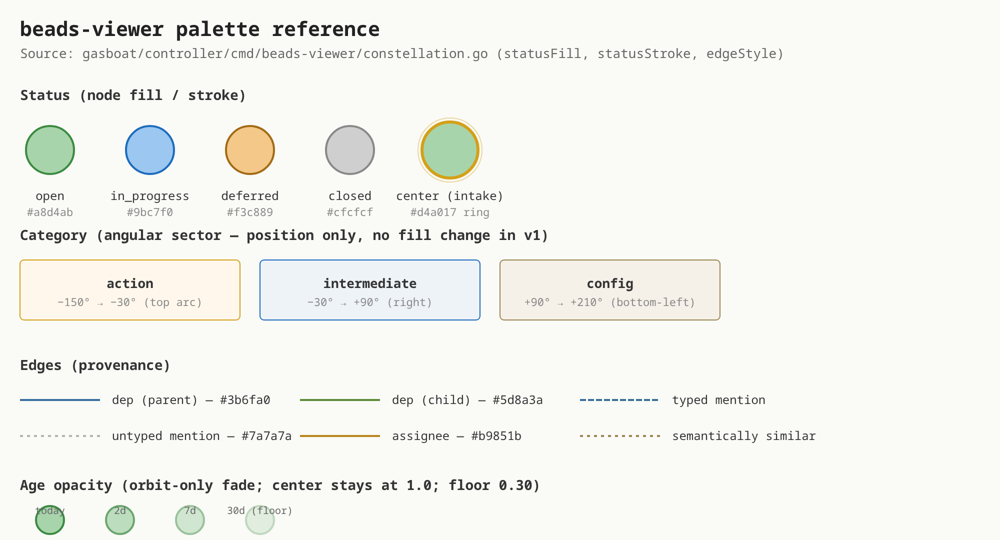
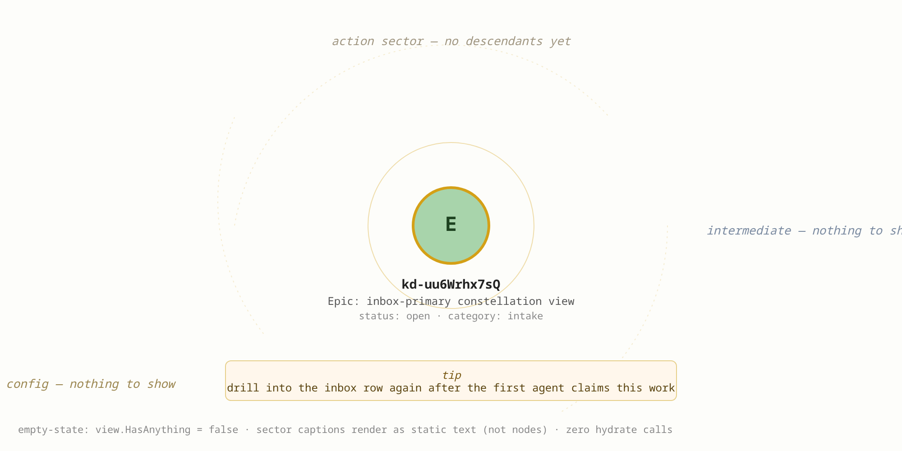
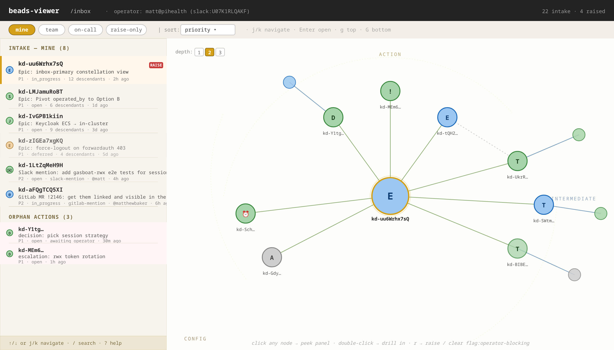
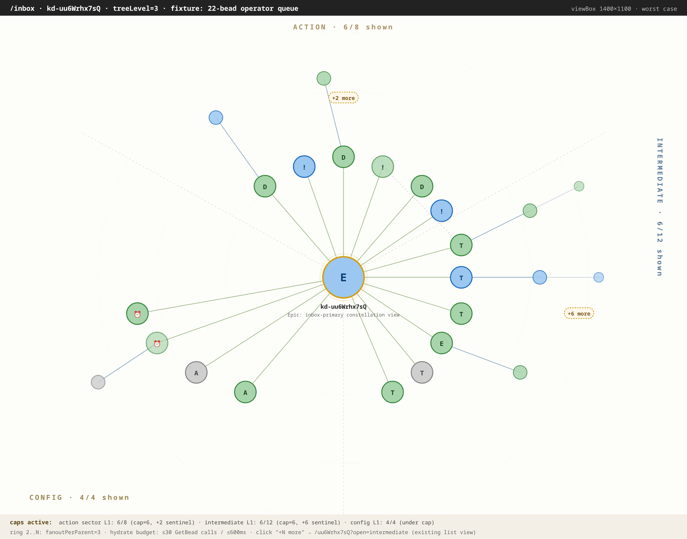
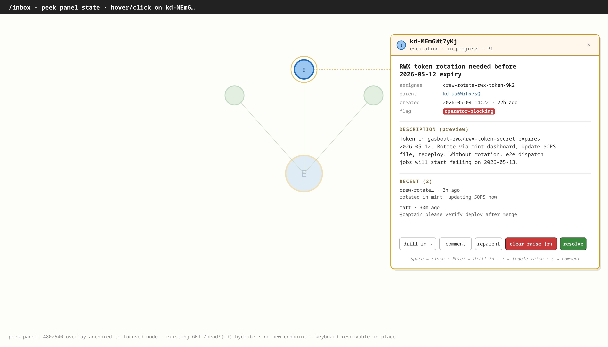
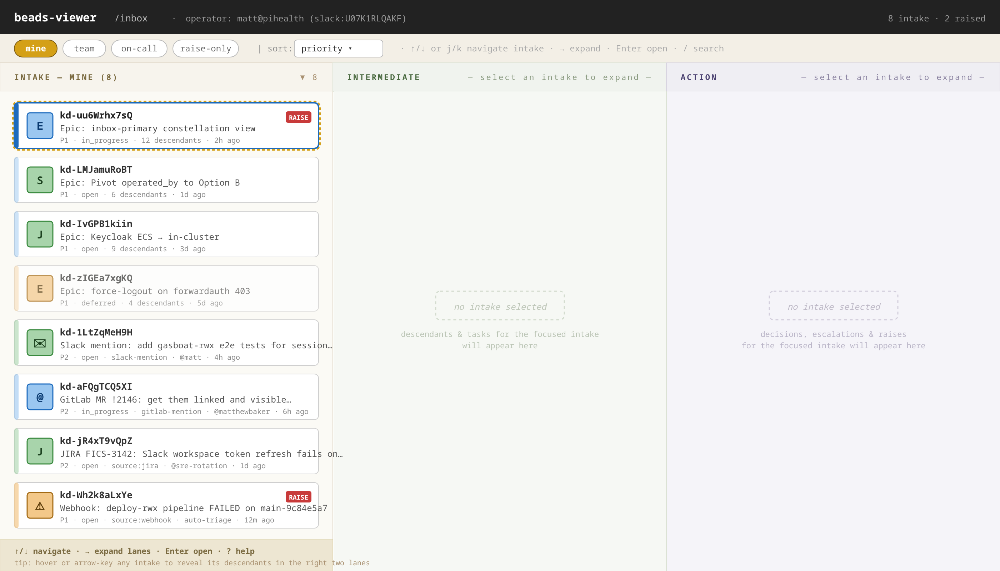
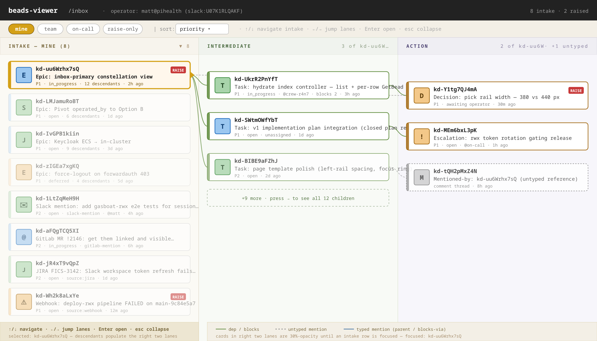

# Inbox-primary visual mockups

> **Status:** design / research only — no viewer code lands until operator
> green-lights this spec.
> **Epic:** ka-0000002831 (beads-viewer visual design)
> **Tied to:** ka-0000006157 (closed inbox-primary epic), ka-0000005952
> (closed v1 plan), ka-0000003625 (Option B operator FK).
> **Source for behavior:** `gardenio/docs/research/inbox-constellation-design.md`
> §§3–5; this doc adds *visual* specifications on top of that prose.

The existing inbox design doc (3,951 lines) specifies behavior — predicate
shape, sector arcs, hydrate caps, keyboard model — using ASCII sketches.
ASCII underspecifies fonts, weights, spacing, contrast, and the ways
status / category / age / edge channels collide with each other. This doc
fills that gap with five embedded SVG diagrams that a reviewer can look
at in a single scroll.

> **Rendered images:** PNGs are committed alongside each SVG under
> [`rendered/`](rendered/) so reviewers without an SVG-capable previewer
> (e.g. the GitLab MR diff view, some local readers) can see the mockups.
> The SVGs remain the source of truth — to re-render after edits, run
> `node scripts/render-svgs.mjs gardenio/docs/design/inbox-visual gardenio/docs/design/inbox-visual/rendered`.

Every diagram reuses palette and layout values from
`gardenio/controller/cmd/beads-viewer/constellation.go` (no new colors are
proposed here — only positions, captions, and the surrounding chrome that
the existing primitives don't yet draw).

---

## 1. Palette reference

Audit the channels in one place before reading any of the layouts. If
`status` and `category` collide on color, they will collide everywhere else.


*Source: [`palette-reference.svg`](palette-reference.svg)*

**What to check:**

- The four status fills (`open` / `in_progress` / `deferred` / `closed`)
  are distinguishable at the 22-px node radius used in every layout below.
- Category does **not** carry a fill — it lives on the angular axis only.
  This is the load-bearing decision in §3 of the design doc; the diagram
  makes it visible.
- Edge palette (provenance: dep / typed mention / untyped mention /
  assignee / similar) doesn't overlap with the status palette.
- Age opacity floor is 0.30 — the orbit-only fade keeps the center
  intake at full saturation regardless of age.

**Source:** `constellation.go` — `statusFill` (line 1057), `statusStroke`
(line 1072), `edgeStyle` (line 878), `ageOpacityFloor` (line 42).

---

## 2. Empty state

The default selection from the index can be an intake with zero
descendants — a freshly-arrived Slack message, a Jira ticket nobody has
expanded yet, a new external-source bead. The layout must not look broken.


*Source: [`empty-state.svg`](empty-state.svg)*

**What this is showing:**

- Center intake at full opacity (`view.Center.Opacity = 1.0`,
  `constellation.go:353`), golden ring, 42-px radius.
- Sector captions are *static `<text>`*, not nodes — they do not consume
  `arcAngle` slots and cannot be clicked.
- Tip strip below the legend area is suppressed once any descendant
  exists.
- Zero hydrate calls — cheapest case for the data path.

**View-model contract** (per design doc §3):

```
view.Center        = <intake bead>
view.Forward       = []  view.HasForward  = false
view.Reverse       = []  view.HasReverse  = false
view.Outer         = []  view.HasOuter    = false
view.Similar       = []  view.HasSimilar  = false
view.HasAnything   = false   ← template branch on this
```

**Reviewer asks:**

- Is the empty case *useful* (the operator gets context) rather than
  *blank* (the operator can't tell if the page broke)?
- Are sector captions readable at this contrast, or do they get lost
  against `#fdfdfa`?

---

## 3. Default state — three-pane layout

Index left, constellation right, filter chips on top. This is the page
the operator lands on at `/inbox`.


*Source: [`default-state.svg`](default-state.svg)*

**What this is showing:**

- **Top bar (48 px):** `beads-viewer` brand + `/inbox` route + operator
  identity chip + counts. Operator chip is reused from
  `operator_chip.go` (per design doc §1.4 / v1 plan §G2).
- **Filter chips bar (40 px):** `mine` (selected) / `team` / `on-call` /
  `raise-only`, plus sort dropdown. Selected chip has the golden fill;
  others are outlined. Predicate map is per design doc §4.3.
- **Left rail (380 px):** intake-mine list — selected row highlighted
  with golden left edge + warm fill. Each row has status disk + glyph,
  bead id, title (one line), and a meta line (priority / status / child
  count / age). Raise badge is a red pill on the right edge.
- **Intake is heterogeneous.** The rail mixes epics (`E` glyph) with
  external-source beads — Slack mentions (`✉` glyph, real example
  [`ka-0000004357`](https://beads.gardenio.e2e.example.com/bead/ka-0000004357)
  "add gardenio-rwx e2e tests for session resumption", `slack-mention`
  label) and GitLab MR mentions (`@` glyph, real example
  [`ka-0000001291`](https://beads.gardenio.e2e.example.com/bead/ka-0000001291)
  "get them linked and visible in the MR please", `gitlab-mention`
  label). These bridge-spawned beads land in the operator's inbox the
  same way an epic does — they're work units that need triage,
  reparenting, or closing, not a separate notification stream. JIRA
  tickets (`source:jira`) and webhook-spawned beads sit in the same rail
  with their own glyphs.
- **Right pane:** intake-rooted constellation at `treeLevel=2`. Center =
  selected intake. Three sectors visible; sector hint labels live in the
  outer corners. Tree-level slider in the upper left.
- **Footer hint (right pane):** keyboard / mouse cheat-sheet. Italic,
  muted — affordance for new operators only.
- **Footer hint (left rail):** `↑/↓ or j/k navigate · / search · ? help`.

**Reviewer asks:**

- Does the left rail width (380 px) fight with the constellation, or does
  the constellation breathe at 1020 px wide?
- Are status disks in the rail readable at 8-px radius — or do they need
  the 11-px radius the center uses?
- Do the sector hint labels (`ACTION`, `INTERMEDIATE`, `CONFIG`) help the
  operator orient, or do they add chartjunk?
- Is the deferred row's reduced opacity (0.7) the right amount of
  de-emphasis, or does it read as *broken* rather than *deferred*?
- Is the orphan-actions section (per design doc §6 — pseudo-intake row)
  the right shape for "decisions / escalations not parented under any
  intake"?

---

## 4. Overflow state — 22-bead operator queue at treeLevel=3

This is the load-test fixture. The current operator queue has ~22 open
beads, mostly intake epics with action and intermediate descendants.
Worst case: a single intake (e.g. `ka-0000006157`) with 8 action / 12
intermediate / 4 config descendants on ring 1.


*Source: [`overflow-state.svg`](overflow-state.svg)*

**What this is showing:**

- Center: same as default state, but at viewBox 1400×1100 (per
  `constellationLayout(treeLevel=3)`, `constellation.go:576`).
- **Action sector:** 6 of 8 descendants visible — `+2 more` sentinel
  rendered as a dashed-outline pill *outside* the radial ring, in the
  same sector arc. Sentinel is keyboard-focusable; clicking opens
  `/uu6Wrhx7sQ?open=action` (existing list view, no new endpoint).
- **Intermediate sector:** 6 of 12 descendants visible — `+6 more`
  sentinel.
- **Config sector:** 4 of 4 descendants visible — under cap, no
  sentinel.
- **Ring 2:** smaller nodes (14-px radius), capped per parent at
  `fanoutPerParent=3`.
- **Ring 3:** smaller still (10-px radius), 65% opacity to push them
  visually behind ring 1.
- **Mention edge** (top arc) demonstrates that untyped mentions
  (`#7a7a7a` dashed) read as different from dep edges (`#5d8a3a`).

**Caps active strip** at the bottom is for reviewer reference — wouldn't
ship in production. Spells out the cap math so the reviewer can audit
the geometry against the actual cap constants.

**Reviewer asks:**

- Are the `+N more` sentinels distinct enough from the real nodes — or
  could a tired operator click one expecting it to be a bead?
- Does ring 3 (10-px, 65% opacity) read as *background context* or as
  *broken / squinty*?
- Is the worst-case visual density acceptable, or do we need to cap at
  ring 2 by default and require an explicit `?tree=3` to expand?

---

## 5. Peek panel — hover/click overlay

Smallest interaction surface that lets the operator drive a triage
session entirely from this view (per design doc §5): peek panel,
raise/clear `flag:operator-blocking`, reparent into an epic, resolve a
decision, comment.


*Source: [`peek-panel.svg`](peek-panel.svg)*

**What this is showing:**

- Background constellation rendered at 30% opacity to focus the eye.
- Focused node has a 30-px outer halo and a 3-px stroke (vs. 2-px
  default).
- Connector dashed line from node to panel for spatial anchoring.
- **Panel header:** golden fill strip, status chip + glyph + bead id +
  type/status/priority line, dismiss `×`.
- **Title:** two lines max, 14-px semi-bold.
- **Meta grid:** assignee / parent / created / flag — labels muted,
  values left-aligned at a fixed column.
- **Description preview:** first ~4 lines, monospaced for code-like
  contents.
- **Recent comments:** last 2 comments with author + age.
- **Action bar:** `drill in` / `comment` / `reparent` / `clear raise`
  (red, dangerous) / `resolve` (green, terminal). Keyboard shortcuts in
  parens where applicable.
- **Keyboard hint:** `space → close · Enter → drill in · r → toggle raise
  · c → comment`.

**Hydrate cost:** zero new endpoints — `GET /bead/{id}` is already in the
viewer (it's what the existing `/bead/<id>` constellation page calls).
Peek just renders a different subset of the same payload.

**Reviewer asks:**

- Is `clear raise` red the right level of friction, or should it require
  a confirm step?
- Is the action bar order right (drill-in first vs. resolve first)?
- Does the connector line help, or is it visual noise — would a simple
  z-order shift be enough?
- Is the panel anchored to the right of the node always, or does it
  flip to the left when the node is in the right half of the viewport?

---

## 6. What this doc deliberately doesn't pin

These are open in the design doc and stay open until reviewed. The
visuals above pick a default for each, but the picks are reviewable.

- **Sector boundaries (degrees).** The diagrams use the design doc §3
  defaults (action: −150° → −30°, intermediate: −30° → +90°, config:
  +90° → +210°). If the operator wants action on the right (closer to
  reading direction), the only change is constants in `constellation.go`.
- **Center radius.** Diagrams use 42 px (current `Center.Radius` default).
  At `treeLevel=3` / 1400×1100 it visually shrinks; could bump to 48 px
  at the larger viewBox.
- **Filter chip palette.** Selected chip uses the golden status (`#d4a017`)
  to match center-ring ownership. Could instead use a sober blue
  (`#1d6bbd`) to match `in_progress`. Reviewer call.
- **Orphan-actions section** in the left rail. Currently styled with a
  faint pink background (`#fff5f5`) to mark it as different from
  intake-anchored rows. Could be a single divider line instead.
- **Empty-state tip wording.** Currently: "drill into the inbox row
  again after the first agent claims this work." Could be more or less
  prescriptive; could be suppressed for power users via
  `?hint=false`.

---

## 7. Iteration: three-lane layout (replaces radial constellation)

> **Status:** May 2026 reviewer iteration on top of §§3–5. The radial
> constellation in §3 is preserved as historical reference; this section
> introduces the **lane** layout that supersedes it for the inbox view.
> Mockups: [`lanes-default.svg`](lanes-default.svg) and
> [`lanes-selected.svg`](lanes-selected.svg).

The reviewer ask: *"three columns, each of which is a lane, and instead of
circle beads we have rectangles; we can keep the links between them; just
intake beads visible to start, and when you mouse / arrow-key an intake
bead it shows the other lanes."* This section pins that visual.

The three lanes correspond to the bead lifecycle reading left-to-right:

| Lane | Contents | Populated when |
|---|---|---|
| **Intake** | epics, slack mentions, gitlab MR mentions, jira tickets, webhook-spawned alerts | always (this is the inbox) |
| **Intermediate** | child tasks / sub-epics that hold the work for the focused intake | an intake row is focused (hover, arrow-key, or click) |
| **Action** | decisions, escalations, raises, untyped mentions for the focused intake | an intake row is focused |

### 7.1 Default state — only Lane 1 visible


*Source: [`lanes-default.svg`](lanes-default.svg)*

**What this is showing:**

- **Lane 1 (Intake):** rectangular cards (426×64), one per intake bead.
  Card chrome:
  - 6-px left edge in the bead's status color (golden ring on focused row,
    blue/green/amber/grey at 50–70% opacity on the rest).
  - Square 36×36 glyph chip with the source/type letter (`E` epic,
    `T` task, `S` sub-epic, `J` JIRA, `✉` slack-mention, `@` gitlab-mention,
    `⚠` webhook).
  - Three lines of text: bead id (mono, 13-px, bold) · title (12-px) ·
    meta (10-px muted: priority · status · provenance · author · age).
  - Optional `RAISE` pill on the right edge for `flag:operator-blocking`.
- **Lanes 2 and 3 are empty placeholders.** Each shows a dashed-outline
  hint card (`no intake selected`) plus a one-line subtitle describing
  what would render there. The lane background is faintly tinted in its
  category color (green/violet) so the lanes are distinguishable even
  when empty.
- **Initial focus is the first intake row** (golden dashed ring). The
  operator can arrow up/down to move focus between intake rows; pressing
  `→` or hovering reveals the descendants in the right two lanes (see
  §7.2). `esc` collapses back to this empty state.
- **Mention/message intake is heterogeneous.** Real-world examples:
  Slack mention `ka-0000004357`, GitLab MR mention `ka-0000001291`, JIRA
  ticket `ka-0000004909`, webhook-spawned alert `ka-0000001974`. These
  bridge-spawned beads sit in the same rail as epics — they are work
  units that need triage, not a separate notification stream.
- **Footer hint** changes from a single line to two — first line lists
  the keyboard model (`↑/↓ navigate · → expand lanes · Enter open · ?
  help`), second line is a tip explaining the hover-to-expand affordance.

**Reviewer asks:**

- Is the empty Lane 2 / Lane 3 *quiet enough* (operator's eye stays in
  Lane 1 until they want more) or does it read as *broken* (panes
  unaccountably empty)?
- Lane width (~466 px each) — does Lane 1 feel cramped at 426-px card
  width with title truncation, or is the truncation acceptable?
- Should mouse hover trigger lane expansion, or only keyboard `→` /
  click? Hover-to-expand can feel jumpy; click-to-pin avoids that but
  costs an interaction.

### 7.2 Selected state — Lanes 2 and 3 populated, edges drawn


*Source: [`lanes-selected.svg`](lanes-selected.svg)*

**What this is showing:**

- **Lane 1:** focused row (`ka-0000006157`) keeps the warm golden fill +
  `RAISE` pill; the small right-edge tab (`▶`) signals "lanes are
  expanded for this row." All other intake rows drop to ~55% opacity to
  push them visually behind.
- **Lane 2 (Intermediate):** descendant tasks for the focused intake.
  Three cards rendered (`ka-0000006945`, `ka-0000005952`,
  `ka-0000001978`), each with the same rectangular chrome but a green
  6-px left edge — Lane 2 cards inherit the lane's category color, not
  the bead's status color, so the lane reads as a coherent column. A
  dashed `+9 more · press → to see all 12 children` sentinel sits at
  the bottom (mirrors the radial-design `+N more` cap in §4).
- **Lane 3 (Action):** decision (`ka-0000004677`), escalation
  (`ka-0000007938`), and one untyped-mention card (`ka-0000000646`,
  dashed border + dashed left edge to match the dashed mention edge).
  Decisions and escalations get an amber 6-px left edge; the untyped
  mention card uses the muted grey palette so it reads as background
  context.
- **Edges:** drawn behind the cards as cubic-bezier curves between the
  right edge of one lane's card and the left edge of the next lane's
  card. Color-coded:
  - **Green solid (`#5d8a3a`)** = dep / blocks / typed parent. These
    are the structural edges — most lane→lane lines are this color.
  - **Grey dashed (`#7a7a7a`)** = untyped mention (audit, comment-thread
    references). Lighter weight.
  - **Blue solid (`#3b6fa0`)** = typed mention (e.g. mentioned-by from
    a different graph branch). Reserved; not heavily used in this
    selected example.
- **Bottom legend bar** spans Lanes 2+3 and lists the edge palette plus
  a state hint (`focused: ka-0000006157`).

### 7.3 Interaction model

Keyboard model (extends the design doc §5 keyboard map):

| Key | Action |
|---|---|
| `↑` / `↓` / `j` / `k` | Move focus between intake rows |
| `→` / `l` | Expand lanes for the focused intake (no-op if already expanded); on second press, jump focus into Lane 2 |
| `←` / `h` | Move focus from Lane 3 → Lane 2 → Lane 1; from Lane 1, collapse the right two lanes |
| `Enter` | Open `/bead/<id>` for the focused card (any lane) |
| `space` | Open peek panel (per §5) for the focused card |
| `r` | Toggle `flag:operator-blocking` on the focused card |
| `esc` | Collapse Lanes 2+3 back to the empty default of §7.1 |
| `g` / `G` | Top / bottom of the current lane |

Mouse model:

- Hovering an intake row triggers a 200-ms debounced expand of Lanes
  2+3 (avoids thrashing on cursor flyovers). Hovering anywhere in
  Lanes 2+3 keeps them pinned. Moving the cursor outside any lane for
  > 1 s is *not* sufficient to collapse — explicit `esc` or clicking
  another intake row re-pins.
- Click-to-pin: clicking an intake row pins it (focus + lane expand)
  and updates the URL to `/inbox?focus=<id>`.

**Reviewer asks:**

- Should the right-two-lane expand happen on hover, or require an
  explicit `→` / click? Hover is faster but flickers under fast cursor
  motion; click is safer but requires an extra action per intake.
- Is dimming the unfocused intake rows to 55% opacity the right amount
  of de-emphasis, or does it read as *broken*?
- Is the right-edge `▶` tab on the focused row necessary affordance, or
  redundant with the warm fill + golden border?
- Lane 2 cards inherit a lane category color on the left edge; does
  that fight with the per-bead status color the operator may want
  (e.g. amber for `deferred`)? Trade-off: lane-coherence vs.
  per-bead-status-at-a-glance.

### 7.4 What this iteration does NOT change

- The view-model contract (intake-rooted predicates, `treeLevel`, hydrate
  caps) is unchanged. The lane layout is a different *renderer* over the
  same data the radial constellation consumed in §3.
- Filter chips (`mine` / `team` / `on-call` / `raise-only`), top bar,
  operator chip, and the peek panel (§5) are reused verbatim.
- `kd list` + `GetBead` paths are still the only data sources — no DB
  schema change, no new endpoint.
- The radial constellation in §§3–4 is preserved as a per-bead deep-dive
  view (`/bead/<id>` route) for cases where the operator wants the full
  graph topology rather than the inbox triage flow.

---

## 8. Implementation sketch (for v1 planning)

Once the visual spec is green-lit, the v1 implementation plan
(`gardenio/plans/inbox-v1-option-b-sequencing.md`, §G3) absorbs these as
template + asset deltas:

- New template: `inbox.tmpl.html` — three-lane wrapper. Lane 1 always
  rendered; Lanes 2+3 rendered server-side for the URL-pinned focus
  (`?focus=<id>`) and re-rendered on intake-row click via a small
  `htmx`-style swap (`hx-get="/inbox/lanes?focus=<id>"`).
- New partial: `lanes.tmpl.html` — Lanes 2+3 + edges. Returned by
  `/inbox/lanes?focus=<id>`. Falls back to the empty placeholder when
  no focus is set.
- New view-model fields on `inboxView`:
  - `IntakeRows []intakeRow` — Lane 1 contents.
  - `FocusID string` — currently-focused intake (URL param).
  - `IntermediateCards []laneCard`, `ActionCards []laneCard` — Lanes 2+3.
  - `Edges []edge` — `{from: cardID, to: cardID, kind: dep|untyped|typed}`.
  - `OverflowSentinels []sentinelDef` (per lane, when L1 cap hit).
- New handlers:
  - `GET /inbox` — page shell + Lane 1 + (optional, URL-driven) Lanes 2+3.
  - `GET /inbox/lanes?focus=<id>` — partial swap for the right two lanes.
  - Both reuse existing `kd list` + `GetBead` paths — no DB schema change.
- Edge layout is computed server-side from card y-positions; the partial
  emits an inline `<svg>` overlay sized to the right-two-lanes bounding
  box, so no client-side graph layout is needed.
- The radial constellation (`constellation.tmpl.html`) is preserved
  unmodified for the `/bead/<id>` deep-dive route.
- Static SVG assets in this directory are reference only — they do not
  ship into the binary.

No `constellation.go` primitive changes are needed; the lane layout is
its own template stack and shares only the palette constants
(`statusFill`, `statusStroke`, `edgeStyle`).

---

## Pointers

- `gardenio/docs/research/inbox-constellation-design.md` — behavior spec.
- `gardenio/plans/inbox-v1-option-b-sequencing.md` — v1 implementation
  plan-of-record.
- `gardenio/controller/cmd/beads-viewer/constellation.go` — primitives
  and palette.
- `gardenio/controller/cmd/beads-viewer/operator_chip.go` — reused for
  the operator identity chip in the top bar.
