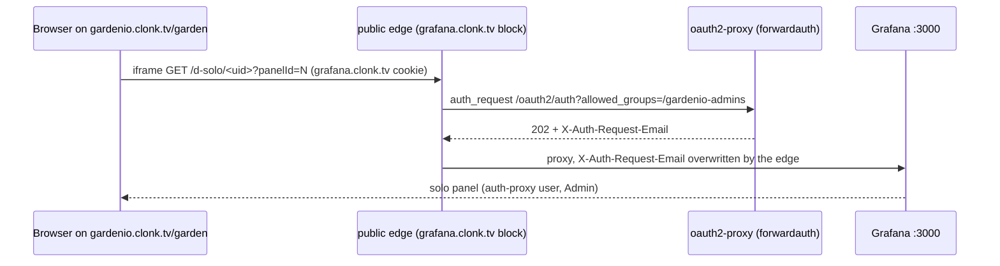
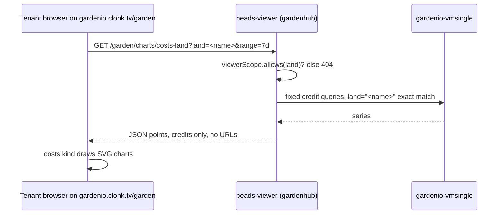

# Grafana panels in the garden

**Status:** design, decided 2026-10-25. Step 0.2 (gd-gv5KV0dqWG) of the plan
"Grafana in the garden, starting with costs" (gd-gh5J0vVbJP, narrative
gd-RfiMc27Ris). Audience: operators first (decision gd-ajC9ucv3dj). Every route
here is `routeAdminOnly` through phase 2. Tenants get their charts from the hub,
not from Grafana: decided 2026-10-26 in step 3.1 (decision gd-YMgXijX0Sc, see
[Tenant isolation (3.1)](#tenant-isolation-31)).

This note covers how one Grafana panel looks and behaves inside `/garden`:
how it is embedded, its theme and time range, how it loads, how it fails, how
it sits on a phone, and which dashboards and panels may be embedded at all.
Phase 1 builds the pieces: 1.1 the shared builder, 1.2 the route, 1.3 the k3s
proof, 1.4 the dashboard. Phase 2 paints them: 2.1 the `costs` kind, 2.2 the
Project panel cost tab. Steps 1.3 and 3.1 add their findings to this file.

## Decisions in one place

| Question | Decision |
|---|---|
| Embed mechanism | One Grafana **solo-panel iframe** per card (`/d-solo/<uid>?panelId=N`), built by the same builder `/costs` uses, against `beadsViewer.grafanaBaseURL`. |
| Base URL on k3s | `https://grafana.clonk.tv`: cross-origin and same-site from `gardenio.clonk.tv`. **Not** the viewer's `/grafana/*` proxy (see below). |
| Who builds URLs | The server only. The route returns each card's `src` and `open_url`, and the page never puts a Grafana URL together itself. |
| Theme | Follows the surface the frame sits on. The Workbench panel is the `--box` surface, which is dark in both day and night, so `theme=dark` in both. |
| Time range | Chips `today` / `7d` / `30d`, default `7d`. `today` means since 00:00 UTC, the same window as the farm's `today_usd` coin. |
| Chrome | `&kiosk` (kept for parity with `/costs`; solo panels draw no chrome anyway). |
| Loading | A skeleton card (title, scope, note, a box at the frame's size) paints at once. The iframe gets its `src` when the card nears view (IntersectionObserver on the panel body). |
| Unconfigured | An empty `grafanaBaseURL` returns cards with no `src`. The card keeps its words and says Grafana is not set up here. |
| Phone | Cards stack in the Workbench sheet. Width 100%, height from a 4:3 ratio clamped to 260–360 px. No horizontal scroll. |
| Allowlist | Closed registry of (set, dashboard uid, panelId) in Go. Nothing author- or viewer-supplied reaches a frame URL except a validated project name. |
| Not taken | Grafana Scenes or the whole Grafana SPA mounted in the page; server-rendered PNGs. |
| Tenant charts (3.1) | **The hub draws them** (decision gd-YMgXijX0Sc, `hub_charts`). Gardenhub queries VictoriaMetrics itself, cuts by `viewerScope` on the server and paints native SVG charts of credits only. A tenant's browser never talks to Grafana or VictoriaMetrics, and no tenant response carries a Grafana URL or a USD figure. Interactive Grafana stays operator-only. |

## What `/costs` does today

The plan step was drafted on the premise that `/costs` frames Grafana through
the viewer's same-origin `/grafana/*` reverse proxy (`grafana_proxy.go`). On
k3s that is not so:

- `deploy-values/gardenio-k3s.yaml` sets `beadsViewer.grafanaBaseURL:
  https://grafana.clonk.tv`. `renderCostsChartPanels` (`costs.go`) passes that
  base to `grafanaEmbedHTML` (`dashboard_view.go`), so every `/costs` frame is
  `https://grafana.clonk.tv/d-solo/gardenio-costs-candidate?panelId=N&kiosk`.
- Grafana runs at the root of its own host: `grafana.rootURL:
  https://grafana.clonk.tv`, `grafana.serveFromSubPath: false` (chart
  default). The public edge (`gardenio-ziti/public-edge.yaml`, the
  `grafana.clonk.tv` server block) runs `auth_request` against oauth2-proxy
  with `allowed_groups=/gardenio-admins`, overwrites `X-Auth-Request-Email`,
  and proxies to `gardenio-grafana:3000`. Grafana trusts that header
  (auth-proxy mode, `defaultOrgRole: Admin`).
- The viewer proxy is wired: the chart sets `GRAFANA_UPSTREAM_URL` to the
  Grafana Service whenever `grafana.enabled` and `grafana.auth.proxy.enabled`
  are on, and `edgeBackends.grafanaCallers` lets beads-viewer reach port 3000.
  But the proxy forwards the `/grafana/...` path verbatim. It was built for a
  Grafana that owns the `/grafana` prefix (`serve_from_sub_path=true`), and
  k3s Grafana serves at `/`. A `/grafana/d-solo/...` request reaches Grafana
  as a path it does not serve, and its pages would link assets at
  `https://grafana.clonk.tv/public/...`, not under `/grafana`. **Read from the
  configuration, the proxy cannot serve a working panel on k3s today.** Nobody
  has tried it live; 1.3 may confirm it in passing.

Whether the four `/costs` panels actually render for the owner on k3s is open
owner check gd-to88eRs0Xa. Step 1.3 records that answer as the baseline, in
[What 1.3 found](#what-13-found-2026-10-25-gd-p8osr6ortm).

## Embed mechanism

### Decision

Each panel card holds one `<iframe>` whose `src` is a Grafana solo-panel URL
on whatever `grafanaBaseURL` is configured. That is exactly the `/costs` path,
through one shared builder (step 1.1 lifts `grafanaEmbedHTML`,
`grafanaEmbedOpts` and `grafanaEmbedVar` into
`gardenio/controller/internal/grafanaembed`). The builder does not care what
the base is, so moving to a same-origin base later is a values change, not a
code change.

On k3s the frame is cross-origin but same-site. `gardenio.clonk.tv` and
`grafana.clonk.tv` share the registrable domain `clonk.tv`, so the browser
sends `grafana.clonk.tv`'s own host-only sign-in cookie (oauth2-proxy,
`SameSite=Lax`, `cookieDomain: ""`) with the frame's requests.



The iframe attributes stay the builder's: `scrolling="no"`,
`sandbox="allow-scripts allow-same-origin allow-popups"`,
`referrerpolicy="same-origin"`, and a `title` naming the panel. The
`.grafana-embed-frame{overflow:hidden}` scroll fix (MR !4566) comes with them.

### What 1.3 must prove on k3s

- **Framing allowed.** `grafana.allowEmbedding: true` (chart default) removes
  `X-Frame-Options: deny`. Nothing on the `gardenio.clonk.tv` edge block or in
  beads-viewer sets a CSP `frame-src`. The only `frame-ancestors 'none'` on
  the edge is the `mux.clonk.tv` block. The chart's Traefik
  `security-headers.yaml` middleware is not in the k3s path.
- **Cold session.** An admin who has signed in to `gardenio.clonk.tv` but has
  never opened `grafana.clonk.tv` has no `grafana.clonk.tv` cookie. The frame's
  first request gets a 302 to `/oauth2/start`, then Keycloak at
  `auth.clonk.tv`. With a live Keycloak SSO session, that round trip may finish
  inside the frame without a form. Without one, Keycloak's sign-in page is
  framed, and its own `X-Frame-Options` refuses that. 1.3 records which case
  happens with several frames starting at once. forwardauth runs
  `--cookie-csrf-per-request=true` with `--cookie-csrf-per-request-limit=4`,
  so up to four parallel starts keep their own CSRF cookie, and a fifth evicts
  the oldest. The lazy load below starts only the cards in or near view (two or
  three in a Workbench panel), which keeps a cold start under that limit. The
  panel footer in [Degraded states](#degraded-states) covers the case where the
  round trip does not finish.
- **No second login.** The frame lands as the auth-proxy user, never on
  Grafana's login form. Grafana's own OIDC stays off. It was turned off
  because four frames racing their own OAuth flows showed the login page in
  every panel.

### What 1.3 found (2026-10-25, gd-p8OsR6oRTm)

No chart or values change is needed for the frame to load. Every knob is
already set the way the embed needs, and `grafana_garden_embedding_test.go`
(`make test-helm`) now pins each one, so a change that would break the
garden's frames fails the chart tests first.

| Knob | Where | k3s value | Why the frame needs it | Pinned by `TestGrafanaEmbedding_…` |
|---|---|---|---|---|
| `grafana.allowEmbedding` | chart `values.yaml` (default `true`); k3s does not override | `GF_SECURITY_ALLOW_EMBEDDING=true` | Without it Grafana sends `X-Frame-Options: deny` and every frame reads "refused to connect". | `OnWheneverViewerFramesGrafana`: whenever the viewer renders a `GRAFANA_BASE_URL` and the in-chart Grafana renders, this env must render (k3s overlay, and the chart default with a base set). |
| `beadsViewer.grafanaBaseURL` + `grafana.rootURL` | `deploy-values/gardenio-k3s.yaml` | both `https://grafana.clonk.tv`; `serveFromSubPath` off | The frame goes to Grafana's own host root, not the viewer's `/grafana` proxy. | `K3sBaseIsGrafanaRoot` |
| Auth proxy | k3s `grafana.auth.proxy` | `X-Auth-Request-Email`, property `email`, whitelist `10.42.0.0/16,10.90.0.0/16`; Grafana OIDC off | The frame signs in from the edge's header, with no Grafana login form to race over. | `K3sAuthProxyFromEdge` (also: no Grafana CSP) |
| Edge sign-in cookie | k3s `keycloak.forwardAuth` | `--cookie-samesite=lax`, host-only (`cookieDomain: ""`), `grafana.clonk.tv` in `whitelistDomains` | `gardenio.clonk.tv` and `grafana.clonk.tv` are the same site, so a Lax host-only cookie rides the frame's requests, and the in-frame sign-in can return to the panel. `None` is never needed. | `K3sEdgeCookieLaxHostOnly` |
| No frame-blocking header | `gardenio-ziti/public-edge.yaml`, `viewer-authproxy.yaml`, beads-viewer, gardenhub | none on the `grafana.clonk.tv` and `gardenio.clonk.tv` blocks or viewer-authproxy; beads-viewer and gardenhub (`/garden`) set no CSP or `X-Frame-Options` at all (`freehtmx.StrictCSP` is mounted by no live binary; repro-cockpit, its one user, was deleted 2026-10-31); `mux.clonk.tv` keeps `frame-ancestors 'none'` | An `X-Frame-Options` on the framed side, or a `frame-src` on the parent, would refuse the frame. | `EdgeSetsNoFrameBlockingHeaders` |
| Traefik `security-headers` middleware | chart `security-headers.yaml` | not in the k3s path (`grafana.ingress.enabled: false`, no Grafana IngressRoute) | Its strict variant re-adds `X-Frame-Options: DENY`. | `TestGrafana_K3sOverlay_RendersNoIngress` (existing) |
| Admins only on `grafana.clonk.tv` | `public-edge.yaml` `grafana.clonk.tv` block | `allowed_groups=/gardenio-admins` only; `location /` runs it and overwrites `X-Auth-Request-Email` | `defaultOrgRole: Admin` (below). | `GrafanaHostAdmitsAdminsOnly` |

The tests were checked against mutations: an `add_header X-Frame-Options` on
the `grafana.clonk.tv` block, `/lands-tenants` added to its `allowed_groups`,
and `allowEmbedding: false` in the k3s overlay each fail them.

**Live, from the cluster side.** Read-only infra check (gd-Y5qbgBL2kb, 2026-10-25
~19:50Z) of the running objects matches the table: the Grafana Deployment env
carries `GF_SECURITY_ALLOW_EMBEDDING=true`, the auth-proxy settings above,
`GF_USERS_AUTO_ASSIGN_ORG_ROLE=Admin`, `GF_SERVER_ROOT_URL=https://grafana.clonk.tv`,
no `GF_AUTH_GENERIC_OAUTH_ENABLED` (image `grafana/grafana:11.4.0`). The
`public-edge` ConfigMap has `X-Frame-Options`/CSP only in the `mux.clonk.tv`
block, and `grafana.clonk.tv` checks `/gardenio-admins` alone. forwardauth runs
`--cookie-samesite=lax`, no `--cookie-domain`, `--cookie-csrf-per-request=true`
with limit 4, and `grafana.clonk.tv` among its whitelist domains. Grafana's own
response headers were not measured: the owner scaled `gardenio-grafana` to 0 at
18:09Z to free memory on a platform node (gd-4nac3mPMgo), and helm restores it
with the 04:00Z 2026-10-26 roll. `/costs` panels are dark until then.

**Baseline gd-to88eRs0Xa (`/costs` 4 panels on release 292.8+).** Still
unrun on 2026-10-25: it needs the owner's own browser, and a pod cannot reach
the public edge. It has not failed, so nothing is fixed first. The agent-side
half passed on 2026-10-21 (port 3000 unreachable from an agent, 3001 refuses a
forged header, edge probe green).

**Owner result, 2026-10-26: pass.** The owner closed both checks,
gd-to88eRs0Xa (baseline) and gd-y94aV38jyv (cold session), through decision
gd-sIYkOUa6cc at 20:23Z: "Nothing broken, close the checks". They picked
neither the cold-sign-in option (result B) nor the blank/reload option
(result C). They gave no per-step letter, so this is recorded as "nothing
broken", not an explicit "cold: A". That sitting came after the 2.6 edge fix
below (PR #1170). A laptop Chrome run at 18:33Z supports it: the cold path went
302 to `/oauth2/start`, and `/garden?costs=fleet` drew 5 frames with 0 reloads
in 15 s. No crew pod reached the public edge. The footer stays as it is.

### What 2.6 found: the frames reload forever (2026-10-26, gd-JXjqvnKU8u)

The owner's check-in on 2026.299.3 (decision gd-b3JPVDmgOR) said "grafana is
broken for iframes". A read-only infra pass (gd-zofWSz81d1, 17:50Z) read the
edge, forwardauth and Grafana logs for the owner's sitting (17:19:54 to
17:23:40Z, iPhone, Firefox iOS). **None of the three suspects caused it:**

- **Cold session: ruled out.** No frame went to `/oauth2/start` or Keycloak.
  `auth_request` returned 202, as the owner, 164 times.
- **Frame-blocking header: ruled out.** Grafana's real `/d-solo` response
  has no `X-Frame-Options` and no CSP (`allow_embedding` holds), and the edge
  adds none. Each frame document loaded with a 200.
- **CSRF cookie eviction: ruled out.** forwardauth logged no CSRF lines.

**What happened.** Each of the 3 frames loaded, then reloaded itself: 93
`/d-solo` reloads in under 4 minutes, each one followed by
`POST /api/user/auth-tokens/rotate` → **401** (99 in all; Grafana logged
`Unauthorized error="user token not found"`). Each reload also aborted
in-flight lazy chunks, which is where the `&chunkNotFound` on the URLs comes from.
The server never failed to serve a chunk.

**Why.** Grafana's own OIDC login was on at `grafana.clonk.tv` from 10-12
(`d5880358`) until 10-19 (`b2609e11`, auth proxy from the edge). A sign-in from that period left `grafana_session`
and `grafana_session_expiry` cookies in the browser, and they last up to 30
days. Grafana 11.4's frontend reads `grafana_session_expiry` from
`document.cookie` (`app/core/utils/auth.ts`). When the cookie is present,
`contextSrv` schedules a token rotation, and `backend_srv` rotates on any
401. The auth-proxy user has no login token, so rotate answers 401. On
`ErrUserTokenNotFound`, `RotateUserAuthToken` (`pkg/api/user_token.go`) does
**not** delete the cookies, and the frontend's 401 handler
(`setLoggedOut`) calls `window.location.reload()`. The next load has the same
cookie and does the same thing, so it never stops. The same thing happens at the
top level of `grafana.clonk.tv` for any browser holding the stale cookie.
It is not specific to frames or to Firefox iOS.

**Fix (edge, `gardenio-ziti/public-edge.yaml`).** The `grafana.clonk.tv`
`location /` now expires both cookies on every response (`Set-Cookie
grafana_session=; Max-Age=0` and `grafana_session_expiry=; Max-Age=0`,
`Path=/`, host-only, `Secure`, `SameSite=Lax`), and restates HSTS because a
location-level `add_header` stops the server's from being inherited. The
browser drops the cookies before the frame's script runs, so rotation is never
scheduled. Auth proxy issues no Grafana session (`enable_login_token` off), so
no valid session is lost. `TestGrafanaEmbedding_EdgeExpiresStaleGrafanaSession`
pins the lines, and it fails if the auth proxy ever starts issuing login tokens,
because the expiry would then delete live sessions. The same-origin move below
is still not needed.

**Still latent, not seen.** If a frame ever starts cold, Keycloak's sign-in page
is refused inside it: Keycloak sends `X-Frame-Options: SAMEORIGIN` and
`frame-ancestors 'self'`, measured in-cluster on 10-26. That would also be true
of a passkey prompt. The edge's `@signin` also passes `rd=` unencoded, so a frame
that signs in comes back with only the URL up to its first `&`. The "Charts
blank? Open Grafana once to sign in ↗" footer stays for that case.
`timezone=utc` at 00:30Z is checked under 1.4, whose dashboard sets
`"timezone": "utc"`.

### Same-origin later, not now

A same-origin base (`https://gardenio.clonk.tv/grafana`, through the viewer's
proxy) would remove the cold-session case, because the viewer stamps the
identity from its own verified session. It needs Grafana on a subpath
(`serveFromSubPath: true`, `rootURL` under `/grafana`). That breaks every
`grafana.clonk.tv` link and the edge block unless the edge also rewrites or
redirects. It is a helm and deploy-values change in a privileged lane, and it
would need its own escalation. Take it only if 1.3 shows the cold-session
case is common and the footer is not enough. Until then the viewer proxy
stays `routeAdminOnly` and is not used by the garden.

### Not taken: Grafana Scenes, or mounting the Grafana SPA

- **Size.** Scenes (`@grafana/scenes`) brings React, the Grafana UI kit and the
  panel plugins it draws. That is megabytes of JavaScript, against a garden that
  is plain hand-written scripts with no bundler, no web fonts and no external
  requests (`garden.css` header). The iframe loads Grafana's bundle in its own
  document, from Grafana, only for operators who open a Costs panel.
- **CSP and origin.** Scenes in the page would call Grafana's query API from
  the garden's origin. That means either a CORS opening on Grafana or the
  same-origin proxy that does not work on k3s, plus `script-src` and
  `connect-src` allowances for Grafana's plugin code inside the garden's
  document. An iframe keeps Grafana's code in Grafana's origin.
- **No per-viewer cut.** Grafana's datasource proxy runs queries as the Grafana
  user, and on k3s every admitted user is a Grafana Admin over a single
  VictoriaMetrics with no tenant isolation. Scenes in the page would not cut
  data per viewer any better than an iframe. It would only put the
  unrestricted query path inside a page tenants will one day load. Tenants get
  their own path in phase 3 (decision 3.1), not Grafana.

### Not taken: server-rendered PNGs

The image renderer is off on k3s (`grafana.imageRenderer.enabled: false`,
chart default; `gb grafana render` detects Grafana's "No image renderer
available" placeholder and errors). `grafana-headless-render.md` describes the
old AWS layout, where the renderer sidecar was on. Turning it on is a helm
change, adds a headless Chromium to the Grafana pod (memory on a node pinned
to the on-demand platform pair), and gives a static picture with no hover and
no "Open in Grafana" continuity. A PNG served by the hub was option B of the
tenant isolation decision 3.1. It was not taken there either: see
[Tenant isolation (3.1)](#tenant-isolation-31).

## The URL

The builder makes, and the route returns:

```text
src      = <base>/d-solo/<uid>?panelId=<N>&kiosk&theme=<theme>&from=<from>&to=<to>&timezone=utc[&var-<name>=<value>...]
open_url = <base>/d/<uid>?viewPanel=<N>&theme=<theme>&from=<from>&to=<to>&timezone=utc[&var-<name>=<value>...]
```

Every input comes from a closed set:

| Input | Allowed | Source |
|---|---|---|
| `base` | `beadsViewer.grafanaBaseURL` (operator-set) | `Server.grafanaBaseURL` |
| `uid`, `panelId` | registry entries only ([Allowlist](#allowlist)) | Go constants |
| `theme` | `light`, `dark` | request param, default `dark` |
| `from`/`to` | the three range rows below | request param `range` |
| `var-project` | a project the farm knows (`type:project` bead), shaped as a DNS label (1–63 of `a-z`, `0-9` and `-`, a letter or digit at each end); `$__all` only when the server sets it for the fleet set | request param `project` |

A value outside these sets is a 400, never a fallback that builds a URL anyway.

**Route shape (1.2).** `GET /garden/charts/{set}?project=&range=&theme=`
returns `{set, project, range, theme, open_dashboard_url, panels: [{id, title,
scope, note, src, open_url, embed_html}]}`. `src` and `open_url` are what the
garden uses. The kind builds the iframe with `createElement` and
`setAttribute`, following the Workbench rule that text goes in through
`textContent` only, never `innerHTML`. `embed_html` stays in the response so
the golden test can show garden, `/costs`, `/charts` and the `:::grafana`
directive produce byte-identical markup. The garden does not inject it.

## Theme

The theme follows the surface the frame sits on, not the sky. The Workbench
panel (`.bv`) paints `background: var(--box)`. `--box` is `#26365a` by day
and `#0b1220` by night (`garden.css` `:root` and the night block). That is a
dark navy in both, as the Porch and the bead view are. A `theme=light` panel
there would be a white slab in a dark box by day. So the `costs` kind asks for
`theme=dark` in both skins.

Two side effects follow. A dusk or dawn flip (`SKY.on`) does not reload four
to six Grafana documents. And a future surface that puts panels on a light
`--surface` passes `theme=light`, with no change to the builder or the route,
and listens to `SKY.on` to reload.

## Time range

| Chip | `from` | `to` | Agrees with |
|---|---|---|---|
| `today` | `now/d` | `now` | farm `today_usd` (since 00:00 UTC, `costWindows` in `farm_cost.go`) |
| `7d` (default) | `now-7d` | `now` | farm `week_usd` (trailing 7 days) |
| `30d` | `now-30d` | `now` | VictoriaMetrics retention (30 days): the left edge may be thin |

- `today` is since midnight UTC, not `now-24h`. 1.1's draft listed `now-24h`.
  This note changes it so the chart's total for "today" matches the coin in the
  header. `now/d` rounds to the dashboard's timezone, so `gardenio-garden-costs`
  sets `"timezone": "utc"` in its JSON (1.4), and the URL also passes
  `&timezone=utc` as a second guard (1.3 confirms Grafana 11.4 honours it on a
  solo panel, and checks one panel at 00:30Z).
- The default is `7d`. Early in the UTC day, `today` is nearly empty, and a
  week shows a shape.
- The range is not in the address. The Workbench gives each kind one
  parameter, `?costs=fleet|<project>`. The last chip a viewer chose is kept per
  viewer under `garden.costs.range` in `localStorage` (read and written in
  try/catch, as `SKY` does). A blocked store falls back to `7d`.
- A chip change re-fetches the route with `range=`. Cards whose frame has loaded
  get the new `src` (Grafana reloads the panel). Cards not yet in view only
  update their pending `src`. The client never edits a URL.
- Stat panels in `gardenio-garden-costs` use `$__range` (for example
  `increase(...[$__range])` through the same dedup and subquery shape as
  `costsTagGaugeSpendExpr`), so the number in a card equals the coin for the
  same window.

## The panel card

```text
┌ Spend rate ─────────────────────── Open ↗ ┐   h3 title, link to open_url (new tab)
│ USD/hour · 1h rolling · LiteLLM bill      │   scope line (--box-dim)
│ ┌───────────────────────────────────────┐ │
│ │  skeleton → iframe (4:3, 260–360 px)  │ │   frame box
│ └───────────────────────────────────────┘ │
│ Per-credential bill, incl. non-agent ...  │   note (optional)
└───────────────────────────────────────────┘
```

The panel itself (2.1) has a header (scope name: "Fleet" or the project; the
farm's `cost.projects[]` coins for today, week and budget when present, so the
numbers and the charts sit together), the range chips, the stack of cards,
"Open the dashboard in Grafana ↗", and the footer line from
[Degraded states](#degraded-states).

**Skeleton first.** The card paints at once from the route's JSON: title,
scope, note, and a frame box at its final size holding a quiet "Loading
chart…" label. The box gets a slow shimmer, none under
`prefers-reduced-motion`. The card reads before the frame does, and its height
never jumps. The iframe sits in the same box. On its `load` event the skeleton
label hides.

**Lazy load.** The iframe is created without `src`. An `IntersectionObserver`
rooted on the panel body (`.bv-body`, the scroll container), with
`rootMargin: '0px 0px 200px 0px'`, sets `src` when a card comes within 200 px
of view. Once loaded, a frame is never unloaded. Native `loading="lazy"` stays
on the element as a fallback, but it is not enough by itself: Chrome's
threshold (over 1000 px) would boot every frame in a 600 px panel at once, and
each frame starts Grafana's whole app and its queries.

**Size.** CSS, not script:
`.gp-frame{width:100%;height:auto;aspect-ratio:4/3;min-height:260px;max-height:360px}`.
As built (2.1, `web/costs.js`), the clamp sits on the frame box (`.gp-box`), not
the iframe, so the skeleton and the frame share one size: `height:clamp(260px,75cqw,360px)`
on a card stack that is an inline-size container. That is the same 4:3, written
without the `aspect-ratio` property, which `layout_test.go` bars page-wide.
The builder's `height="360"` attribute (`costsEmbedHeight`) stays as the no-CSS
fallback. 360 is the height Playwright verified as scroll-free on `/costs`. A
solo panel fills its frame, so any height inside the clamp stays scroll-free.
The ratio only sets what is legible:

| Where | Card width | Frame height |
|---|---|---|
| Desktop Workbench panel (`min(440px, …)`, 12 px body padding) | about 410 px | about 307 px |
| Phone sheet, 390 px screen | about 366 px | about 274 px |
| Any card 480 px or wider | ≥ 480 px | 360 px |
| Phone held sideways (under 481 px tall, `garden.css` landscape block) | about 600 px | 55% of the screen's height: about 187 px at 750x340 |

Sideways, the pane body is about 280 px tall, so a 4:3 frame (360 px) is never
seen whole. There the box is `min(75cqw,360px,55dvh)`: the card, the frame plus
about 90 px of title and scope, fits the body, so one scroll stop shows a whole
chart (gd-5h9wZrJ711).

**Phone.** On a phone the Workbench is a sheet from the header to the tab bar
(`garden.css` `@media (max-width:899px)`). Cards stack one per row at full
width in the sheet's scrolling body. Chips wrap, and nothing scrolls sideways.
Inside the frame, Grafana handles touch (tooltips on tap). The sheet's
swipe-from-left-edge Back belongs to the host and starts outside the frame,
so a frame does not take it over.

**Accessibility.** Each iframe's `title` is the card title plus "Grafana
panel". The card is a `section` labelled by its `h3`. The chips are a
`role="radiogroup"` of buttons with `aria-checked`. "Open ↗" links say where
they go (`aria-label="Open Spend rate in Grafana"`). Keyboard focus runs
chips, then each card's Open link, then the frame (Grafana's own controls),
in document order.

## Degraded states

| State | How the page knows | What the card or panel says |
|---|---|---|
| Grafana not configured (`grafanaBaseURL` empty) | route returns `src: ""` (the builder's existing fallback, kept) | Every card keeps title, scope and note. The frame box reads "Grafana isn't set up in this environment." No Open links. HTTP 200. |
| Route fetch fails | Workbench `failure()` | The host's error line in words, with Try again. The header still paints the farm's cost coins from the farm document. |
| Viewer is not an admin | route is `routeAdminOnly` (403) | Openers are not shown to non-admins (2.3). A pasted `?costs=` link opens the panel with "Costs charts are for operators for now." |
| Frame slow or never loads | no `load` within 15 s of setting `src` | The frame box says "This chart is taking a while" with that card's Open ↗. A late `load` clears it. |
| Frame lands on sign-in or "refused to connect" (cold `grafana.clonk.tv` session) | cannot be seen from outside a cross-origin frame | The panel footer always shows one quiet line: "Charts blank? Open Grafana once to sign in ↗" (top-level `<base>/`, new tab). After that, a chip click or reopening reloads. 1.3 decides whether the line can go. |
| Grafana up, query empty or datasource down | Grafana draws "No data" or its error in the panel | Nothing extra. The panel's own message is the honest one. `gardenio-garden-costs` stat panels set `noValue: "0"` only where zero is true (spend), never for a failed query. |
| Farm cost figures stale (`has: false`, `as_of`) | farm document | The header coins carry the farm's own "as of" marker, as the Porch does. Charts are unaffected. |

## Allowlist

The registry is a Go table in `internal/grafanaembed` (1.1). It holds sets of
entries `(set, dashboard uid, panelId, title, scope, note)`. The route accepts
only a set name, and the builder accepts only entries from the table.
Changing an entry means changing the table and the dashboard JSON in one PR,
with the golden that pins both. That is the lesson of `costs.go`'s
"PANEL IDS ARE POSITIONAL" note: catalog-generated dashboards renumber
panels when the catalog is reordered. So `gardenio-garden-costs` is a
hand-written JSON with explicit `id`s, and a test pins those ids against the
registry.

### Phase 1 first cut (retired by 1.5)

Until 1.4 shipped, `costs-fleet` embedded the four panels `/costs` shows
(`gardenio-costs-candidate` ids 1–4, no `project` variable) so 2.1 could be
built against panels known to exist, and `costs-project` had no entries. Step
1.5 (gd-266LKIvFXP) moved both sets onto `gardenio-garden-costs` below.

### After 1.4: `gardenio-garden-costs`

The ids 1.4 shipped (`gardenio/helm/gardenio/dashboards/gardenio-garden-costs.json`).
`grafana_garden_costs_dashboard_test.go` pins each id to its type and title.
Changing one means changing the dashboard, the registry, this table and that
test in the same PR.

| panelId | Name | Sets | Series (real bill only) |
|---|---|---|---|
| 1 | Spend (window), stat | fleet, project | `gardenio_tag_cost_usd{dim="project"}`, `value=~"$project"`, over `$__range`: the farm's `costsTagGaugeSpendExpr`, each project floored at 0 |
| 2 | Fleet spend rate, USD/hour (24 h and 1 h lines) | fleet | the `fleetHourlyRateQuery` and 1 h shapes (`costs_rate.go`) on `gardenio_account_cost_usd`, `account=~"$account"` |
| 3 | Spend by project over time, stacked | fleet | `gardenio_tag_cost_usd{dim="project"}`, trailing hour per step; fixed hues per known project, grey for the rest |
| 4 | Spend by model | fleet | `gardenio_tag_cost_usd{dim="model"}` over `$__range` |
| 5 | Spend by account | fleet | `gardenio_account_cost_usd` over `$__range`, `account=~"$account"` |
| 6 | Spend by agent, table (agent, role, model, USD) | project | `gardenio_agent_spend_logs_usd{project=~"$project"}`, top 10, instant deduped sum, sweep lookback (see below) |
| 7 | Spend by role | project | same gauge, by `role` |
| 8 | Spend by model (project) | project | same gauge, by `model` (the tag gauge's `dim="model"` cannot be cut by project) |
| 9 | Land purse spend, USD (operator only), stat: window and to date | project, tenant lands only | `gardenio_account_cost_usd{account=~"lands-$project"}` |
| 10 | Project spend rate, USD/hour (24 h and 1 h lines) | project | the tag gauge for `$project`, with the fleet-rate shape |
| 11 | Per-agent spend spread (p50, p90, p99) | none (board only) | the spend-logs gauge, per-agent level per step |
| 12 | Land spend rate, with the `LandSpendVelocityHigh` $2/h floor | project, tenant lands only | `gardenio_account_cost_usd{account=~"lands-$project"}`, trailing hour per step |

Ids 100–102 are the board's text panel and rows and are never embedded.

- `costs-fleet` = 1, 2, 3, 4, 5, with `var-project=$__all` set by the server
  (`var-account` stays at the board's All default).
  `costs-project` = 1, 10, 6, 7, 8, and also 9 and 12 when the project is a
  tenant land (`land_kind` is not `operator`). The registry marks 9 and 12
  `LandOnly`; the route sets `Query.Land` from the farm, never from a request
  param, and `Build` refuses it on the fleet set.
- 1.4 split the drafted panel 2 in two: one panel cannot switch between the
  account gauge (fleet) and the tag gauge (project) on `$project`. Panel 2 is the
  fleet rate and panel 10 the project rate. With every project selected, panel 10
  sits a little under panel 2 by the spend no project tag claims.
- Never `gardenio_agent_spend_usd_total`. It is the dead at-close counter
  behind the old "Settled cost" P0.
- Panels 6–8 and 11 read the Reset+Set spend-logs gauge. `increase()` over it is
  garbage (`costsTagGaugeSpendExpr`'s neighbour in `costs_rollup.go` explains
  why). Its figure is the sweep's ~48 h lookback slice, not the chip's range,
  and the card's scope line says so.
- Panels 9 and 12 are USD and stay operator-only. The tenant credits view is
  phase 3 (3.2 recording rules, 3.3 the scoped set), on a separate path that
  never hands a tenant a Grafana URL.
- Every window stat and bar sets `noValue` to "no bill data in this window"
  (or names the sweep lookback, or "not a tenant land"), never "0": an empty
  result here cannot tell a quiet window from a missing series.
- Checked against `gardenio-vmsingle` on 2026-10-25: 7 d fleet window $5,413.55
  on the tag gauge against $5,420 on the account gauge; fleet rate $42.24/h
  (24 h) and $78.84/h (1 h). grafanagrade richness 8.29 (bar 8.0), no
  empty-branch defects, every panel has a unit.

### Step 4.2: `gardenio-garden-agents`

The agent panels (gd-g7Ms8Ddfmj) embed a second hand-written board,
`gardenio/helm/gardenio/dashboards/gardenio-garden-agents.json`, whose ids
`grafana_garden_agents_dashboard_test.go` pins. Its one variable, `agent`, is a
**textbox**: a query variable falls back to its first option for a value its
query does not list, which would show another agent's chart under this one's
title. The server sends one agent name, or several joined by `|`; every
selector matches it anchored (`agent=~"$agent"` on the spend-logs gauge,
`agent_name=~"$agent"` on the session series), and a name is a DNS label, so no
regex metacharacter can reach it.

| panelId | Name | Sets | Series |
|---|---|---|---|
| 1 | Cost over time | agent, gardener | the `/costs` "Per-agent cost over time" query (`last_over_time` over `gardenio_agent_spend_logs_usd`, top 10) scoped to `$agent`; amber at $10, red at $25 |
| 2 | Context size | agent, gardener | `gardenio_session_context_tokens`, top 10 by `agent_name`; amber at 160k, red at the 200k window |
| 3 | Turns | agent, gardener | `gardenio_session_turns_total`, per session, cumulative |
| 4 | Tokens, stacked by type | agent, gardener | `increase(gardenio_session_tokens_total[5m])` by `type` |
| 5 | Spend by run, bar gauge | gardener | the spend-logs gauge by `agent`, instant (the sweep's ~48 h lookback) |
| 6, 7, 10 | Spend so far, Largest context, Turns in the window (stats) | none (board only) | the same series |
| 8 | Context spread across the agents (p50, p90, p99) | none (board only) | the context series, one value per agent |
| 9 | Agents and their bill, table | none (board only) | the spend-logs gauge by agent, project, role, model |

Id 100 is the board's text panel.

- `agent` = 1, 2, 3, 4: `GET /garden/charts/agent?agent=<name>`, opened from an
  agent's face ("See its charts") as the Costs panel's `?costs=agent:<name>`.
  The builder checks the name's shape (`ValidAgent`); the route is admin-only
  like every other set.
- `gardener` = 5, 1, 2, 3, 4: `GET /garden/charts/gardener?gardener=<id>`, the
  Gardener panel's Charts tab. The route reads the gardener loop's runs on the
  request's bearer, as its panel does, and sends their names (newest first, at
  most 25, a spawn that never ran left out); no request param names an agent. A
  gardener with no run answers no cards.
- The spend-logs gauge is never `increase()`d here either, and the session
  series reset with each session: a restarted agent starts a new line.

## Tenant isolation (3.1)

**Decided 2026-10-26** (decision gd-YMgXijX0Sc, option A `hub_charts`, chosen
by the owner). A tenant sees charts of their own land's credits, drawn by the
hub. The tenant path has no Grafana in it at all.

### Why the cut cannot live in Grafana or VictoriaMetrics

- Tenants hold only `gardenio-project-member` through `/project-<land>`. They
  sign in through the edge group `/lands-tenants`, which is admitted to
  `gardenio.clonk.tv` only (gd-ylb7gW9sb1).
- `grafana.clonk.tv` admits `/gardenio-admins` only, and every user it admits
  is created as a Grafana Admin (`defaultOrgRole: Admin`). See
  [Hazards carried forward](#hazards-carried-forward).
- The project-scoped humans plan
  (`docs/superpowers/plans/2026-10-14-project-scoped-humans.md`) gives scoped
  users no Grafana: `/costs` and `/grafana` return 403 to them.
- There is one VictoriaMetrics single with no per-tenant isolation. Anything
  that can send it a query can read every land.

So the one place that knows who the viewer is and which lands they may see is
the viewer process: `viewerScope` (`cmd/beads-viewer/scope.go`), built from the
verified OIDC roles and groups and never from a raw header. The cut goes there.

### The path



1. **Route.** `GET /garden/charts/costs-land?land=&range=` (step 3.3), classed
   `routeScoped` in `route_classes.go`. The existing
   `GET /garden/charts/{set}` stays `routeAdminOnly`. It hands out Grafana URLs
   and `costs-project` takes any project, so it is never reclassified.
   `routeScoped` says nothing may come from a non-daemon backend "without a
   per-principal cut". This handler reads VictoriaMetrics, so its cut is the
   in-handler scope check below, and the route's classification comment says so.
2. **Scope check first.** The handler reads `land` from the request, validates
   it as a DNS label, and checks `viewerScopeFromContext(ctx).allows(land)`
   before it builds any query. A land outside the scope is a **404**, the same
   as a land that does not exist, so a tenant cannot probe for other lands'
   names. That is the `BeadFeedHub.eventVisible` and Glass `InScope` pattern.
   An operator land (`land_kind: operator`) is also a 404: it has no purse.
   Every land role the scope admits (owner, member, guest) sees the charts.
   That is the same audience as the purse in the 8.8 land header.
3. **Fixed queries.** The PromQL lives in Go as constant templates, as
   `buildFarmProjectSpendQuery` does. Only the validated land name goes into
   them, as an exact matcher (`land="<name>"`, never `=~`), so no value can
   widen the selector. A request parameter never reaches PromQL, except a
   range chip mapped to a fixed window and step. The handler queries vmsingle
   through `s.metricsUpstream`, as `farmSpendSource` and
   `instantVectorQuery` do. 3.3 adds a range-query sibling of
   `instantVectorQuery` with the same timeout, body cap and failure handling.
   It does **not** go through the admin-only `/api/v1/query_range` proxy.
4. **Credits only, by construction.** The queries select only the 3.2
   recording-rule series (`gardenio:land_spend_credits:*` and
   `gardenio:land_credits:*`, USD × the land's credit rate, computed in
   vmalert; see [Credit series (3.2)](#credit-series-32)). The response type has no USD field and
   no URL field, so nothing at cost can be added to it by mistake. That is the
   chart side of `purse.CreditsOnly`. Remaining and granted come from the purse
   (`purse.Read(...).CreditsOnly()`), not from VictoriaMetrics, so "remaining"
   on a chart matches the land header.
5. **Native charts.** The `costs` kind (2.1, `web/costs.js`) paints the tenant
   set when the viewer is scoped. It draws inline SVG built with
   `createElementNS` (the `plans.js` `sv()` helper pattern), with text set
   through `textContent` only. There is no chart library and no external
   request. Colours are the garden's CSS tokens, so the charts follow
   `SKY`, day and night, with no reload. They have hover and tap readouts, and
   use the same card, chips (`today` / `7d` / `30d`), phone stacking and
   `garden.costs.range` key as the operator cards.

### The tenant panel set (3.3)

| Card | Form | Series |
|---|---|---|
| Credits spent | three stat tiles: today, 7 d, 30 d | `gardenio:land_spend_credits:today`, `:increase7d`, `:increase30d` |
| Remaining vs granted | a meter, remaining of granted, with the margin marked | the purse, `CreditsOnly` |
| Burn to the wall | a line of credits remaining over the chip's range, the projected run-out at the current burn rate dashed, the wall (margin) as a rule | `gardenio:land_credits:remaining` (range query), run-out at `gardenio:land_spend_credits:rate1d` |
| Credits per agent | a ranked bar list, top 10 and "the rest" | `gardenio:land_spend_credits:by_agent` (the spend-logs sweep's ~48 h slice, as panel 6) |

The operator keeps Grafana panels 9 and 12 (USD) on `costs-project`. An admin
may call `costs-land` for any land to see exactly what that land's tenant sees.

**Shipped (gd-kSG5BqJMRo).** The route is `gardenhub/land_credits.go`; the
viewer feeds it through `landCreditSource` (`cmd/beads-viewer/land_credits.go`),
one instant query for the tiles, the rate and per agent, and one range query
for `:remaining`. The windows: `today` since 00:00 UTC every 5 minutes, `7d`
hourly, `30d` every 6 hours, so a chip draws at most 288 points. The answer:

| Field | What |
|---|---|
| `land`, `range` | the land and the chip |
| `history` | `ok`, `none` ("No credit history yet") or `unavailable` |
| `purse` | the purse's credit fields only (`granted_credits`, `remaining_credits`, `margin_credits`, …), from the farm's read |
| `spent` | `today`, `week`, `month`; `null` unless `history` is `ok` |
| `burn` | `start`, `end`, `points` ([unix s, credits]), `rate_per_hour`, `wall` (the margin), `run_out` (unix s at the wall at that rate; `null` with no burn or none within a year) |
| `agents`, `rest` | the top 10 by credits, then the rest's `count` and `credits` |

The panel opens on `?costs=land:<name>` (`web/credits.js` draws it). A scoped
viewer's Menu item and the header purse (gd-H9LerJ0v3g, which took the Porch
chip's place; for a tenant it adds a row of the land's credits left) open the
cursor's land, else the first land the farm gives a purse, once the farm
document names one. The 8.8 land
header (gd-vJK94LpTOm) is not built yet; its purse should open the same id.

### Credit series (3.2)

vmalert records these per tenant land (`templates/_lands-credits.tpl`; runbook:
`docs/e8-recording-rules-runbook.md`, "Land credit series"). Every series has
one label, `land` (plus `agent` on `by_agent`), and every value is credits.

| Series | Value |
|---|---|
| `gardenio:land_spend_credits:total` | spent to date, the purse's `spent_credits` before in-flight |
| `gardenio:land_spend_credits:today` | since 00:00 UTC (the `today` chip), 5-minute steps |
| `gardenio:land_spend_credits:increase7d`, `:increase30d` | trailing 7 and 30 days |
| `gardenio:land_spend_credits:rate1h`, `:rate1d` | credits per hour: the trailing hour, the trailing day's mean |
| `gardenio:land_spend_credits:by_agent` | per agent, the spend-logs gauge's ~48 h slice |
| `gardenio:land_credits:granted` | the ledger's sum |
| `gardenio:land_credits:remaining` | granted − spent, settled: the purse also subtracts in-flight |

The rate reaches PromQL as `gardenio_lands_credit_rate{land}`. The controller
exports it from the rate in force, with `gardenio_lands_credits_granted{land}`.
With no rate in force there is no rate series and no credit series, which is
the card's "No credit history yet" state. The tiles and the remaining meter
still take the live figures from the purse, as point 4 above says. The
recorded remaining is for the chart line.

### Degraded states (tenant set)

| State | What the card says |
|---|---|
| vmsingle not wired or a query fails | "Credit history is unavailable right now." The figures are unknown, never 0, as with `errFarmSpendUnavailable`. The purse tiles still paint from the purse. |
| The 3.2 series do not exist yet for the land (new land) | "No credit history yet." HTTP 200. |
| History longer than 30 days | Not offered: retention is 30 days, and the contract's `budget/history` (3.4) takes `days` 1 to 30 too. |
| Purse unreadable | The land header's own "unknown" state (`purse.Unreadable`). Charts still draw. |

### What this rules out

- A tenant response never carries a Grafana `src`, `open_url`, dashboard uid
  or USD figure. 3.5 (security review) tests this on the route's JSON for a
  tenant principal.
- No new identity anywhere: no Grafana service account, no vmauth user, no new
  edge route, no change to `defaultOrgRole`. Nothing changes in the helm chart
  for 3.1 itself. 3.2's recording rules are a separate helm change.
- No image renderer. Option B (PNGs fetched server-side with an admin
  Grafana token) put a Grafana admin credential in the hub, and one panel
  without the project pinned would show every land. Option C (Grafana per land
  through vmauth `extra_filters`, a Viewer role and a tenant edge route) needed
  the Grafana auth redesign above, and went against the project-scoped humans
  plan.
- The cost: we own a small SVG chart component. It looks close to the
  operator's Grafana panels but not identical. That is accepted.

### Security review (3.5, 2026-11-01)

Step 3.5 (gd-E7FphpZNMI) reviewed the tenant path that 3.1 to 3.4 built. The attacker in the model is a tenant
principal of land `a`: it holds `gardenio-project-member` and the `/project-a` groups, or `a`'s land token or a
per-agent token. It tries to read land `b`, or any at-cost dollar figure. The review read the code for each
vector and pinned the gaps with tests.

| Vector | Control | Proof | Verdict |
|---|---|---|---|
| `?land=b` on `GET /garden/charts/costs-land`, plus `B`, `b"}`, `a..b` and a repeated `land=` | DNS-label check, then `gardenInLand` (`viewerScope.allows`) before any read. The answer is a 404 with the same body as a land that does not exist. The PromQL takes the land only as an exact matcher, and the answer keeps only samples whose `land` label equals it. | `TestLandCostsRefusesBeforeAnyRead`, `TestGardenLandCostsCutsToOwnLand` (end to end through `scopeMiddleware`, including a token that carries `gardenio-viewer` beside `gardenio-project-member`), `TestLandCreditsQueries` | safe |
| `?range=` and other parameters | A range chip maps to a fixed window and step; anything else is a 400. No other parameter is read. | `TestLandCostsRange` | safe |
| Dashboard variables, `GET /garden/charts/{set}` (`costs-project?project=b`, `health-land`) | `routeAdminOnly`: 403 to a scoped principal | `TestGardenChartsAndGrafanaStayAdminOnly` | safe |
| Direct `/grafana/...` on `gardenio.clonk.tv` | The viewer's Grafana proxy is `routeAdminOnly`, and the edge has no `/grafana` location of its own | the same test | safe |
| Direct `grafana.clonk.tv` | The edge admits `/gardenio-admins` only | `TestGrafanaEmbedding_GrafanaHostAdmitsAdminsOnly` | safe ([Hazards](#hazards-carried-forward)) |
| The farm document and its stream (`GET /garden/farm`, `/garden/farm/events`) | `FarmCost.ForProjects`: the viewer's rows only. A tenant land's row keeps its purse `CreditsOnly` and drops every `*_usd`, budget and level. Fleet figures are never sent. The stream recuts each blob from the same view. | `TestFarmCutCostPurse`, `TestFarmCutCostDropsFleetFigures`, `TestFarmCutStream` | safe |
| USD in a tenant answer | No `*_usd` or URL field on `landCosts`. The purse is copied field by field from `CreditsOnly`. | `TestLandCostsAnswer` (walks the JSON for `*_usd`, `llm_multiplier`, `src`, `open_url`, `dashboard`, `://`) | safe |
| Purse `reason` on a failed read | It used to carry the batch's error, which named another land and the daemon. Now it is the generic text. | `TestFarmCostPurse` | **fixed** (gd-ozJuqHJK2f) |
| The contract (`GET /lands/v1/lands/{land}/budget[/history]`) | `admit(land)`: the name pattern, then `landAdmitsCaller` (land token, scoped human, per-agent token). `days` must be 1 to 30. Exact matcher. The ledger fallback picks credit fields only. | `TestLandsAPI_BudgetOtherLandRefusedByAdmit` (new: `other` is a real tenant land that the admin reads, so the 404 is the land check's), `TestLandsAPI_BudgetHistory` | safe |
| The land's event stream (`budget.updated`) | Filed under the bead's `project:` land, then re-admitted per subscriber, and it reads `Budget(subscriber's land)` | `TestFeed_BudgetUpdated`, `TestFeed_OtherLandIsNotFound` | safe |
| **The land's own account bead** (`lands-<land>`, `project:<land>`) | **None.** `GET /v1/beads/{id}`, the list and the land door hand a member the raw `litellm_key` and `total_cost_usd`. | repro on the bug | **open, P0** (gd-q8jegjvKI3) |

The tenant charts themselves (3.1 to 3.4) have no blocking finding. The account bead leak is older than this
plan and sits in kbeads' generic bead reads, not in the chart path. It still breaks "no USD reaches a tenant",
and it hands over the land's key, so it should block the Open day check-in (3.6, gd-Pn2fD1WQsR) until it is fixed.

### After 4.1: `gardenio-garden-health`

Step 4.1 (gd-SKVLOuGToB) added a second board and the `health-land` set, for the
Project panel's Health tab (`web/project.js`, beside Cost). Same builder, same
`GET /garden/charts/{set}` route, `routeAdminOnly`
(`gardenio/helm/gardenio/dashboards/gardenio-garden-health.json`, ids pinned by
`grafana_garden_health_dashboard_test.go`). Changing an id means changing the
dashboard, the registry, this table and that test in the same PR.

| panelId | Name | In `health-land` | Series |
|---|---|---|---|
| 1 | SLO burn rate (dashed line at 14.4, the fast-burn page) | every project | `gardenio:lands_slo_errors:ratio_rate1h` over `(1 - gardenio:lands_slo:objective)`, by `slo` |
| 2 | Error budget left (30 d), bars | every project | `1 - ratio_rate30d / (1 - objective)`, instant: the chips do not move it |
| 3 | SLO error ratio (5 m) | every project | `gardenio:lands_slo_errors:ratio_rate5m`, by `slo` |
| 4 | Uptime probes now, up/down | every project | `gardenio_uptime_probe_success{target}` |
| 5 | Probe availability (window), bars | every project | `1 - increase(gardenio_uptime_probe_failures_total) / increase(gardenio_uptime_probe_total)` over `$__range`, by `target` |
| 6 | Prober last ran | none (board only) | `time() - max(gardenio_uptime_probe_last_run_timestamp_seconds)` |
| 7 | Land API requests by caller | tenant lands only | `gardenio_lands_api_requests_total{land=~"$project"}`, rate by `caller` |
| 8 | Land API problems by code | tenant lands only | the same, `code!="ok"`, rate by `code` |
| 9 | Member calls, last 7 days | tenant lands only | `sum(increase(...{land=~"$project", caller="member"}[7d]))`, the v1-beta exit's weekly-use read (`lands/contract/V1_BETA_EXIT.md`, criterion 2) |
| 10 | Land API calls by op (window), bars | tenant lands only | the same counter over `$__range`, by `op` |
| 11 | Land API requests by land | none (board only) | the same counter, `land!=""`, rate by `land` |
| 12 | Commons event lag (p50, p95) | tenant lands only | `histogram_quantile` over `gardenio_commons_event_lag_seconds_bucket{land=~"$project"}` (the `commons_event_latency` SLI, 5 s) |
| 13 | Agent spawn to working (p50, p95) | tenant lands only | `histogram_quantile` over a day of `gardenio_lands_spawn_to_working_seconds_bucket{land=~"$project"}` (the `tenant_spawn_to_working` SLI, 300 s) |
| 14 | Caption sources | none (board only) | `gardenio_farm_caption_total`, rate a minute by `src`, stacked (bird captions, gd-FOzMlrXga6) |
| 15 | Haiku caption latency (p50, p95) | none (board only) | `histogram_quantile` over `gardenio_farm_caption_haiku_seconds_bucket`, dashed at the 3 s timeout |
| 16 | Haiku caption spend (window) | none (board only) | `gardenio_farm_caption_haiku_tokens_total{type}` over `$__range`, input at $1 and output at $5 per million |
| 17 | Haiku calls skipped | none (board only) | `gardenio_farm_caption_haiku_skipped_total`, rate a minute by `why` |
| 18 | Transcript bytes per viewer | none (board only) | `gardenio_farm_transcript_bytes_total` rate over `gardenio_farm_transcript_clients`, dashed at 3 KB/s |

Ids 100–103 are the board's text panel and rows and are never embedded. Ids 14–18, under row 103 "Farm:
bird captions", are fleet-wide and board only, and are pinned by `grafana_garden_health_farm_captions_test.go`
(shapes and switches: `homestead-farm-read-model.md`, "Captions: switches, bounds, metrics").

- The SLO panels (1–5) are fleet-wide: the Lands SLOs measure the shared front
  door, Commons and spawns, not one land, so every project's Health tab shows
  the same five and the board's `project` variable never touches them.
- The land panels are `LandOnly`, like the cost set's purse panels: the route
  sets `Query.Land` from the farm (a project with a purse), never from a
  param. A land is the project of its name, so the board's variable is called
  `project` (the builder's `var-project`) and its queries cut `land=~"$project"`.
  Its All value is `.+`, not `.*`: `land=""` is every call the map never
  admitted, which is no land's use.
- The SLIs record only where `agents.metrics.prometheusRule.landsSLO` is on,
  and the probe series only where `vmagent.uptimeProbeScrape` is
  (`gardenio/docs/lands/slos.md`, "Turning it on"). Off, the cards say "no SLO
  recorded here" or "probe scrape off here", never a clean month.

## Parity with `/costs` (4.3, gd-0WYDQUDLFf, 2026-10-27)

**beads-viewer stays.** The owner decided (2026-10-27, Commons thread
gd-RRCiOkQB5N) that the old viewer is not retired after all: `/costs` keeps its
chart cards and `/charts` keeps its hub, with no banner, no redirect flag and
no old-viewer entry. The two pages are the administrative view of the same
series the garden's Costs panel draws, and each links the panel ("See it in
the garden" in the `/costs` header, there since phase 2; "Costs in the garden"
in the `/charts` header for a viewer who reaches `/garden`). The parity table below is kept as a
record of what the garden draws and what it does not; it gates nothing.

The owner's frame checks passed
(gd-sIYkOUa6cc `all_good`, gd-to88eRs0Xa, gd-y94aV38jyv): the garden's frames
render. Panel by panel, the garden covers each `/costs` chart's subject but not
always its shape:

| `/costs` card (`gardenio-costs-candidate`) | Garden (`gardenio-garden-costs`) | Parity |
|---|---|---|
| 1 Cost per agent-hour (USD/hour per producing agent, 1 h + 24 h) | none | **Gap.** No garden panel divides spend by agents. |
| 2 Fleet spend rate (24 h + 1 h lines, cost per agent, agent counts) | `costs-fleet` 2, Fleet spend rate (24 h + 1 h lines) | Rate lines match (same gauge, same shape). The cost-per-agent and agent-count lines are not drawn. |
| 3 Per-agent cost over time (top agents + other, stacked) | `costs-project` 6, Spend by agent (top 10 table); 11 per-agent spread (board only) | **Shape differs.** Per agent within one project, as a window total, not fleet-wide over time. |
| 4 Spend by account over time (1 h rate, stacked) | `costs-fleet` 5, Spend by account (window total) | **Shape differs.** Per account, as a window total, not over time. |

The garden also draws what `/costs` never did: window spend (1), spend by
project over time (3), spend by model (4), and the project set (6-10, 12).

The gaps are open for the owner to accept or have drawn, which the final
check-in (4.4) asks; nothing in beads-viewer waits on the answer. `/charts`
lists every dashboard bead, of which the garden draws only the costs ones,
which is one more reason the hub stays.

## Hazards carried forward

- **`defaultOrgRole: Admin` on `grafana.clonk.tv`.** That is safe only while
  the edge admits `/gardenio-admins` and nobody else. Every garden route that
  returns a Grafana `src` or `open_url` is `routeAdminOnly`. A tenant must
  never receive one, even for a frame that would 403 at the edge.
  Every user Grafana creates from the edge header lands as an org Admin
  (`GF_USERS_AUTO_ASSIGN_ORG_ROLE=Admin`, k3s `grafana.auth.defaultOrgRole`,
  `deploy-values/gardenio-k3s.yaml` near `:1963`). The `gardenio.clonk.tv`
  block admits tenants (`/lands-tenants`, `/project-*`); the
  `grafana.clonk.tv` block must never take that list. **Tenants must never be
  admitted to `grafana.clonk.tv`.** To admit anyone else there, first set
  `defaultOrgRole` to `Viewer` (or have the edge stamp and blank a role
  header), then widen the edge. `TestGrafanaEmbedding_GrafanaHostAdmitsAdminsOnly`
  fails if the edge block admits any group but `/gardenio-admins` while the
  role is Admin.
- **One VictoriaMetrics, no tenant cut.** Anything inside a Grafana frame can
  query every series. That is why tenants never go through this path. Their
  cut is `viewerScope` in the hub ([Tenant isolation](#tenant-isolation-31)),
  so a new tenant route that reads VictoriaMetrics must check
  `allows(land)` before it builds a query.
- **30-day retention.** Every "history" panel is capped at 30 days. Longer
  history needs the purse ledger (3.4).
- **Live cost chip bug gd-UIlh0DR2VG** (`live_cost_usd=0`). Charts here use the
  real-bill gauges, so in-flight figures elsewhere on the page may read low
  next to them.

## What each step takes from this note

| Step | Takes |
|---|---|
| 1.1 builder | URL shape with `theme`, `from`/`to`, `timezone=utc`; the input sets; the registry table; `today` = `now/d`, not `now-24h`; degraded `src: ""`. |
| 1.2 route | response fields incl. `src` and `open_url`; 400 on anything outside the sets; `routeAdminOnly`; viewer `/grafana/*` stays out of the garden path. |
| 1.3 k3s proof | the three checks under [What 1.3 must prove on k3s](#what-13-must-prove-on-k3s); the `today` timezone check; record the gd-to88eRs0Xa baseline and the cold-session result here. |
| 1.4 dashboard | hand-written JSON, explicit ids per the table, `"timezone": "utc"`, `$__range` stats, real-bill series only. |
| 2.1 `costs` kind | card anatomy, skeleton, IntersectionObserver lazy load, 4:3 clamp, `theme=dark`, chips and `garden.costs.range`, the degraded table, DOM-built iframes. |
| 2.2 cost tab | the `costs-project` set, under the farm cost row. |
| 4.2 agent panels | the `agent` and `gardener` sets on `gardenio-garden-agents`, the textbox `agent` variable, the Gardener panel's Charts tab kept in place across refreshes, the agent face's link into the Costs panel. |
| 4.1 health tab | the `health-land` set and `gardenio-garden-health` ([After 4.1](#after-41-gardenio-garden-health)); the Cost tab's chips, section and painter. |
| 3.2 credit rules | the series names the hub reads (`gardenio:land_spend_credits:*`, `gardenio:land_credits:*`), with a `land` label that takes an exact match; credits only, computed in vmalert. Shipped: [Credit series (3.2)](#credit-series-32). |
| 3.3 tenant set | `GET /garden/charts/costs-land`, `routeScoped`, `allows(land)` before any query and 404 outside the scope; fixed PromQL with an exact land matcher; a response with no USD or URL fields; SVG charts in `web/costs.js`; the tenant set and degraded tables above. |
| 3.4 contract history | the same credit series for `budget/history` (`:today` and `:remaining`, exact land matcher, `days` 1 to 30); when VictoriaMetrics fails or has no series for the land, the purse snapshots recorded on the account bead, marked `stale` (`kbeads/internal/server/lands_budget_history.go`). |
| 3.5 security review | a tenant principal gets 404 for another land; no Grafana URL, dashboard uid or `*_usd` key in any tenant response; `GET /garden/charts/{set}` still 403 to a tenant. |
| 4.3 `/costs` and `/charts` stay | the parity table above; both pages link the garden's Costs panel when `/garden` is reachable, and neither carries a banner, a redirect flag or an old-viewer entry (beads-viewer stays). |
