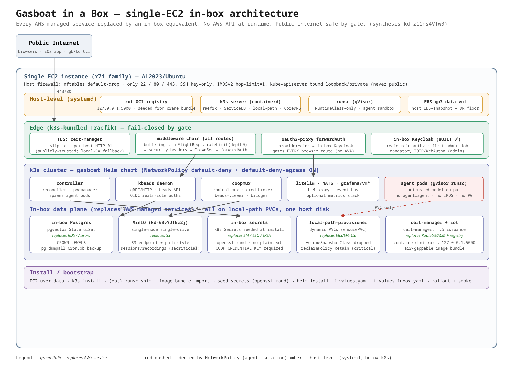

# Gardenio in a Box — Architecture Synthesis & Phased Build Plan

> **Keystone synthesis for mega-epic [ka-0000001295](https://beads-viewer.e2e.example.com/bead/ka-0000001295)**
> — *"Gardenio in a Box: single-EC2 full install, in-box kube, zero external cloud deps."*
> **Bead:** ka-0000000791 · **Operator:** Matt Baker (oidc:matthew.baker@acme.example)
> **Status:** hand-off from research → build. All 12 research children + the in-box Keycloak
> epic (ka-0000005376) are CLOSED. This doc fixes the chosen substitutions, sketches the
> values overlay, and files a phased, independently-shippable backlog.

This is a **synthesis of completed research**, not new research. Every substitution below
is drawn from a closed research child; each section links its source doc. The deliverables:

1. **§1 Architecture** — the in-box topology (diagram: `gardenio-in-a-box-architecture.png`,
   source `gardenio-in-a-box-architecture.svg`).
2. **§2 Substitutions** — the chosen in-box replacement for every external dependency.
3. **§3 Values overlay** — a `values-inbox.yaml` sketch that flips each dep to its in-box
   variant, off by default.
4. **§4 Phased backlog** — real epics/tasks filed under ka-0000001295, each phase
   independently shippable, each item referenced back to its source research doc.

---

## 1. Architecture



*Source: [`gardenio-in-a-box-architecture.svg`](gardenio-in-a-box-architecture.svg) (rendered PNG embedded per advice ka-0000000334).*

### 1.1 The shape in one paragraph

A single memory-optimized EC2 instance (`r7i` family — the workload is RAM-bound at 8 GiB/vCPU
because every agent pod reserves a hard 16 GiB) runs **k3s** as the in-box Kubernetes. k3s is
chosen because it is the only candidate that bundles *all four* reuse wins out of the box:
Traefik ingress, ServiceLB (real `type=LoadBalancer` with no cloud LB), local-path-provisioner
(dynamic PVCs), and CoreDNS — and its containerd config-template is a durable injection point
for the gVisor `runsc` handler. Below k3s, three host-level systemd concerns: a **zot OCI
registry** on `127.0.0.1:5000` (seeded from an offline image bundle), the **runsc shim**
(RuntimeClass-only, for agent sandboxing), and the **EBS data volume** (host-level snapshot is
the DR floor). The gardenio Helm chart installs on top with an **in-box values overlay** that
flips every AWS-coupled default to its in-box equivalent. The box is reachable only on
**22/80/443**; the kube-apiserver is bound to loopback/private and never public.

### 1.2 The five trust boundaries (threat model spine)

```
INTERNET → EDGE (Traefik/forwardauth) → CLUSTER (k3s services) → AGENT SANDBOX (gVisor) → NODE (host + control plane + IMDS)
```

The crown-jewel concern is a **malicious prompt / compromised agent escaping runsc and
pivoting** to the node, control plane, IMDS, or operator data. gVisor blocks the first hop;
the agent-egress NetworkPolicy (IMDS + RFC1918 + control-plane + cross-agent exclusions) blocks
hops 2–5; the gvisor-probe's no-listener + RBAC blocks hop 6. **The single most important fact:
the entire NetworkPolicy layer is OFF by default — the in-box profile must flip it ON.** Source:
[`inbox-public-internet-exposure-hardening.md`](research/inbox-public-internet-exposure-hardening.md).

### 1.3 Sizing (from the committed chart, not estimates)

| Scenario | Agents | Instance | vCPU/RAM | gp3 root |
|---|---|---|---|---|
| Demo / eval | 1–2 | `r7i.2xlarge` | 8 / 64 GiB | 150 GiB |
| Small team | 4–6 | `r7i.4xlarge` | 16 / 128 GiB | 250 GiB |
| Heavier | 8–12 | `r7i.8xlarge` | 32 / 256 GiB | 400 GiB |

`RAM_needed = 6 GiB (infra) + N × 16 GiB (agents)`, ÷ 0.82 for OS/kubelet/containerd headroom.
CPU is never the binding constraint. Source:
[`inbox-ec2-sizing-bootstrap.md`](research/inbox-ec2-sizing-bootstrap.md).

---

## 2. The chosen substitution for each external dependency

Each row is the decided in-box replacement, the code/chart surface it touches, and its source
research doc. The **guiding principle** across all axes: prefer a values-overlay flip over a
template/code rewrite; keep the AWS-POC path untouched; gate every in-box variant OFF by default.

| # | External dep | In-box substitute | Verdict | Source |
|---|---|---|---|---|
| A | **RDS / Aurora** (Postgres) | **In-cluster Postgres** (pgvector StatefulSet, already in chart) on local-path PVC | Already shipped; the in-box profile just doesn't point at external RDS. `pg_dumpall` CronJob is the only MUST-backup. | storage axis |
| B | **S3** (sessions/recordings) | **MinIO** single-node single-drive, in-cluster, local-path PVC | ~15 LoC across coop+controller (S3 endpoint + `force_path_style`), 1 chart Deployment. Impl epic **ka-0000004955**. | object-store axis |
| C | **Secrets Manager + ESO + IRSA** | **k8s Secrets seeded at install** (`openssl rand`); fail-fast on missing `COOP_CREDENTIAL_KEY` | No ESO/IRSA at runtime. Reuse `deploy-byo.sh` secret-seeding. Remove plaintext fallbacks. | secrets synthesis |
| D | **Route53 + ACM** (DNS+TLS) | **cert-manager + sslip.io + per-host HTTP-01** (default); local-CA fallback | Default yields *publicly-trusted* certs with zero DNS records / no domain. `tls.mode: perHost\|wildcard` switch. | DNS/TLS axis |
| E | **EBS/EFS CSI** (storage) | **local-path-provisioner** (k3s built-in default SC); drop VolumeSnapshotClass | Preserves dynamic `ensurePVC`. `reclaimPolicy: Retain` for critical stores. | storage axis |
| F | **AWS Verified Access** (edge-auth) | **in-box Keycloak + oauth2-proxy forwardAuth** (chart default) | AVA dropped *by omission*, not surgery. No daemon/chart code change. Keycloak BUILT (ka-0000005376). | AVA + SSO + ingress axes |
| G | **Private GitLab registry** | **in-box zot** on `127.0.0.1:5000` + containerd mirror, seeded from crane bundle | Air-gappable. Helm refs stay byte-identical; mirror rewrites every pull. 4 hard blockers (see §2.7). | image-distribution axis |
| H | **Karpenter / EKS autoscaling** | **single node, no autoscaling** | Nothing to build — the in-box composition simply omits the Karpenter NodePool path. | k8s-distro / sizing axes |

### 2.A RDS → in-box Postgres

The chart **already ships** an in-cluster pgvector StatefulSet; the AWS-POC path points it at
external Aurora via values. In-box, postgres is simply the in-cluster one on a local-path PVC.
It is the **one crown-jewels store**: kbeads beads DB + controller state + (under Path A)
Keycloak runtime users all live here. Backup is a single in-cluster **`pg_dumpall` CronJob**
(captures *all* DBs + roles in one shot) writing to a backup dir on the EBS data volume, plus
the host EBS-snapshot as the whole-box DR floor. NATS/coopmux/keycloak-runtime state is
re-derivable from postgres on restart, so postgres backup is mandatory and the rest is
nice-to-have. Source: [`inbox-storage-localpv.md`](research/inbox-storage-localpv.md) §5.

### 2.B S3 → MinIO

Coop (Rust) and the controller (Go) touch only **5 S3 verbs** (`PutObject`, `GetObject`,
`HeadObject`, `HeadBucket`, `ListObjectsV2`) — no multipart, versioning, KMS-SSE, copy, or
delete. MinIO implements all faithfully. The **real work is an integration gap, not a
compatibility one**: neither SDK exposes an endpoint + path-style override today, and
**`force_path_style` cannot be set from an env var in either the Rust or Go SDK — it must be
code** (aws-sdk-rust #1230). Net delta: ~8 lines in coop's `build_aws_client` (threaded into
the credential-thaw rebuild), one shared `newS3Client` helper in the controller called from 3
sites, one gated MinIO Deployment+Service+PVC+Secret, a bucket-bootstrap Job (`mc mb`), an ILM
expiry rule (replaces the AWS lifecycle rule), and `COOP_S3_ENDPOINT` wired into every pod spec
that sets `COOP_S3_BUCKET`. Session archives are **sacrificial** vs postgres for DR.
**Open decision:** MinIO server is **AGPL-v3** — flagged for legal; SeaweedFS (Apache-2.0) is
the documented fallback. This is the **MinIO impl epic ka-0000004955** (already parented under
the mega-epic; slotted into Phase 2). Source:
[`inbox-replace-s3-object-store.md`](research/inbox-replace-s3-object-store.md).

### 2.C SM / ESO / IRSA → in-box secrets

IRSA/web-identity and ESO disappear in-box. Secrets become **k8s Secrets seeded at install**
via `openssl rand` (the existing `scripts/deploy-byo.sh` `ensure_secret` pattern is idempotent
and already does the 3 core secrets). The in-box profile must **close the plaintext-fallback
foot-guns** the secrets synthesis identified: coop must **fail-fast (not warn) when
`COOP_CREDENTIAL_KEY` is unset** (T1), `buildCoopEnv` must allowlist (not inherit `os.Environ()`)
the child env (T2), and the chart's raw-K8s-Secret fallbacks for Slack/NATS/Claude-OAuth should
be removed or schema-gated (T16). MinIO root creds (axis B) are provisioned as an in-box k8s
secret surfaced as `AWS_ACCESS_KEY_ID`/`AWS_SECRET_ACCESS_KEY`. Source:
[`secrets-story-synthesis.md`](research/secrets-story-synthesis.md) §4 (T1, T2, T16).
*Note: the broad secrets-hardening backlog (T1–T16) belongs to its own epic ka-0000001193;
only the in-box-blocking subset is pulled into this plan.*

### 2.D Route53 + ACM → cert-manager + sslip.io + per-host HTTP-01

Two seams already exist in the chart with **no template rewrites**: the `gardenio.tls.secretName`
helper (every IngressRoute references TLS by name) and the `tls.yaml` gate that disables the
whole Route53/ACM/external-dns block when `existingSecretName` is set or `tls.dns.target` is
empty. Three modes, picked by what the operator provides:

- **DEFAULT — sslip.io + per-host HTTP-01.** Hostnames like `auth.<dashed-ip>.sslip.io` resolve
  via public sslip.io nameservers with **zero DNS records and no domain owned**; cert-manager
  issues **one publicly-trusted cert per subdomain** via HTTP-01 (LE wildcard ban → per-host).
  Eliminates trust-distribution pain entirely (browsers, iOS, CLI all trust it). Cost: ~8–10
  certs, a soft runtime dependency on sslip.io, public IP embedded in hostnames. **Pin an
  Elastic IP.**
- **OPTIONAL — operator real domain** (any registrar, not Route53): DNS-01 wildcard (smallest
  diff) or HTTP-01 per-host.
- **FALLBACK — self-signed local CA** (cert-manager SelfSigned→CA→leaf) for air-gapped boxes;
  cost is trust distribution (10y root, documented browser/iOS/CLI import runbook).

Add `tls.mode: perHost|wildcard` (default `wildcard` preserves today; overlay sets `perHost`).
Source: [`inbox-dns-tls-replace-route53-acm.md`](research/inbox-dns-tls-replace-route53-acm.md).

### 2.E EBS/EFS CSI → local-path-provisioner

k3s ships **local-path** as the default StorageClass — it is the only candidate preserving the
controller's runtime **dynamic provisioning** (`podmanager.ensurePVC` + the
`pre-upgrade-adopt-pvcs` hook hard-depend on it; raw hostPath fails PSA-baseline admission and
has no dynamic provisioning). The conversion is **one overlay file** — every PVC inherits
`global.storageClass` via `| default`, and the EBS `StorageClass`/`VolumeSnapshotClass` objects
already default `create:false`. Decisions baked in: **drop VolumeSnapshotClass** (local-path is
non-CSI; nothing creates/consumes a VolumeSnapshot — gVisor freeze/thaw uses node-local runsc
hostPath checkpoints), keep `coverage` disabled (it needs RWM, unsatisfiable on node-local
local-path), and **set `reclaimPolicy: Retain` for critical stores** (postgres/nats/keycloak)
so data survives `helm uninstall`. Capacity is advisory (no quota enforcement) — mitigate with
a generously-sized disk + disk-usage monitoring, or XFS `prjquota`. Source:
[`inbox-storage-localpv.md`](research/inbox-storage-localpv.md).

### 2.F AVA edge-auth → in-box Keycloak + oauth2-proxy forwardAuth

**Already substantially solved.** Two findings converge: (1) AVA is **not coupled** — it ships
dark (`edgeAuth.ava.trustSigner=""`), is opt-in, and the daemon HMAC trust boundary is
mode-agnostic, so dropping AVA is "don't instantiate the terraform module + leave the toggles at
defaults" — **no daemon or chart code change**. (2) The operator chose **Path A: in-box
Keycloak** (decision ka-0000001876) and the implementation epic **ka-0000005376 is CLOSED** —
in-box Keycloak bring-up, edge migration off GitLab-direct OIDC, first-admin bootstrap Job, and
MFA are all built. **Treat in-box Keycloak as a solved substrate.** The remaining in-box edge
work (axis F') is the **ingress hardening** that makes the box public-safe by gate, not by
omission:

- Disable **every** `*.avaIngress.enabled` (AVA carve-outs = unauth holes without AVA).
- `beads.ingress.skipForwardAuth=false`; `unifiedHost.forwardAuth.enabled=true` if used;
  `landing.public=false` — so forwardAuth gates **every** browser route.
- Flip `trustForwardHeader` off / Traefik `forwardedHeaders.trustedIPs` unset (direct exposure
  ⇒ `X-Forwarded-*` is spoofable); per-IP middlewares use RemoteAddr (depth 0).
- Add global **`inFlightReq`** (concurrency cap) + **`buffering`** (request-body cap)
  Middleware (neither exists in the chart yet), default-on for the in-box profile.
- Ship **CrowdSec** agent + Traefik bouncer (streaming, fail-open) as the WAF-lite layer
  (reject Coraza/CRS — too heavy for a small box).
- A chart-level test asserting every non-allowlisted IngressRoute carries forwardAuth.

Sources: [`replace-ava-edge-auth-in-box.md`](research/replace-ava-edge-auth-in-box.md),
[`sso-identity-gardenio-in-a-box.md`](research/sso-identity-gardenio-in-a-box.md),
[`gardenio-in-a-box-ingress-edge-access-control.md`](research/gardenio-in-a-box-ingress-edge-access-control.md).

### 2.G Private registry → in-box zot + containerd mirror

Images live in a private GitLab registry today; a single-box install must not need registry
creds at runtime. **Recommendation: in-box zot OCI registry on `127.0.0.1:5000` as a host
systemd unit** (reboot-safe, started before kubelet), seeded at release/install from a single
**crane OCI-layout bundle**, with a node-level **containerd registry mirror**
(`registries.yaml`/`hosts.toml`) + `k3s --disable-default-registry-endpoint`. Helm image refs
stay **byte-identical** to prod; the mirror rewrites every pull. **Why not repoint
`global.imageRegistry`:** the 3 hottest runtime refs bypass Helm — the agent image via
`COOP_IMAGE` env (`config.go:719`), init-clone alpine/git + DinD `docker:dind` are Go constants
(`manager.go:235,250`) — and the agent pod is hardcoded `PullAlways` (`manager.go:982`), so the
registry is a **hot path, not install-only**. **Four hard impl blockers:** (1) make agent pull
policy configurable; (2) add a `DIND_IMAGE` override (none today); (3) neutralize
`IMAGE_PULL_SECRETS` in single-box mode; (4) a `global.airgap` flag forcing `latestMode=false`
(latestMode bypasses digest pinning). Fallback (NOT air-gapped): pull-once-at-install with a
short-TTL `read_registry` deploy token. Source: research bead ka-0000005069 (doc
`docs/research/inbox-image-distribution.md`, MR !3846).

### 2.H Karpenter / EKS autoscaling → single node

No build. The chart's gVisor RuntimeClass path is decoupled from the Karpenter NodePool path
(`gvisor.nodePool.create=false` by default) — a pod runs on runsc purely by carrying
`runtimeClassName: runsc`. The in-box composition omits Karpenter entirely. Source:
[`inbox-ec2-sizing-bootstrap.md`](research/inbox-ec2-sizing-bootstrap.md) §4.

---

## 3. In-box values overlay sketch (`values-inbox.yaml`)

> **Implementation note (ka-0000007248):** this section sketched a *single*
> `values-inbox.yaml`, but the work landed as **two** overlays with
> complementary scopes — `gardenio/helm/gardenio/values-inbox.yaml` (storage +
> secrets) and `deploy-values/gardenio-inbox.yaml` (edge + in-box Keycloak).
> Layer both, in that order. The canonical layering order, the overlapping-key
> reconciliation, and the combined render test are documented in
> [`inbox-overlay-layering.md`](inbox-overlay-layering.md).

A single overlay file applied with `helm install -f values.yaml -f values-inbox.yaml`, **OFF by
default** (the base chart and the AWS-POC path are untouched). This is a *sketch* — the
authoritative values come from each axis's follow-up tasks; line references are to the chart at
synthesis time and must be re-verified before editing.

```yaml
# values-inbox.yaml — Gardenio in a Box public-safe single-EC2 profile.
# Apply: helm upgrade --install gardenio helm/gardenio -f values.yaml -f values-inbox.yaml
# Every block below flips an AWS-coupled default to its in-box variant.

global:
  inBox: true                      # marker — later axes branch on this one flag
  storageClass: "local-path"       # (E) EBS/EFS CSI -> k3s built-in local-path SC
  coverage:
    enabled: false                 # (E) RWM unbindable on node-local local-path
  # imageRegistry stays byte-identical to prod; containerd mirror rewrites pulls (G)
  airgap: true                     # (G) forces latestMode=false (digest-pinned), neutralizes IMAGE_PULL_SECRETS

# ---- (E) storage: local-path, no EBS objects, no CSI snapshots ----
storageClass:
  create: false                    # do not create the EBS StorageClass in-box
volumeSnapshotClass:
  create: false                    # local-path is non-CSI; VolumeSnapshot unsupported
agents:
  agentStorageClass: "local-path"  # runtime ensurePVC target (be explicit)
  pullPolicy: IfNotPresent         # (G) NEW knob — make agent pull policy configurable (was hardcoded PullAlways)

# ---- (A) postgres: in-cluster, the one MUST-backup store ----
postgres:
  enabled: true                    # in-cluster pgvector, NOT external RDS
backup:
  postgres:
    enabled: true                  # NEW pg_dumpall CronJob -> local backup PVC
    schedule: "17 */6 * * *"
    retentionDays: 7
    pvcSize: 5Gi
  nats:
    enabled: false                 # nice-to-have; flip on for zero event-loss

# ---- (B) object store: MinIO instead of S3 (impl epic ka-0000004955) ----
inBox:
  objectStore:
    enabled: true                  # gated MinIO Deployment+Service+PVC+Secret
    mode: single-node-single-drive
    pvcSize: 50Gi
    ilmExpireDays: 30              # replaces the AWS S3 lifecycle rule
coopS3:
  endpoint: "http://gardenio-minio.gardenio.svc:9000"   # wired into controller, beads-viewer, agent pods
  region: "us-east-1"             # cosmetic but required for SDK signing
  forcePathStyle: true            # MUST be honored in code (Rust+Go SDKs); env alone is insufficient

# ---- (C) secrets: in-box seeded k8s Secrets, no ESO/IRSA, no plaintext ----
externalSecrets:
  enabled: false                  # no ESO in-box; secrets seeded at install via openssl rand
coop:
  requireCredentialKey: true      # fail-fast if COOP_CREDENTIAL_KEY unset (T1) — no plaintext fallback

# ---- (D) DNS + TLS: cert-manager + sslip.io + per-host HTTP-01 ----
tls:
  enabled: true
  mode: perHost                   # NEW switch: perHost renders N HTTP-01 certs; wildcard = legacy
  domainName: "<dashed-ip>.sslip.io"   # or operator real domain; or local-CA host (air-gapped)
  issuer: "letsencrypt-http01"    # HTTP-01 ClusterIssuer (no DNS provider credential)
  # existingSecretName: ""        # set ONLY for the static-cert / local-CA fallback
  dns:
    target: ""                    # empty => external-dns / DNSEndpoint NOT rendered (drop Route53)

# ---- (F) identity: in-box Keycloak (BUILT, ka-0000005376) + forwardAuth on every route ----
keycloak:
  enabled: true
  runtime:
    enabled: true                 # in-cluster Keycloak StatefulSet (Path A)
  forwardAuth:
    enabled: true
    provider: oidc                # NOT gitlab — gate on in-box Keycloak issuer
edgeAuth:
  enabled: false                  # AVA shim off; daemon HMAC boundary is mode-agnostic
  ava:
    trustSigner: ""               # AVA branch unreachable (do NOT set non-empty)
beads:
  ingress:
    skipForwardAuth: false        # in-box: beads route MUST be auth-gated
    avaIngress:
      enabled: false              # AVA carve-out = unauth hole; disable everywhere
landing:
  public: false

# ---- (F') edge hardening: public-safe by gate, not omission ----
trustForwardHeader: false         # direct exposure => X-Forwarded-* spoofable
edge:
  inFlightReq:
    enabled: true
    amount: 50                    # NEW Middleware — concurrency cap (tune to box size)
  buffering:
    enabled: true
    maxRequestBodyBytes: 2000000  # NEW Middleware — request-body cap; raise per upload route
  crowdsec:
    enabled: true                 # WAF-lite agent + Traefik bouncer, streaming, fail-open
networkPolicies:
  enabled: true                   # (threat model F1) the single most important flip
  defaultDenyEgress: true         # (F2) makes every agent-escape hop fail closed
  traefik:                        # (F3) MUST set or all Traefik->service ingress is dropped
    namespaceSelector: { matchLabels: { "kubernetes.io/metadata.name": "kube-system" } }
    podSelector:       { matchLabels: { "app.kubernetes.io/name": "traefik" } }

# ---- gVisor: RuntimeClass-only agent sandbox; node-root probe stays off ----
gvisor:
  enabled: true
  runtimeClass:
    create: true
    scheduling: {}                # single node: drop the dedicated-pool nodeSelector/toleration
  nodePool:
    create: false                 # no Karpenter in-box (H)
  probe:
    create: false                 # node-root object; keep off unless freeze/thaw required
  freezeThaw:
    enabled: false
```

**Host-level (NOT chart values)** — set by user-data / install script, per the hardening +
distro + registry docs: nftables default-drop to 22/80/443; SSH key-only; IMDSv2 hop-limit=1;
k3s `--bind-address`/`--node-ip`/`--tls-san` (apiserver loopback/private + stable cert SANs);
`--disable-default-registry-endpoint` + containerd mirror → `127.0.0.1:5000`; runsc shim via
the containerd `config-v3.toml.tmpl` template; Elastic IP pin (for the sslip.io default).

---

## 4. Phased implementation backlog

Filed as **real epics/tasks parented under ka-0000001295**. Each phase is **independently
shippable** — the box gets more self-contained and more public-safe at every phase boundary,
and you can stop at any phase with a working (if less complete) artifact. Every item references
its source research doc. The existing MinIO impl epic **ka-0000004955** is slotted into
**Phase 2**.

**Phase epics (filed):**

| Phase | Epic | Title |
|---|---|---|
| 0 | **ka-0000007690** | bootstrap substrate (k3s + gVisor + scripted EC2 install) |
| 1 | **ka-0000007539** | storage & secrets self-containment (local-path, in-box secrets) |
| 2 | **ka-0000004955** | object store (S3 → MinIO) — *existing epic, slotted here* |
| 3 | **ka-0000005904** | public-internet edge hardening (fail-closed by gate) |
| 4 | **ka-0000007881** | air-gap image distribution (in-box zot registry) |
| 5 | **ka-0000006354** | capstone — documented one-shot install + acceptance |

Blocks: Phases 1/2/3/4 each `blocked-by` Phase 0; Phase 5 `blocked-by` Phases 1–4 + MinIO.

### Phase 0 — Bootstrap substrate (the box boots & installs)
*Goal: a fresh EC2 comes up running k3s with the chart installed via the BYO path. No public
safety yet, no in-box stores yet — just "it installs and runs."*

- **ka-0000003206 · P0.1 `scripts/bootstrap-ec2.sh` + `#cloud-config` user-data template**, parameterized by
  scenario (instance type / gp3 size). Reuses `scripts/deploy-byo.sh` for secret-seed + helm
  install + smoke. Source: `inbox-ec2-sizing-bootstrap.md` §5.
- **ka-0000002781 · P0.2 k3s pinning & durability:** `--node-ip`/`--tls-san`/`--bind-address`, SQLite/kine,
  `etcd-snapshot` cron. Source: `inbox-k8s-distro-choice.md` §"install sketch".
- **ka-0000002716 · P0.3 gVisor RuntimeClass-only mode** on single node: containerd `config-v3.toml.tmpl`
  injection (mind containerd 1.7 vs 2.x schema), `AdmissionConfiguration` runtimeClass exemption,
  pin runsc release. Source: `inbox-ec2-sizing-bootstrap.md` §4, `inbox-k8s-distro-choice.md` §4.

### Phase 1 — Storage & secrets self-containment (no EBS CSI, no ESO/IRSA)
*Goal: all state lives on local-path; all secrets are seeded in-box; no AWS storage/secrets API
at runtime. Shippable as "runs on local disk, no AWS data-plane."*

- **ka-0000000657 · P1.1 `values-inbox.yaml` overlay (storage half)** — `global.storageClass=local-path`,
  `agentStorageClass`, `storageClass.create=false`, `volumeSnapshotClass.create=false`,
  `coverage.enabled=false`. Source: `inbox-storage-localpv.md` §8.
- **ka-0000008198 · P1.2 `pg_dumpall` backup CronJob** (`templates/backup/postgres-cronjob.yaml`) + optional
  NATS backup; `reclaimPolicy: Retain` for critical stores; restore runbook. Source:
  `inbox-storage-localpv.md` §5/§8.
- **ka-0000002047 · P1.3 In-box secret seeding + plaintext foot-gun closure:** fail-fast on missing
  `COOP_CREDENTIAL_KEY` (T1), allowlist `buildCoopEnv` (T2), schema-gate raw-Secret fallbacks
  (T16). Source: `secrets-story-synthesis.md` §4.

### Phase 2 — Object store (S3 → MinIO)  ·  **includes existing epic ka-0000004955**
*Goal: coop/controller persist to in-box MinIO; no S3 at runtime. Shippable independently of
the edge work.*

- **P2.0 → existing epic ka-0000004955** (MinIO impl) — slotted here. Its children are the §8
  follow-ups: coop endpoint+path-style override, controller `newS3Client` helper, gated MinIO
  Deployment, `COOP_S3_ENDPOINT` wiring, bucket-bootstrap Job + ILM rule.
- **ka-0000006018 · P2.1 Legal decision: MinIO AGPL-v3 acceptability** (SeaweedFS Apache-2.0 fallback) — a real
  `type=decision` gate, not a placeholder task. Source: `inbox-replace-s3-object-store.md` §7/§8.

### Phase 3 — Public-internet edge hardening (fail-closed by gate)
*Goal: every browser route auth-gated; only 80/443/22 reachable; control plane off the internet;
WAF-lite + rate-limit + NetworkPolicy on. This is the HARD requirement (ka-0000000837).
In-box Keycloak (ka-0000005376) is the assumed substrate — already built.*

- **ka-0000006983 · P3.1 `values-inbox.yaml` overlay (edge half)** — disable all `avaIngress`,
  `skipForwardAuth=false`, `trustForwardHeader=false`, forwardAuth provider=oidc on every route.
  Source: `gardenio-in-a-box-ingress-edge-access-control.md` §8, `replace-ava-edge-auth-in-box.md` §4.
- **ka-0000006519 · P3.2 NEW Traefik Middleware: `inFlightReq` + `buffering`** (chart, gated `edge.*`,
  default-on in-box). Source: ingress doc §4.
- **ka-0000001941 · P3.3 CrowdSec WAF-lite** (agent + Traefik bouncer, streaming, fail-open). Source: ingress §5.
- **ka-0000005564 · P3.4 NetworkPolicy default-on** (`networkPolicies.enabled=true`, `defaultDenyEgress=true`,
  set `traefik.*`/`kubeDns.*` selectors for k3s). Source: ingress §7, hardening F1–F3.
- **ka-0000006978 · P3.5 Host-layer hardening:** nftables default-drop (k3s-aware — don't break FORWARD/CNI),
  SSH key-only + fail2ban (nft backend), apiserver loopback-bound, IMDSv2 hop-limit=1, gvisor
  probe off + pinned-by-digest. Source: `inbox-public-internet-exposure-hardening.md`.
- **ka-0000002443 · P3.6 cert-manager + sslip.io + per-host HTTP-01** (`tls.mode: perHost`, drop external-dns /
  DNS-01). Source: `inbox-dns-tls-replace-route53-acm.md` §3.1.
- **ka-0000005775 · P3.7 forwardAuth-coverage chart test** (regression guard — every rendered non-allowlisted
  IngressRoute carries forwardAuth). Source: ingress §G8.

### Phase 4 — Air-gap image distribution (no external registry pull)
*Goal: the box pulls zero images from any external registry at runtime. Shippable as the
"truly air-gappable" capstone.*

- **ka-0000003363 · P4.1 in-box zot registry** (host systemd unit, `127.0.0.1:5000`) + crane OCI-layout bundle
  build at release/install. Source: ka-0000005069 report.
- **ka-0000006135 · P4.2 containerd registry mirror** (`registries.yaml`/`hosts.toml`) +
  `--disable-default-registry-endpoint`. Source: same.
- **ka-0000007177 · P4.3 Close the 4 hard blockers:** configurable agent pull policy, `DIND_IMAGE` override,
  neutralize `IMAGE_PULL_SECRETS` in single-box mode, `global.airgap` flag forcing
  `latestMode=false`. Source: same.

### Phase 5 — Capstone: documented one-shot install + acceptance
*Goal: satisfy the mega-epic acceptance — "a documented, scripted install on a fresh single EC2
that brings up the full stack reachable over the instance's address, with no calls to any AWS
API at runtime; every public route auth-gated; only 80/443/+SSH reachable; k8s API not public."*

- **ka-0000002846 · P5.1 End-to-end install runbook** (`docs/gardenio-in-a-box-install.md`) tying P0–P4 together.
- **ka-0000005704 · P5.2 Acceptance smoke** — fresh-EC2 install, `https://<service>.<dashed-ip>.sslip.io`
  reachable with a publicly-trusted cert and no client trust import; assert no AWS API egress at
  runtime; assert apiserver not publicly reachable.
- **ka-0000006635 · P5.3 Threat-model sign-off** — verify the fail-closed checklist (hardening doc) holds on the
  built artifact.

### Dependency shape

```text
Phase 0 (substrate)
  └─> Phase 1 (storage+secrets) ──┐
  └─> Phase 2 (MinIO, ka-0000004955) ──┤
  └─> Phase 3 (edge hardening) ───────┤──> Phase 5 (capstone install + acceptance)
  └─> Phase 4 (air-gap registry) ─────┘
```

Phases 1–4 are mutually independent given Phase 0 — they can be built in parallel by separate
crew and each merges on its own. Phase 5 is the integration gate that depends on all of them.
Phase 3 assumes the (already-closed) Keycloak epic ka-0000005376 as a substrate.

---

## 5. Open decisions to surface to the operator

These are real forks the build will hit; none block filing the backlog, but each needs an
operator pick before the relevant phase ships:

1. **MinIO AGPL-v3** vs SeaweedFS (Apache-2.0) — Phase 2 (P2.1). License acceptability for the
   in-box distribution model.
2. **DNS basis** — accept the sslip.io soft runtime dependency for the turnkey default, or
   require a real domain from the start? — Phase 3 (P3.6).
3. **Elastic IP as a hard install prerequisite** — required for stable hostnames/certs on the
   sslip.io default. — Phase 0/3.
4. **gVisor default in-box** — recommend ON (agent sandboxing on a public box) RuntimeClass-only;
   confirm the runsc release pin + containerd-schema branch. — Phase 0 (P0.3).

---

## Appendix — Source research docs (all closed children of ka-0000001295)

| Axis | Doc | Bead |
|---|---|---|
| EC2 sizing + bootstrap | `research/inbox-ec2-sizing-bootstrap.md` | ka-0000003889 |
| k8s distro choice (k3s) | `research/inbox-k8s-distro-choice.md` | ka-0000000624 |
| S3 → MinIO | `research/inbox-replace-s3-object-store.md` | ka-0000004744 |
| EBS/EFS → local-path | `research/inbox-storage-localpv.md` | ka-0000005525 |
| Route53/ACM → cert-manager | `research/inbox-dns-tls-replace-route53-acm.md` | ka-0000004570 |
| ingress / edge access control | `research/gardenio-in-a-box-ingress-edge-access-control.md` | ka-0000002581 |
| SSO / identity | `research/sso-identity-gardenio-in-a-box.md` | ka-0000004895 |
| keycloak in-cluster from ECS | `research/keycloak-in-cluster-from-ecs.md` | (ref) |
| replace AVA edge-auth | `research/replace-ava-edge-auth-in-box.md` | ka-0000006758 |
| secrets story | `research/secrets-story-synthesis.md` | ka-0000004337 |
| public-exposure hardening | `research/inbox-public-internet-exposure-hardening.md` | ka-0000003100 |
| image distribution (registry) | `research/inbox-image-distribution.md` (MR !3846) | ka-0000005069 |
| constellation design | `research/inbox-constellation-design.md` | ka-0000001956 |

**Already-built substrate (do not re-design):** in-box Keycloak identity — epic **ka-0000005376**
(CLOSED), per operator decision ka-0000001876 (Path A).
**Existing impl epic slotted into Phase 2:** MinIO — **ka-0000004955**.
