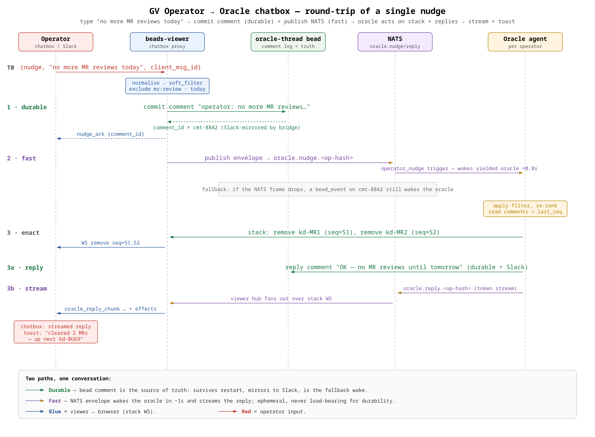

# GV Operator → Oracle Chatbox — PRD

**Status:** Draft (phase-1 research, no code).
**Origin:** [ka-0000000086](https://beads.gardenio.e2e.example.com/beads/ka-0000000086) under epic [ka-0000006841](https://beads.gardenio.e2e.example.com/beads/ka-0000006841) (Next-up / GV).
**Author:** `gardenio-gv-research-operator-jax`.
**Companion PRDs:** Oracle agent (ka-0000003894 · [`gv-oracle-prd.md`](./gv-oracle-prd.md)), Stack + WebSocket (ka-0000005517 · [`design/gv-stack/PRD.md`](./design/gv-stack/PRD.md)), UX card (ka-0000003264 · bundle ka-0000005278), Signals survey (ka-0000007686).

The **chatbox** is the persistent input that lives on the GV next-up view and lets one human operator *talk to the oracle* — reshape their stack, ask why an item is on top, snooze a kind of work, pause the oracle, and drop or promote specific beads. This PRD owns three things the sibling PRDs deliberately deferred to it:

1. **The intent vocabulary** — what the operator can say, and how each utterance normalises into the **nudge envelope** the Oracle PRD §9 consumes.
2. **The round-trip protocol** — how a chatbox message reaches the oracle and how a reply comes back, reconciling the two sibling PRDs that disagree on transport.
3. **History, explainability, and authority** — where the conversation is persisted, what "why is this on top?" returns, and when a nudge becomes a durable preference versus a session-scoped hint.

It consumes as fixed contracts: the oracle's nudge-envelope shape and `why` blob (Oracle PRD §6, §9), the stack write API and WS transport (Stack PRD §8), and the chatbox UX shape — layout, slash/chip/free-text split, streaming, conflict rules (UX PRD §8). It authors **no code, no DB migrations, no new gRPC services** — it recommends contracts the build phase implements.

---

## 1. Goals and non-goals

### 1.1 Goals

- Give the operator a **single, always-available** way to reshape their stack in natural language without leaving the one-card view.
- Make every common nudge reachable in **≤ 1 interaction** (a chip tap or a slash command) and every uncommon one reachable in **free text**.
- Guarantee **durability**: a nudge the operator typed is never lost to a dropped socket or a restarting oracle pod. The conversation survives compaction, reconnect, and pod death.
- Make the round-trip **explainable and auditable**: every nudge and every oracle reply is a durable, timestamped record the operator (and we) can read back.
- **Unify** the web chatbox and Slack: the same operator↔oracle conversation is reachable from the GV view *and* from a Slack thread, riding the bridge that already exists — no second conversation store.
- Keep the operator in control of **authority**: a nudge is session-scoped by default; making it a standing preference ("never show me MR reviews on weekends") is an explicit, reversible act.

### 1.2 Non-goals

- **Not** the oracle's ranking logic, weights, or signal catalogue — Oracle PRD §7 and Signals survey (ka-0000007686) own those. This PRD only specifies how a nudge *modifies* ranking inputs (soft filters, snoozes, pins), not how the oracle scores.
- **Not** the stack data model or WS frame schema — Stack PRD §4, §8 own those. This PRD adds two message types to the existing envelope; it does not redesign it.
- **Not** the card layout, chip placement, keyboard map, or streaming-render mechanics — UX PRD §8 owns the surface. This PRD owns what the chips and commands *mean*.
- **Not** an LLM natural-language-understanding engine. v1 free-text parsing is a small deterministic dictionary; LLM interpretation is a named v2 candidate behind a flag (§5.4).

### 1.3 Quality bar for phase-2

A phase-2 chatbox build is "done" when, for a logged-in operator on the GV route:

1. Typing `/pause` and pressing enter pauses the oracle and shows a confirmation **within 1 s**; the status pip flips to paused.
2. Typing `why?` returns the current top item's rank explanation — the literal `explain` string plus the signal/weight breakdown — **within 2 s**, rendered inline.
3. `no more MR reviews today` removes MR-review items from the stack and the operator sees both an inline reply and a toast over the card **within 2 s**; the filter auto-expires at local midnight.
4. Killing the oracle pod mid-conversation and restarting it loses **zero** operator messages — the restarted oracle reads the unhandled nudges from the thread bead and acts on them.
5. The same conversation, viewed in the operator's Slack thread, shows every web-typed nudge and every oracle reply **in order** — and a nudge *typed in Slack* takes effect in the GV view.

---

## 2. The chatbox in one picture

```
        ┌──────────────────────────────────────┐        ┌───────────────────────┐
        │  Operator (browser, GV next-up view) │        │  Operator (Slack)     │
        │  chatbox: free text / slash / chips  │        │  oracle DM/thread     │
        └───────────────┬──────────────────────┘        └───────────┬───────────┘
                        │ nudge (over stack WS)                      │ message
                        ▼                                            ▼
   ┌───────────────────────────────────────────┐          ┌────────────────────┐
   │  beads-viewer  — chatbox proxy             │          │  slack-bridge      │
   │  1. normalise text → nudge envelope        │          │  (existing)        │
   │  2. append comment on oracle-thread bead ──┼──────────┼──► forwards both   │
   │  3. publish envelope to NATS nudge subject │          │    ways (advice    │
   └──────────────┬───────────────┬─────────────┘          │    ka-0000000409)  │
                  │ (durable)     │ (fast path)             └─────────┬──────────┘
                  ▼               ▼                                   │
        ┌───────────────────┐   ┌──────────────────────────┐         │
        │ oracle-thread     │   │ NATS: oracle.nudge.<op>   │         │
        │ bead (comment log │   │   → fires operator_nudge  │         │
        │  = source of truth│   │     synthetic trigger     │         │
        │  + Slack proxy)   │   └────────────┬─────────────┘         │
        └─────────▲─────────┘                ▼                        │
                  │ reply comment    ┌─────────────────────────┐      │
                  └──────────────────┤  Oracle agent           │◄─────┘
                     reply on NATS   │  (per operator)         │  bead_event fallback
                     oracle.reply.<op>│  parse envelope → act  │  wake
                                     │  → stack ops + reply    │
                                     └─────────────────────────┘
```

The one-sentence model: **the operator's message is committed as a comment on a durable per-operator oracle-thread bead (the source of truth), and simultaneously fast-pathed to the oracle over NATS; the oracle acts on the stack and replies the same two ways — durable comment + fast NATS frame the viewer streams into the chatbox.**

---

## 3. Round-trip protocol

This is the section the sibling PRDs handed to us, and they handed it in a state of *disagreement* we must resolve.

### 3.1 The cross-PRD tension

| PRD | What it assumed about the chatbox transport |
|---|---|
| **Oracle PRD** (§8.3, §9) | Chatbox posts a **nudge envelope to a per-operator NATS subject**; a synthetic `operator_nudge` trigger wakes the oracle within ~1 s; the oracle replies on a **response NATS subject**. Fast, but says nothing about durability. |
| **Stack PRD** (§2 non-goals) | "The chatbox **rides bead comments / mention syntax, not the stack WS**." Durable and uniform (reuses the beads event bus + Slack bridge), but bead-comment latency is not sub-second and it adds a second inbound path the operator never sees. |
| **UX PRD** (§8.1, §8.3) | Chatbox and stack **share a single WS connection**; replies **stream token-by-token**; last-20 scrollback persists on a "per-operator oracle thread bead — ka-0000000086 to spec." |

The three are not actually in conflict about *what* they want — they want durable, low-latency, Slack-unified, streamable. They conflict only on *which single mechanism* delivers it. The resolution is to stop treating it as one mechanism.

### 3.2 Decision: durable source-of-truth + fast accelerator

**The oracle-thread bead's comment log is the authoritative conversation. NATS (and the WS) are a low-latency delivery accelerator layered on top. If the accelerator drops a frame, the comment still lands and a fallback trigger still wakes the oracle. Nothing is ever lost.**

Concretely, a chatbox submit does **both** of these, in this order, inside the beads-viewer nudge handler:

1. **Commit** the operator's message as a **comment on the per-operator oracle-thread bead** (§4). This is synchronous and must succeed before the UI acknowledges the send. It gives us: durability, the Slack proxy for free (comment-forward bridge, advice ka-0000000409), an audit trail, and a **fallback wake** — a `bead_event` trigger on the thread bead fires the oracle even if NATS delivery hiccups (Oracle PRD §8.1 already matches on this operator's beads).
2. **Publish** the normalised nudge envelope to the per-operator NATS subject `oracle.nudge.<op-hash>` (Oracle PRD §8.3). This fires the `operator_nudge` synthetic trigger and wakes a yielded oracle in **~1 s** — the fast path.

The oracle replies symmetrically:

1. **Comment** its reply on the same oracle-thread bead (durable + auto-Slack).
2. **Publish** the reply to `oracle.reply.<op-hash>`; beads-viewer's hub fans it out over the **existing stack WS** to the chatbox for inline streaming.

This reconciles all three siblings: the Stack PRD gets its bead-comment durability and Slack uniformity; the Oracle PRD gets its sub-second NATS round-trip; the UX PRD gets its single-WS streaming render. The one place we override a sibling is the Stack PRD's "*not* the stack WS": reply frames ride the already-open, already-authed stack WS as a distinct message type rather than opening a second socket. Justification in §3.4.

### 3.3 Why not each single mechanism alone

- **Comments only** (Stack PRD's literal proposal): correct for durability and Slack, but a bead-comment write → NATS `beads.>` → trigger-engine debounce round-trip is multi-second, and the trigger engine intentionally throttles/debounces bead events (Oracle PRD §8.1 uses `throttle:5s, debounce:2s`). The operator typing `/pause` should not wait 5 s. So comments are the *floor*, not the whole floor-to-ceiling.
- **NATS envelope only** (Oracle PRD's literal proposal): sub-second, but ephemeral. A dropped subject message or an oracle that is between pods loses the nudge with no record. Unacceptable for "clear my stack" or "add ka-XXX to the front."
- **A new dedicated chatbox WS**: redundant. The GV view already holds one authed WS to the viewer for the stack (Stack PRD §8). A second socket doubles connection state, heartbeats, and auth surface for no gain.

### 3.4 Transport of the fast path — reuse the stack WS

The chatbox needs a bidirectional, low-latency browser channel. The stack WS is already open, already carries the operator identity (Stack PRD §8.2 auth handshake), and already has a heartbeat, reconnect, and replay story. We add two message types to the existing envelope (Stack PRD §8.3), keeping them namespaced so they never collide with stack ops:

**Client → server (new):**
```jsonc
{ "type": "nudge", "data": { "text": "no more MR reviews today", "client_msg_id": "c-01HQ..." } }
```

`client_msg_id` is a client-generated idempotency key so a reconnect-retried send does not double-post the comment.

**Server → client (new):**
```jsonc
// streamed reply chunks (token-by-token; UX PRD §8.3 requires streaming)
{ "type": "oracle_reply_chunk", "data": { "reply_id": "r-01HQ...", "seq": 3, "text": "…no MR reviews until", "done": false } }
{ "type": "oracle_reply_chunk", "data": { "reply_id": "r-01HQ...", "seq": 4, "text": " tomorrow.", "done": true, "effects": [ /* see §3.6 */ ] } }

// the operator's own message, echoed back with its committed comment id (so the UI reconciles the optimistic bubble)
{ "type": "nudge_ack", "data": { "client_msg_id": "c-01HQ...", "comment_id": "cmt-8842", "committed_at": "2026-05-15T16:42:11Z" } }
```

The stack-mutation frames the reply causes (`remove`, `push_front`, …) still flow over the **same WS as ordinary stack ops** with their own `seq` (Stack PRD §8.3.1) — the chatbox does not re-implement stack rendering; it just also shows a toast (§3.6). This is why reusing the socket is not merely convenient but *correct*: the reply and the stack change it triggers must arrive on one ordered channel, or the UI can render "snoozed ka-YYY" before the `remove` that enacts it.

> **Open question for the Stack PRD author (§10 Q1):** we are adding `nudge` / `oracle_reply_chunk` / `nudge_ack` to the stack WS envelope, overriding your §2 "not the stack WS." If you prefer to keep the stack WS pure, the fallback is a sibling SSE stream `GET /api/v1/oracle/replies` + `POST /api/v1/oracle/nudge` — same envelope, one extra connection. We recommend the shared socket; you own the final call.

### 3.5 Normalisation — where text becomes an envelope

The **beads-viewer chatbox proxy** normalises, not the oracle. This keeps the oracle's prompt simple (it receives a typed envelope, per Oracle PRD §9) and keeps parsing testable in Go. The proxy runs this pipeline on each submit:

1. **Slash command?** If the text starts with `/`, match against the deterministic slash grammar (§5.2). A match produces a fully-typed envelope (`hard_command`, `soft_filter`, `explain_request`, or `add_to_stack`) with no ambiguity. An unknown slash command returns a client-side "unknown command" hint and does *not* round-trip.
2. **Chip?** Chips are pre-baked slash commands (§5.3); they arrive already as `/…` text and take the same path.
3. **Free text.** Anything else becomes `kind: "free_text"` with the raw string. The proxy attaches a **best-effort local classification** (the v1 dictionary, §5.4) as a hint, but leaves the final interpretation to the oracle so a future LLM upgrade needs no viewer change.
4. **Typed-mention extraction.** Regardless of kind, the proxy scans the text for bead ids (`kd-[A-Za-z0-9]+`) using the typed-mention lexer (advice ka-0000007977) and attaches them as `referenced_beads` so `add ka-XXX to the front` and `why is ka-YYY on top?` resolve deterministically even inside free text.

The resulting envelope is the Oracle PRD §9 shape, extended with the two provenance fields the round-trip needs:

```jsonc
{
  "operator_id": "slack:U12345",
  "received_at": "2026-05-15T16:42:11Z",
  "thread_bead": "ka-OTHREAD1",          // the oracle-thread bead (§4)
  "comment_id": "cmt-8842",              // the durable comment this envelope mirrors
  "client_msg_id": "c-01HQ...",          // idempotency key
  "kind": "soft_filter",                 // Oracle PRD §9 kinds, unchanged
  "referenced_beads": ["ka-YYY"],        // extracted bead ids (may be empty)
  "payload": { /* per-kind, Oracle PRD §9 */ }
}
```

### 3.6 Reply effects — closing the loop on the card

An oracle reply's final chunk carries an `effects` array so the chatbox can render a **toast over the card** (UX PRD §8.3: "Replies that change the stack also produce a tiny toast") without waiting to correlate the separate stack `remove`/`push_front` frames:

```jsonc
"effects": [
  { "kind": "removed",     "bead_id": "ka-MR1", "reason": "soft filter: no MR reviews today" },
  { "kind": "removed",     "bead_id": "ka-MR2", "reason": "soft filter: no MR reviews today" },
  { "kind": "filter_added","filter": "no_mr_reviews_today", "scope": "today", "expires_at": "2026-05-16T00:00:00-07:00" }
]
```

`effects` is advisory/UX-only; the authoritative stack change is still the `seq`-carrying stack frame. If they disagree (a race), the stack frame wins and the toast is best-effort.

---

## 4. History and persistence — the oracle-thread bead

The UX PRD names a "per-operator oracle thread bead — ka-0000000086 to spec." Here is the spec.

### 4.1 One bead per operator, comment log is the conversation

- A single **`type=oracle-thread`, `kind=config`** bead per operator, created **lazily** on the operator's first nudge (or on oracle bootstrap). Title: `"Oracle conversation — <operator-id>"`. Labels: `project:gardenio`, `role:oracle`, `operator:<slug>`.
- Its **comment log is the entire conversation history** — operator messages and oracle replies interleaved, each a normal bead comment with `created_by` distinguishing operator (`operated_by=<operator-id>`) from oracle (`created_by=<oracle-agent-id>`). No separate log table; comments are already timestamped, ordered, durable, and paginated by the daemon.
- Fields on the bead carry the live conversation state so any restarted oracle reconstructs context from `gb prime` + a comment read:

```yaml
type: oracle-thread
kind: config
title: "Oracle conversation — slack:U12345"
labels: [project:gardenio, role:oracle, operator:slack-U12345]
fields:
  operator_id:          "slack:U12345"
  oracle_agent:         "gardenio-oracle-slack-U12345"   # the oracle that owns replies
  slack_thread_channel: "C0AHE7C0E1G"                    # set once the Slack side is bound (§6)
  slack_thread_ts:      "1786179759.892409"
  last_operator_seq:    "8842"                            # highest operator comment id handled
  last_reply_seq:       "8843"                            # highest oracle reply comment id
  soft_filters:         "[]"                              # mirror of active session/today filters (authoritative copy on the schedule bead)
```

### 4.2 Why a dedicated bead, not the oracle schedule bead

The Oracle PRD keeps oracle *state* (soft filters, target_n, paused) on the oracle's **schedule bead** (§3.1). We keep the *conversation* on a **separate** oracle-thread bead. Reasons:

- Comments on the schedule bead would interleave operator chat with trigger-fire audit noise — unreadable in Slack and in `kd show`.
- The thread bead can carry `slack_thread_channel`/`slack_thread_ts` and become a first-class Slack-thread-bound bead (advice ka-0000004818) without entangling the schedule.
- Lifecycle differs: the schedule bead is the oracle's *definition* (permanent, operator-scoped); the thread bead is the *conversation* (also permanent, but archivable/rotatable independently if a thread gets long).

The two are linked: the thread bead's `oracle_agent` field points at the oracle, and the schedule bead's `soft_filters` remain authoritative (the thread bead mirrors them only for display).

### 4.3 Scrollback and pagination

- The chatbox shows the **last 20 messages** on load (UX PRD §8.1), fetched via `kd comment list <thread-bead> --limit 20 --newest`.
- Older history is fetched on demand (scroll-up) by paging the comment log — the daemon already paginates comments.
- **Persistence is unconditional.** There is no "ephemeral session" mode; even a session-scoped *filter* leaves a durable record of the *request* in the comment log, because the operator asked for it and should be able to see they did.

### 4.4 Retention

The conversation is durable indefinitely by default (comments are cheap text). If a thread bead's comment count crosses an operational threshold (proposed: 5,000), a follow-up sweep may archive-and-rotate it — out of scope for v1, named as a follow-up (§10 Q6).

---

## 5. Intent vocabulary — first cut

This is the heart of the deliverable: **what the operator can say.** Three surfaces, one normalised set of intents.

### 5.1 The three surfaces (surface vs deep)

| Surface | For | Latency to author | Determinism |
|---|---|---|---|
| **Quick chips** | The 3–4 most common nudges, one tap. | 1 tap. | Fully deterministic (each chip is a canned slash command). |
| **Slash commands** | Common, named intents the operator wants to type fast and predictably. | A few keystrokes + tab-complete. | Fully deterministic (fixed grammar). |
| **Free text** | Everything else; anything the operator would rather say than remember a command for. | Natural typing. | Oracle-interpreted (dictionary v1 → LLM v2). |

**Decision.** Slash and chips are the **surface** commands: deterministic, no interpretation, no round-trip surprise. Free text is the **deep** command: expressive, oracle-interpreted, always with a confirming reply so the operator sees how it was understood. The two are not exclusive — a chip is just a pre-typed slash command, and a slash command that fails to parse degrades to a free-text hint rather than an error.

### 5.2 Slash command grammar (deterministic)

Each row is a fixed command the beads-viewer proxy parses without the oracle. `<dur>` ∈ `{1h, 3h, today, tomorrow, mon…sun, Nm, Nh}`. `<kind>` ∈ a small closed set of work-kinds (§5.5).

| Command | Envelope kind | Payload | Meaning |
|---|---|---|---|
| `/why` | `explain_request` | `{item_id: <current top>}` | Explain why the current top item is on top. |
| `/why ka-XXX` | `explain_request` | `{item_id: ka-XXX}` | Explain a specific item's rank. |
| `/pause` | `hard_command` | `{command: "pause"}` | Oracle stops pushing until resumed. |
| `/resume` (`/unpause`) | `hard_command` | `{command: "unpause"}` | Resume pushing; re-rank + refill. |
| `/clear` | `hard_command` | `{command: "clear"}` | Drop everything from the stack. (Confirm chip; §7.3.) |
| `/show N` | `hard_command` | `{command: "show_n", args:{n:N}}` | Set stack depth to N. |
| `/snooze <dur>` | `soft_filter` | `{filter:"snooze_top", item_id:<top>, scope:<dur>}` | Hide the current item for `<dur>`; re-push when it expires. |
| `/snooze ka-XXX <dur>` | `soft_filter` | `{filter:"snooze_item", item_id:ka-XXX, scope:<dur>}` | Snooze a specific item. |
| `/snooze <kind> <dur>` | `soft_filter` | `{filter:"snooze_kind", kind:<kind>, scope:<dur>}` | "No more `<kind>` for `<dur>`." |
| `/only <kind>` | `soft_filter` | `{filter:"only_kind", kind:<kind>, scope:"session"}` | Show only this kind of work. |
| `/no <kind>` | `soft_filter` | `{filter:"exclude_kind", kind:<kind>, scope:"today"}` | Suppress this kind of work. |
| `/priority <P>` (`/high`) | `soft_filter` | `{filter:"min_priority", value:P, scope:"session"}` | Only items at priority ≤ P. |
| `/add ka-XXX [front\|back]` | `add_to_stack` | `{bead_id:ka-XXX, position:"front"}` | Put a bead on the stack (front default). |
| `/pin ka-XXX` `/unpin ka-XXX` | `hard_command` | `{command:"pin"\|"unpin", item_id:ka-XXX}` | Lock/unlock an item's position (Stack PRD §4.2 pin). |
| `/prefs` | `explain_request` | `{subject:"preferences"}` | List active filters + permanent preferences. |
| `/forget <filter-id>` | `hard_command` | `{command:"forget_filter", args:{id}}` | Remove an active filter or permanent preference. |
| `/oracle status` | `explain_request` | `{subject:"oracle_status"}` | Health, paused?, last re-rank, stack depth. |
| `/help` | *(client-side)* | — | Render the command cheat-sheet; no round-trip. |

Slash commands **tab-complete from a server-fetched list** (UX PRD §8.2), so the operator never has to memorise the table.

### 5.3 Quick chips (surface, oracle-learned)

Chips are canned slash commands rendered above the input. Defaults (UX PRD §8.2): `why this?` → `/why`, `snooze 1h` → `/snooze 1h`, `bugs only` → `/only bug`, `pause oracle` → `/pause`. The oracle may **learn** and re-order chips per operator (most-used first) — the learning lives oracle-side; the chatbox just renders the current chip set the oracle advertises on the thread bead (`fields.chips`). Empty-state offers a distinct chip set (UX PRD §9.1: `/triage`, `/random open`, `/quiet mode`).

### 5.4 Free text (deep, oracle-interpreted)

Everything without a leading `/` is `free_text`. The proxy attaches a best-effort local classification but the oracle decides. Interpretation ladder:

- **v1 — deterministic dictionary.** A small phrase-map in the oracle (and mirrored in the proxy as a hint) covers the high-frequency utterances the epic named:

  | Operator says | Interpreted as |
  |---|---|
  | "give me only bugs" / "just bugs" | `/only bug` |
  | "no more MR reviews today" / "stop showing me MRs" | `/no mr-review` (scope today) |
  | "why is this on top?" / "why this?" | `/why` |
  | "snooze this for an hour" | `/snooze 1h` |
  | "high-priority only" / "only urgent stuff" | `/priority P1` |
  | "add ka-ABC to the front" / "put ka-ABC on top" | `/add ka-ABC front` |
  | "clear my stack" / "start over" | `/clear` |
  | "pause the oracle" / "stop pushing" | `/pause` |
  | "quiet for the rest of the day" | `quiet_mode` (scope today) |

- **v2 — LLM interpretation** behind a flag. The oracle passes unmatched free text + the current stack + the filter set to an LLM that returns a typed envelope with a confidence score. Below a threshold, the oracle asks a clarifying question rather than guessing (§5.6).
- **Always confirm.** Free text **always** produces a reply that restates the interpretation ("OK — hiding MR reviews until tomorrow.") so a misread is visible and correctable, never silent.

### 5.5 The work-kind vocabulary

`<kind>` is a small **closed** set so `/only`, `/no`, `/snooze <kind>` are unambiguous. First cut, drawn from the signal categories in the Oracle PRD §7.1 and the Signals survey (ka-0000007686):

`bug` · `decision` · `escalation` · `mr-review` · `mr-merge` · `stale-crew` · `mention` · `cycle-wrapup` · `unassigned-bug` · `epic`.

Free text maps synonyms onto these ("MRs"→`mr-review`+`mr-merge`, "wrap-ups"/"cycle stuff"→`cycle-wrapup`, "my kids"→`stale-crew`). The closed set is the contract the oracle's soft-filter logic keys on; adding a kind is a coordinated change across this PRD, the Oracle PRD §7.1, and the survey.

### 5.6 Unparseable input

If free text matches nothing and v2 is off (or low-confidence), the oracle replies with a bounded clarifier, never a silent no-op (Oracle PRD §13):

> "I didn't quite get that. Try: `bugs only` · `no MR reviews today` · `why?` · `snooze 1h` · `pause`. Or type `/help`."

---

## 6. The Slack-thread proxy — one conversation, two front-ends

The task asks explicitly: *could the chatbox proxy a Slack thread?* **Yes — and it should, for free, via the oracle-thread bead.**

Because the oracle-thread bead (§4) carries `slack_thread_channel`/`slack_thread_ts`, it is a first-class Slack-thread-bound bead (advice ka-0000004818). The existing comment-forward bridge (advice ka-0000000409) already mirrors **every bead comment to the bound Slack thread** and forwards Slack replies back as comments. So with zero new bridge code:

- Every web-chatbox nudge (a comment) appears in the operator's Slack oracle thread.
- Every oracle reply (a comment) appears there too.
- A message the operator types **in the Slack thread** arrives as a comment on the thread bead → fires the same `bead_event` fallback wake → the oracle handles it exactly like a web nudge.

The only asymmetry: the **fast NATS path (§3.2) is web-only**. A Slack-originated nudge takes the durable comment path (a few seconds via the bridge + trigger debounce) rather than the ~1 s NATS path. That is acceptable — Slack is already an asynchronous surface and the operator does not expect keystroke-latency there.

**Decision.** The GV chatbox and the Slack oracle thread are two front-ends over **one** conversation (the thread bead's comment log). We do not build a Slack-specific oracle protocol; we reuse the bridge. This directly answers the epic's open question "how does the chatbox round-trip with the oracle — bead comments, mention syntax, a new endpoint?": **bead comments are the durable substrate; a new endpoint (NATS subject) is the web accelerator; mentions are used only for bead-id extraction inside text, not as the transport.**

### 6.1 How today's operator↔agent plumbing informs this

The task names three existing mechanisms; here is how each maps:

| Existing mechanism | Role in the chatbox design |
|---|---|
| `gb squawk` | The oracle's **broadcast** narration ("Pushed ka-AAA to front…", Oracle PRD §12.2) — *not* the chatbox reply channel. Squawks are one-way and go to the project channel; chatbox replies are conversational and go to the thread. |
| `gb mail send` | Agent-to-agent, hook-delivered. **Not** used for the operator round-trip (the operator is a human, not an agent inbox). Its `--interrupt` immediate-nudge idea *is* the conceptual ancestor of our `operator_nudge` fast trigger. |
| `gb decision` / `gb yield` | The right tool when the oracle needs the operator to **choose** between divergent actions — but that is a *blocking* fork, not a chatbox nudge. The chatbox is the operator *driving* the oracle; a decision is the oracle *blocking on* the operator. They coexist: a decision assigned to the operator is itself a high-rank stack item (Oracle PRD §7.1) the operator resolves from the card, not via chatbox. |

So the chatbox is a **new, conversational** channel that sits alongside these — modelled on the Slack-thread reply affordance (`gb slack reply`), persisted like a bead comment thread, accelerated like an interrupt-mail.

---

## 7. Oracle replies, explainability, and authority

### 7.1 Where replies render

Per UX PRD §8.3, replies render **inline in the chatbox scroll** (primary), **stream token-by-token**, and **also raise a toast over the card** when they change the stack (§3.6 `effects`). Long replies collapse to a one-liner + expander. This PRD adds only the *content* contract for two reply shapes: explanations (§7.2) and confirmations (§7.4).

### 7.2 Explainability — "why is this on top?"

When the operator asks `/why` (or `/why ka-XXX`), the oracle returns the item's **`why` blob** verbatim (Oracle PRD §6). The chatbox renders it as a compact explanation:

- **Headline:** the literal `explain` string ("P0 decision (ka-DEC1) raised 14 min ago by your crew ka-AAA. You're the only operator who can resolve it. Pushed to front.").
- **Breakdown (expandable):** the `signals[]` array as a small table — signal name, value, weight, contribution — and the total `rank_score`. This is the "cite signals + weights" the task requires.

```text
why is ka-ESC1 on top?
────────────────────────────────────────────
P1 escalation to you, raised 47 min ago. No other
operator is on it. Score 214 — the age penalty pushed
it past your P0 decision (203).

  ▸ show the math
     decision_priority   P1     ×30.0 →  120.0 (base)
     age (47 min)        1.78×          →  +94.0
     no_other_resolver   true   ×4.3  →    +4.3
     ───────────────────────────────────
     rank_score                          214.3
```

The blob is deterministic (Oracle PRD §6 guarantees every pushed item carries it), so `/why` never triggers a fresh ranking computation — it reads what the oracle already recorded. If the item is no longer on the stack (operator asks about a bead the oracle dropped), the oracle replies with the last-known blob plus "(no longer on your stack — dropped 3 min ago because it was closed)."

### 7.3 Confirmations and destructive-command guards

- Every stack-changing nudge gets a **confirming reply** stating the effect and its scope: "OK — no MR reviews until tomorrow (expires 12:00 AM)." Non-destructive nudges apply immediately; the reply is the receipt.
- **Destructive** commands — `/clear`, `/forget <permanent-pref>` — require a **one-tap confirm chip** in the chatbox before round-tripping (UX PRD footer chip-row pattern), because "clear my stack" and an accidental "start over" are easy to fire and expensive to undo. The confirm is client-side; the nudge is not sent until confirmed.

### 7.4 Authority — session-scoped vs persistent preference

This is the task's sharpest question: *does an operator nudge become a persistent preference or session-scoped?* The answer is **scoped, with an explicit ladder**, mirroring Oracle PRD §9.3:

| Scope | Lifetime | Where it lives | Default for |
|---|---|---|---|
| `session` | Until the GV route reloads / socket closes | oracle schedule bead `soft_filters` (ephemeral entry) | `/only`, `/priority` |
| `<duration>` (`1h`, `3h`) | Explicit expiry timestamp | schedule bead `soft_filters[].expires_at` | `/snooze 1h` |
| `today` | Until local midnight | schedule bead `soft_filters[].expires_at = EOD` | `/no <kind>`, "no MR reviews today" |
| `permanent` | Until the operator removes it | **`type=operator-preference` bead** (queryable across surfaces) | never a *default* — always explicit (§7.5) |

**Decision.** A nudge is **never silently permanent.** The default scope per intent is session/today (above). Making a preference standing ("never show me MR reviews on weekends") requires an **explicit permanent scope** — either `/no mr-review permanent`, or the confirming reply for a `today`-scoped filter offers a chip: *"Make this permanent?"*. Only then does the oracle write a `type=operator-preference` bead. This keeps the operator from accidentally training the oracle into a corner they can't see.

### 7.5 Permanent preferences — the `operator-preference` bead

- A `type=operator-preference`, `kind=config` bead per standing rule: `{operator_id, predicate, action, schedule?}`, e.g. `{operator:"slack:U12345", predicate:"kind==mr-review AND weekday in {sat,sun}", action:"exclude"}`.
- The oracle reads all of an operator's preference beads on every full re-rank (Oracle PRD §5, cheap indexed query) and applies them as hard multipliers before scoring.
- **Auditable and reversible:** `/prefs` lists them (each with a stable id); `/forget <id>` closes the bead (with a confirm chip). Because they are beads, they show up in `kd list --type operator-preference --assignee <op>` and in beads-viewer — the operator can always see and prune what they've told the oracle to remember.

---

## 8. Concurrency and edge cases

The chatbox inherits the stack's concurrency model (Stack PRD §7) and adds a few of its own.

| Situation | Behaviour |
|---|---|
| Operator sends a nudge, then the WS drops before `nudge_ack` | The comment already committed (§3.2 step 1). On reconnect, the client replays unacked sends *by `client_msg_id`*; the proxy dedups on the idempotency key and returns the existing `comment_id`. No double-post. |
| Operator sends two nudges fast (`/pause` then `/only bug`) | Both commit as ordered comments; the oracle handles them in comment order. The NATS fast-path is `throttle:1s, debounce:200ms` (Oracle PRD §8.3) so a burst coalesces to one wake that reads *all* new comments since `last_operator_seq`. |
| Oracle is mid-reply when the operator sends another nudge | Replies are keyed by `reply_id`; the chatbox renders concurrent streams in arrival order. The oracle processes nudges serially per operator (single-writer, its own pod). |
| Operator types in Slack and web simultaneously | Both land as comments on one thread bead, ordered by the daemon. No divergence — there is one conversation. |
| Nudge references a bead the operator can't see / that's closed | The oracle replies with the reason ("ka-XXX is closed — nothing to add to your stack") rather than silently dropping. |
| Oracle paused, operator keeps nudging | Nudges still commit and the oracle still *replies* (it's awake for `operator_nudge`), but it does not push new stack items until `/resume`. `/resume` is always honoured even while paused. |
| Operator mid-comment-draft when a reply's `effects` would swap the card | Never swap under a typing operator (UX PRD §7.2 decision). The reply renders in the chatbox; the card change waits for the draft to submit/discard. |

---

## 9. Worked example transcript

The deliverable asks for a transcript: *operator opens stack, asks 'why this?', oracle explains, operator says 'no more cycle wrap-ups today', oracle confirms and re-ranks.* Here it is end-to-end, showing the round-trip at each step.

**Setup.** Operator `slack:U12345` opens `/g/next`. The oracle has already populated the stack; the top item is `ka-CY42`, a cycle-wrap-up awaiting close. Below it: `ka-MR7` (MR review), `ka-BUG9` (P1 bug), two more wrap-ups.

```
┌─ GV next-up ────────────────────────────────┬─ ORACLE CHAT ──────────────────┐
│ ◀ STACK  [1/5]   ● live · oracle ✓          │                                │
│                                             │  (chips) why this? · snooze 1h │
│  ka-CY42  ·  cycle wrap-up  ·  P3  ·  22m   │          · bugs only · pause   │
│  "Cycle wrap-up: delivery-drive rescope"    │                                │
│  [close]  [comment]  [skip]                 │  ▷ _                            │
└─────────────────────────────────────────────┴────────────────────────────────┘
```

**T0 — operator taps the `why this?` chip.**

- Chatbox sends `{type:"nudge", data:{text:"/why", client_msg_id:"c-1"}}` over the WS.
- Proxy: parses `/why` → `explain_request{item_id:"ka-CY42"}`. Commits comment on thread bead `ka-OTHREAD1` ("**operator:** why this?"), publishes envelope to `oracle.nudge.h(U12345)`.
- Oracle (woken in ~0.8 s): reads `ka-CY42`'s stored `why` blob, replies on `oracle.reply` + comments it on the thread bead.
- Chatbox renders (streamed):

```
  you        why this?
  oracle     ka-CY42 is a cycle wrap-up awaiting close, 22 min
             old. Nothing higher-priority is ready right now —
             your MR review (ka-MR7) scored lower because it's
             only 8 min old. Score 25.
             ▸ show the math
```

**T0+15s — operator types free text: `no more cycle wrap-ups today`.**

- `{type:"nudge", data:{text:"no more cycle wrap-ups today", client_msg_id:"c-2"}}`.
- Proxy: no leading `/` → `free_text`. Local dictionary hint matches "cycle wrap-ups"→`cycle-wrapup`, "today"→scope. Extracts no bead ids. Commits comment, publishes `free_text` envelope with the hint.
- Oracle: confirms interpretation, writes a `soft_filter{filter:"exclude_kind", kind:"cycle-wrapup", scope:"today", expires_at:"2026-05-16T00:00:00-07:00"}` onto its schedule bead, re-ranks. `ka-CY42` and the two other wrap-ups multiply by 0.0 and are removed; the stack refills from `ka-MR7`, `ka-BUG9`, and the next two by score.
- Oracle emits stack frames (`remove ka-CY42 seq=51`, `remove …`, `push …`) **and** a reply whose final chunk carries `effects`.
- Chatbox:

```
  you        no more cycle wrap-ups today
  oracle     OK — hiding cycle wrap-ups until tomorrow
             (expires 12:00 AM). Removed 3 from your stack;
             pulled up your MR review and a P1 bug.
             ▸ Make this permanent?
```

- A toast flashes over the card: `"Cleared 3 cycle wrap-ups — up next: ka-MR7"`, and the card auto-advances (operator had no draft open) to:

```
┌─ GV next-up ────────────────────────────────┬─ ORACLE CHAT ──────────────────┐
│ ◀ STACK  [1/4]   ● live · oracle ✓          │  ...                           │
│  ka-MR7  ·  MR review  ·  P2  ·  9m         │  oracle: OK — hiding cycle      │
│  "!2611 docs(research): GV Oracle PRD"      │  wrap-ups until tomorrow…       │
│  [review]  [approve]  [skip]                │  ▷ _                            │
└─────────────────────────────────────────────┴────────────────────────────────┘
```

**T0+40s — operator ignores "Make this permanent?"** The filter stays `today`-scoped and expires at midnight. Had they tapped it, the oracle would have written a `type=operator-preference` bead `{predicate:"kind==cycle-wrapup", action:"exclude"}` and confirmed: "Got it — I'll keep cycle wrap-ups off your stack from now on. `/forget` any time."

**In Slack, meanwhile.** The operator's oracle thread shows the identical exchange (comment-forward bridge), and the operator could have typed "no more cycle wrap-ups today" *there* instead — same result, via the durable comment path.

---

## 10. Open questions for review

Each is a genuine fork the epic owner or a sibling-PRD author should resolve.

1. **Fast path on the stack WS vs a separate channel (§3.4).** We recommend adding `nudge`/`oracle_reply_chunk`/`nudge_ack` to the existing stack WS, overriding the Stack PRD §2 "not the stack WS." The alternative is a sibling SSE+POST pair. Stack PRD author owns the call; we need it before build.
2. **Synthetic `operator_nudge` trigger vs comment-only wake.** The fast path depends on the `operator_nudge` synthetic trigger the Oracle PRD §8.3 proposes. If we choose *not* to add synthetic trigger kinds (Oracle PRD open-Q3), the chatbox falls back to the comment-driven `bead_event` wake for everything — correct but multi-second. Acceptable for v1?
3. **Where the proxy/normalisation lives.** We put text→envelope normalisation in **beads-viewer** (§3.5) so the oracle prompt stays simple and parsing is Go-testable. Alternative: send raw text to the oracle and let it parse. We recommend the viewer; confirm.
4. **Default scope per intent (§7.4).** We chose `session` for `/only`/`/priority`, `today` for `/no`, explicit for `permanent`. Is `today` the right default for suppression, or should `/no <kind>` default to `session`? Operator taste.
5. **Permanent preferences as beads (§7.5).** `type=operator-preference` beads are queryable and auditable but add a bead type and a re-rank read. Alternative: keep permanent prefs as JSON on the schedule bead (cheaper, less visible). We recommend beads for auditability; confirm.
6. **Thread-bead retention/rotation (§4.4).** At what comment count (if any) do we rotate an oracle-thread bead, and does rotation break Slack-thread binding? Follow-up, not v1-blocking.
7. **Chip learning ownership (§5.3).** We let the oracle learn/re-order chips per operator. Is per-operator chip learning worth it in v1, or ship fixed defaults and revisit? 
8. **Free-text v1 dictionary vs LLM (§5.4).** v1 is a deterministic dictionary; v2 LLM is flagged. Is the dictionary rich enough for launch, or do we need LLM interpretation from day one to avoid a frustrating "I didn't get that" rate?

---

## 11. Cross-references

- **Parent epic:** [ka-0000006841](https://beads.gardenio.e2e.example.com/beads/ka-0000006841) — Next-up / GV vision.
- **Sibling PRDs:**
  - [ka-0000003894](https://beads.gardenio.e2e.example.com/beads/ka-0000003894) — Oracle agent ([`gv-oracle-prd.md`](./gv-oracle-prd.md)). **Owns** the nudge-envelope kinds (§9) and the `why` blob (§6) this PRD produces and consumes.
  - [ka-0000005517](https://beads.gardenio.e2e.example.com/beads/ka-0000005517) — Stack + WebSocket ([`design/gv-stack/PRD.md`](./design/gv-stack/PRD.md)). **Owns** the WS envelope this PRD extends and the stack ops a nudge triggers.
  - [ka-0000003264](https://beads.gardenio.e2e.example.com/beads/ka-0000003264) — UX card (bundle ka-0000005278). **Owns** the chatbox surface (§8 layout, chips, streaming); this PRD owns what the surface *means*.
  - [ka-0000007686](https://beads.gardenio.e2e.example.com/beads/ka-0000007686) — Signals survey. **Will refine** the work-kind vocabulary (§5.5).
- **Foundational:**
  - Slack-thread affordances — advice ka-0000004818 (the `gb slack reply` / thread-bound-bead pattern the §6 proxy reuses).
  - Comment-forward bridge — advice ka-0000000409 (auto-mirrors bead comments to Slack; the §6 unification rides it).
  - Typed mentions — advice ka-0000007977 (the bead-id lexer §3.5 step 4 uses).
  - Operator↔agent plumbing today — `gb squawk` / `gb mail send` / `gb decision` (§6.1), the mechanisms the chatbox sits alongside.

---

## Appendix A — Round-trip sequence diagram

The interaction diagram of a single nudge: **operator types → viewer commits comment + publishes NATS → oracle acts on stack + replies → viewer streams reply + toasts the card**, with the durable comment path shown as the fallback that survives a NATS drop.

ASCII (authoritative; SVG/PNG render alongside):

```text
 Operator (chatbox)    beads-viewer proxy        oracle-thread bead      NATS               Oracle agent
   |                        |                          |                   |                     |
   |  type "no more MR      |                          |                   |                     |
   |  reviews today" ------>|                          |                   |                     |
   |  {nudge, client_msg}   |                          |                   |                     |
   |                        |-- 1. commit comment ---->|  (durable;        |                     |
   |                        |   "operator: no more…"   |   Slack-mirrored) |                     |
   |                        |<-- comment_id=cmt-8842 --|                   |                     |
   |<-- nudge_ack ----------|                          |                   |                     |
   |    {comment_id}        |-- 2. publish envelope ------------------------>|  oracle.nudge.<op> |
   |                        |   {soft_filter, exclude   |                   |-- operator_nudge -->|
   |                        |    mr-review, today}      |                   |    trigger (≈0.8s)  |
   |                        |                           |                   |                     |
   |                        |                           |    (fallback: bead_event on the comment |
   |                        |                           |     wakes oracle if NATS frame dropped) |
   |                        |                           |                   |     apply filter,   |
   |                        |                           |                   |     re-rank         |
   |                        |<== stack: remove ka-MR1 (seq=51) =============================|      |
   |<== WS remove seq=51 ===|                           |                   |                     |
   |                        |<== stack: remove ka-MR2 (seq=52) =============================|      |
   |<== WS remove seq=52 ===|                           |                   |                     |
   |                        |   3a. reply comment ----->|  "OK — no MR      |                     |
   |                        |       (durable+Slack)     |   reviews until…" |                     |
   |                        |<== oracle.reply.<op> stream <=================================|      |
   |<== oracle_reply_chunk =|   3b. stream to chatbox   |                   |                     |
   |    …"OK — no MR         |                          |                   |                     |
   |    reviews until        |                          |                   |                     |
   |    tomorrow." + effects |                          |                   |                     |
   |  [toast over card:      |                          |                   |                     |
   |   "cleared 2 MRs"]      |                          |                   |                     |
   |                         |                          |                   |                     |
```

Rendered diagram:



*Source: [`gv-chatbox-roundtrip.svg`](./gv-chatbox-roundtrip.svg) (per advice ka-0000000334; PNG embedded, SVG kept as source).*

### What the diagram deliberately omits

- The pod-spawn for a cold oracle (assumed yielded-and-woken; Oracle PRD §8.5).
- WS reconnect/replay of the reply stream (Stack PRD §8.5 owns it).
- The Slack front-end (§6) — it rides the same `oracle-thread bead` comment writes, so it is the "commit comment" step viewed from the other side.

---

*End of PRD. SVG/PNG round-trip diagram is bundled alongside this doc.*
