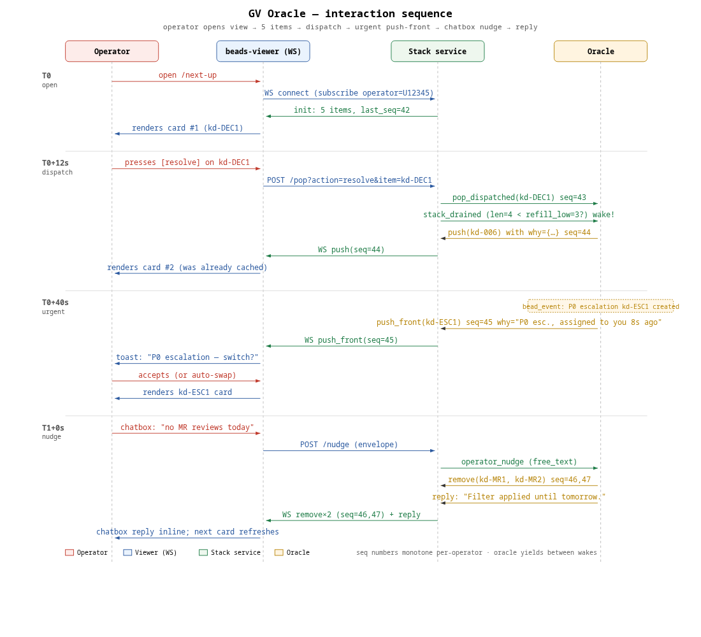

# GV Oracle Agent — PRD

**Status:** Draft (phase-1 research, no code).
**Origin:** [ka-0000003894](https://beads.gardenio.e2e.example.com/beads/ka-0000003894) under epic [ka-0000006841](https://beads.gardenio.e2e.example.com/beads/ka-0000006841) (Next-up / GV).
**Companion PRDs:** Stack + WebSocket (ka-0000005517), UX card (ka-0000003264), Chatbox (ka-0000000086), Signals survey (ka-0000007686).
**Author:** `gardenio-gv-research-oracle-adh`.

The **oracle** is the backend agent that decides, for one human operator at a time, what bead they should look at next — and pushes that decision onto a per-operator **stack** which the new beads-viewer "next-up" route reads over WebSocket. This PRD specifies the oracle: how it lives, wakes, reads the world, ranks, writes the stack, accepts nudges, and explains itself. It deliberately defers the **stack write API** and **WebSocket protocol** to the sibling PRD (ka-0000005517) and the **operator-facing chatbox semantics** to ka-0000000086; this doc consumes both as contracts.

---

## 1. Goals and non-goals

### 1.1 Goals

- Always have something good on top of the operator's stack within seconds of any state change relevant to them.
- Push *truly urgent* things (P0 decisions assigned to the operator, fresh escalations, broken cycles) to the **front** of the stack so the next pop surfaces them.
- Be **resumable**: oracle pods are ephemeral and may die, restart, or be compacted away. The next pod must reconstruct the ranking without operator intervention.
- Be **explainable**: every item the oracle pushes carries a *why* — citations of the signals that put it there and the weights it used — so the chatbox "why is this on top?" question has a deterministic answer.
- Be **cheap by default**: never busy-loop, never push duplicates, never re-push something the operator just skipped.

### 1.2 Non-goals

- This PRD does **not** define the stack data structure, persistence, or wire protocol — that is ka-0000005517. The oracle's read/write surface to the stack is treated here as a contract (`stack.Push`, `stack.PushFront`, `stack.Snapshot`, `stack.Subscribe`).
- This PRD does **not** define the operator chatbox UI or its input grammar — that is ka-0000000086. The oracle consumes a normalised nudge envelope.
- This PRD does **not** define the one-element card UI — that is ka-0000003264. The oracle annotates each pushed item with the data the card needs (suggested action, age, type chips); rendering is the card's job.
- No code. No DB migrations. No new gRPC services authored here (we recommend them; sibling PRDs own the shapes).

### 1.3 Quality bar for phase-2

A phase-2 oracle build is "done" when, for a logged-in operator opening the next-up route cold:

1. The first item appears within **< 2 s of route load** (snapshot is already populated).
2. Dispatching the first item auto-pops the stack and the next item is **already rendered** with no fetch-on-demand.
3. A P0 escalation created for the operator while they are mid-task interrupts within **< 5 s** with a `push_front` and a visible toast.
4. The operator can ask `why?` and get a one-screen explanation that cites the signals (e.g. "P0 decision raised 12 min ago by your gardener ka-AAA, no other operator can resolve it").
5. After a controller restart the oracle resumes within **one tick (≤ 30 s)** without operator intervention and without re-pushing items the operator has already dispatched.

These are the targets the recommendations below are tuned for.

---

## 2. The system in one diagram

The full sequence diagram lives in §10. The five-second mental model:

```
                         ┌────────────────────────────┐
                         │  Operator (human, browser) │
                         └────────────┬───────────────┘
                                      │ WS (next-up route)
                                      ▼
       ┌──────────────────────────────────────────────────────────┐
       │  beads-viewer next-up route                              │
       │  - subscribes to per-operator stack                      │
       │  - renders top item as a card                            │
       │  - proxies chatbox text to oracle nudge endpoint         │
       └──────────────────────────────────────────────────────────┘
              ▲  pop / dispatch                  │ chatbox nudge
              │                                  ▼
       ┌──────┴──────────────────────────────────────────────────┐
       │  Stack service (ka-0000005517)                          │
       │  - per-operator ordered list                            │
       │  - push / push_front / pop / remove / reorder           │
       │  - WS fan-out with sequence numbers                     │
       └──────▲──────────────────────────────────────────────────┘
              │ writes
              │
   ┌──────────┴──────────────────────────────────────────────────┐
   │  Oracle (one per operator, scheduled-gardener shape)         │
   │  Inputs:                                                    │
   │    - beads daemon (open / mentions / decisions / esc.)      │
   │    - controller events (MR state, formula state)            │
   │    - schedules / cycle state                                │
   │    - operator engagement signals (last skip / dispatch)     │
   │  Wakes on:                                                  │
   │    - cron sweep (sparse)                                    │
   │    - bead_event triggers (push when state changes)          │
   │    - stack_drained signal (push when shelf empties)         │
   │    - operator nudge (chatbox)                               │
   │  Writes the stack + the *why* on each item.                 │
   └─────────────────────────────────────────────────────────────┘
```

The oracle is the only thing in the system that owns ranking. The stack service is a dumb queue with a fan-out hose. The viewer is read-only against the stack except for `pop` / `remove` (operator actions) and chatbox proxy.

---

## 3. Lifecycle: "semi-persistent and resumable" decoded

The brief calls the oracle *semi-persistent and capable of resuming itself*. Four shapes were considered:

| Shape | Sketch | Cost | Resume story |
|---|---|---|---|
| A: Long-lived pod | One always-on pod per operator | Pod hours add up; we already have ~50 gardeners and only a handful of operators. Acceptable. | Kubernetes restarts it; oracle must re-hydrate stack from beads on boot. |
| B: Cron-only gardener | `type=schedule` bead with `triggers: [{kind:"cron"}]`. Sparse wake. | Cheap. | Each fire is a fresh pod; state must live on the schedule bead's `progress_state` (already supported). |
| C: Hybrid gardener (cron + bead_event + manual) | Same as B with extra trigger entries that wake the oracle when relevant beads transition. | Same baseline cost; reactive within seconds. | Same as B. |
| D: Auto-respawn on its assignment bead | Use `gardenio-spawn-on-bead` style: assignment bead is the schedule itself. | Identical to B/C in practice — the engine already keys off an assignment bead. | Same as B/C. |

**Recommendation: shape C** — a `type=schedule` bead per operator, with **three** trigger sources fanned in. This is the exact pattern the gardener-loop runbook (ka-0000007684) is designed for, and it solves "semi-persistent + resumable" without inventing a new pod-lifecycle primitive.

### 3.1 What "semi-persistent" means operationally

- **No always-on pod.** Each oracle run is a normal agent pod, spawned by the scheduler when a trigger fires.
- **State lives on the schedule bead.** `progress_state`, `trigger_state`, and a small JSON oracle-state blob (last-rank snapshot, recent operator engagement, soft-filter set from chatbox) live in fields on the schedule bead so they survive restart and compaction.
- **State also lives on the stack.** The stack itself is the authoritative artifact; the oracle's job is to converge the stack toward the right ordering, not to remember its own intermediate computation. After a restart the oracle reads the stack snapshot from the stack service and re-ranks against current state.
- **"Capable of resuming itself"** = the `yield → wake → re-enter` semantics in the gardener-loop runbook §1 (yield-aware fire). Operator nudges, urgent triggers, and cron sweeps all wake the same yielded run when one exists.

### 3.2 Wake / fire shape

The schedule bead carries this `triggers:` block (illustrative; lowered values resolved at parse time):

```json
[
  {
    "kind": "cron", "cron": "*/3 * * * *", "timezone": "America/Los_Angeles",
    "comment": "sparse sweep — keeps the stack within 3 min of fresh even if event delivery drops"
  },
  {
    "kind": "bead_event",
    "events": ["created", "updated", "closed"],
    "match": {"any": [
      {"field": "type",         "op": "==",      "value": "decision"},
      {"field": "type",         "op": "==",      "value": "escalation"},
      {"field": "label:operator-mention", "op": "present"},
      {"field": "assignee",     "op": "==",      "value": "{{operator_id}}"}
    ]},
    "throttle": "5s", "debounce": "2s"
  },
  {
    "kind": "stack_drained",
    "comment": "synthetic trigger emitted by stack service when len(stack) < refill_low_water_mark"
  },
  {
    "kind": "operator_nudge",
    "comment": "synthetic trigger emitted by chatbox proxy on operator text input; payload = nudge envelope"
  },
  {"kind": "manual", "label": "operator-fire"}
]
```

Two of these (`stack_drained`, `operator_nudge`) are **synthetic trigger kinds we are proposing** in this PRD; they require new emitters in the stack service and the chatbox proxy and a one-line addition to the trigger engine's kind table. They follow the same envelope shape as `bead_event` and reuse the `match` / `throttle` / `debounce` machinery; the trigger engine does not need new condition kinds.

### 3.3 Run end / loop end

The oracle is a loop that, by intent, never ends while an operator is active. But we still encode `stop:` defensively because the gardener primitive requires it and because operator lifecycles do end:

```json
{
  "loop_end": {"any": [
    {"kind": "specific_bead_closed", "bead_id": "{{operator_bead}}"},
    {"kind": "manual", "reason_field": "operator_offboarded"}
  ]},
  "run_end": {"any": [
    {"kind": "yielded_then_woken_then_idle"},
    {"kind": "no_actionable_state"},
    {"kind": "wall_clock", "duration": "15m"}
  ]},
  "hard_stop": {"any": [
    {"kind": "consecutive_failures", "value": 5},
    {"kind": "wall_clock", "duration": "168h"}
  ]}
}
```

The 15-minute `run_end.wall_clock` is intentional: oracles **never need to think for that long**. Either the wake produced a small re-rank (push / push-front, then yield), or the world has changed enough that the next trigger will fire anyway. Long runs are a bug.

### 3.4 Compaction / restart resume

When a pod restarts (controller restart, node eviction, OOM, compaction):

1. Scheduler sees the assignment bead, no live run pod → fires next cron tick (≤ 3 min worst case).
2. New oracle pod boots, calls `gb prime`, gets:
   - Its identity (operator id, role:oracle, assignment bead).
   - Last run's wrap-up (progress_score + summary + soft-filter set).
   - Current stack snapshot (via `gb stack snapshot --operator <id>` — sibling PRD CLI).
3. Oracle re-ranks against current beads/MR/decision state and reconciles vs snapshot:
   - If the stack already contains the right top-N, **no writes** (idempotent).
   - If items are missing, `push` them in rank order.
   - If a P0 item is missing from the top, `push_front`.
   - If items in the stack are now stale (closed, reassigned away), `remove`.

The oracle MUST treat the stack as the source of truth across restarts; it never wipes-and-repushes unless a soft-filter or operator nudge invalidates the whole snapshot.

---

## 4. Where the oracle lives

### 4.1 Spawning

The oracle is spawned by the **existing gardenio controller** through the **existing scheduled-gardener pathway**. We do **not** invent a new pod-lifecycle primitive. Concretely:

- A new role `oracle` is added to the roles config (`gardenio/controller/internal/podmanager/roles.go` or the roles-bead registry depending on which is current). The role inherits the gardener image and toolset; the only diff is the prompt template and the default toolset (`gb`, `kd`, the new `gb stack` CLI from the sibling PRD).
- For each human operator who wants a next-up view, the controller (or an operator-bootstrap gardener) creates a `type=schedule, role:oracle` bead with:
  - `assign_bead = <operator-bead-id>` (the operator's identity bead — Slack-id or OIDC-subject keyed; see edge-auth commit 716f5ebd referenced by sibling PRD).
  - `fields.operator_id = "slack:U12345"` (or `oidc:...`).
  - The `triggers:`, `stop:`, `progress:` blocks from §3.
- The schedule bead's `prompt` is the oracle playbook (appendix B).

### 4.2 Per-operator instance — yes, one each

We considered a single shared oracle that ranks per-operator inside one pod. Rejected:

- Operator nudges (soft filters, "pause oracle", "high-priority only") create per-operator state that is easier to keep on a per-operator schedule bead than to multiplex.
- Auth / scoping: the stack is per-operator already; an oracle that has to remember "which operator am I writing for right now?" is one bug away from cross-pollinating two operators' stacks.
- Cost: at fleet scale (current: a handful of operators), per-operator pods are cheap. If we grow to dozens, we revisit.

**Decision: one oracle schedule bead per operator who opts in.** Operators who never open the next-up view never get an oracle — the controller does not spawn one speculatively.

### 4.3 Identity and auth

The oracle authenticates to the daemon and to the stack service using the same per-agent-token mechanism gardeners already use. It does NOT impersonate the operator. Writes to the stack carry `operated_by = <operator-id>` so they show up in audit trails as oracle-on-behalf-of writes.

---

## 5. Inputs — the signals catalogue

The signals survey (ka-0000007686) will produce the **canonical signals catalogue** that this PRD consumes. Until that lands, this section is a first-cut list, grouped by cost and freshness.

### 5.1 Cheap / fresh signals (queried every wake)

| Signal | Source | Why it matters |
|---|---|---|
| Pending decisions assigned to operator | `kd list --type decision --status open --assignee <op>` | Decisions are blocking work — humans gate this. |
| Pending escalations to operator | `kd list --type escalation --status open --assignee <op>` | Real-world auth/privilege gates; usually urgent. |
| Open MRs the operator authored or was tagged on | GitLab API (cached) | Reviewer's queue + author's "needs response" pile. |
| Stale `in_progress` beads owned by **the operator's spawned crew** | `kd list --status in_progress --owner <op-or-crew> --updated_before now-90m` | Agents that are wedged need a human nudge. |
| Recent mentions of operator | beads daemon mentions index | "Someone asked you a question 4 min ago." |
| Stack snapshot | Stack service | Existing positions, recent dispatches, recent skips. |

These are all cheap (single index hit) and the oracle pulls them on every wake.

### 5.2 Medium-cost signals (queried each wake, with caching)

| Signal | Source | Cache TTL |
|---|---|---|
| Open P0/P1 bugs unassigned project-wide | `kd list --type bug --priority 0,1 --assignee=""` | 60 s |
| Recent agent activity (squawks last 15 min) | `kd list --type message --updated_after now-15m` | 60 s |
| Cycle wrap-ups awaiting close | `kd list --label cycle:* --status open` | 5 min |
| Formula state | Formula registry | 5 min |

### 5.3 Slow / heuristic signals (per-run, may be stale)

| Signal | Source | Cache TTL |
|---|---|---|
| Operator's calendar / quiet hours | Optional, future | n/a |
| Operator's historical engagement (which kinds dispatched / skipped) | `gb stack history` (sibling PRD) | 1 h |
| Time of day / day of week (used as a weight modifier) | local clock | n/a |

### 5.4 Operator engagement signals (read on every wake)

These are the freshest negative-feedback signals — the oracle MUST respect them:

| Signal | Source | Effect |
|---|---|---|
| Operator skipped item X | `pop_skipped` event on the stack | Apply per-item skip penalty for 1 h. |
| Operator dispatched item X | `pop_dispatched` event on the stack | Mark X dispatched; do not re-push for 4 h unless reopened. |
| Operator soft filter "no MR reviews today" | Chatbox nudge | Apply soft filter to ranking until end-of-day. |
| Operator paused the oracle | Chatbox `pause` command | Yield without pushing; resume on `unpause` or next manual fire. |

### 5.5 Signals deliberately out-of-scope for v1

- Cross-operator load balancing ("nobody else has reviewed ka-ABC, please you do it"). Future.
- Predictive scoring on bead text content (LLM relevance scoring). The oracle is a small, explainable ranker for v1; LLM-driven re-ranking is a v2 idea behind a flag.
- External signals (PagerDuty, calendar, Slack DMs). Operator-bridge integrations land later.

---

## 6. Output API — writing to the stack

The oracle's write surface is **owned by the sibling stack PRD (ka-0000005517)**. This PRD only asserts the contract the oracle expects:

```text
stack.Push(operator, item, why) → seq
stack.PushFront(operator, item, why) → seq
stack.Remove(operator, item_id) → seq
stack.Reorder(operator, [item_ids in order]) → seq
stack.Snapshot(operator) → [items..., last_seq]
stack.Subscribe(operator) → events ({push, push_front, pop, remove, reorder, ping})
```

Where:

- `item` is `{id, type, headline, suggested_action, age, badges...}` — the card-rendering shape. The oracle is responsible for filling the suggested-action field (e.g. for a pending decision → `resolve`; for an MR awaiting review → `review`; for a stale crew bead → `nudge or close`).
- `why` is a small structured blob:

```json
{
  "rank_score": 87.3,
  "category": "pending-decision-assigned",
  "signals": [
    {"name": "decision_age_min", "value": 14, "weight": 2.0, "contribution": 28.0},
    {"name": "decision_priority", "value": "P0", "weight": 30.0, "contribution": 30.0},
    {"name": "operator_assigned", "value": true, "weight": 25.0, "contribution": 25.0},
    {"name": "no_other_resolver", "value": true, "weight": 4.3, "contribution": 4.3}
  ],
  "explain": "P0 decision (ka-DEC1) raised 14 min ago by your crew ka-AAA. You're the only operator who can resolve it. Pushed to front."
}
```

The `explain` string is the literal text the chatbox returns when the operator asks "why?". The `signals` array is the structured form the audit log and the bundle-viewer "stack history" view consume.

### 6.1 Recommended write surface

The oracle invokes these via a thin CLI we propose: `gb stack push`, `gb stack push-front`, `gb stack snapshot`, etc., backed by the sibling PRD's HTTP/gRPC service. Reasoning:

- Gardeners already shell out via `gb` for everything (`gb decision`, `gb squawk`, `gb mail send`); adding `gb stack` is the lowest-cost integration.
- A CLI surface is trivially mockable in tests and trivially callable from the oracle prompt (no SDK needed).
- The CLI hides the wire protocol (gRPC vs HTTP vs NATS) so the sibling PRD can pick whatever transport is right without forcing the oracle to follow.

Sibling PRD is encouraged to define `gb stack` with these exact verb names so this PRD's recommendations compile.

### 6.2 Idempotency / dedup

- Every push includes a stable `item_id` (the bead id, or `<bead-id>#<aspect>` if multiple aspects of the same bead can appear, e.g. "review this MR" vs "resolve this decision on the same bead").
- The stack service rejects duplicate item_ids with `already-present`; the oracle treats that as a no-op.
- The oracle MAY call `Reorder` to surface an existing item without re-pushing it.

---

## 7. Ranking heuristics — first cut

This is the **first-cut** weighting; production tuning belongs in phase-2 and reads from the signals survey ka-0000007686. The principle: **explainable additive scoring**, no ML. Each candidate bead gets a score; top-N go to the stack.

### 7.1 Categories and base weights

| Category | Base weight | Examples |
|---|---|---|
| **P0 escalation to operator** | 200 | Privileged-access requests, broken production gates. |
| **P0 decision to operator** | 180 | A gardener's crew is blocked on the operator. |
| **P1 decision to operator** | 120 | Same as above, lower priority. |
| **Hard-failing cycle owned by operator** | 110 | `cycle:failed` on a gardener the operator owns. |
| **MR ready-to-merge, operator is author** | 90 | Author needs to click merge. |
| **MR awaiting operator's review (assigned)** | 80 | Reviewer's queue. |
| **Stale (>90 min) `in_progress` crew bead** | 60 | Operator's crew may be wedged. |
| **Recently-mentioned bead** | 50 | "Someone tagged you." |
| **P0 unassigned bug in operator's project** | 45 | Important and needs an owner. |
| **Open decision raised by operator's crew, anyone-can-resolve** | 40 | Lower priority because it's not specifically assigned. |
| **Cycle wrap-up awaiting close** | 25 | Tidy-up work. |
| **P1 unassigned bug in operator's project** | 20 | |

### 7.2 Modifiers (multiplicative, applied to the category base)

| Modifier | Multiplier |
|---|---|
| Age modifier: `min(1 + age_minutes / 60, 3.0)` — items get more urgent over time, capped at 3×. |
| Operator skipped within last 1 h | × 0.2 (heavy penalty; respect the skip) |
| Operator dispatched within last 4 h (same item) | × 0.0 (suppressed) |
| Soft-filter excludes this category | × 0.0 |
| Soft-filter prefers this category | × 1.3 |
| Quiet-hours active and item is not P0 | × 0.4 |

### 7.3 Tie-breakers

When two items end up within 1 point of each other:

1. Higher priority wins.
2. Older raised-at wins (resolve the older blocker first).
3. Item raised by a crew the operator spawned wins (your kids first).
4. Lexicographic on bead id (deterministic).

### 7.4 What goes on the stack

- Top **N = 5** items by default. Configurable via operator chatbox nudge ("show me 10").
- Anything with `rank_score >= push_front_threshold (default: 150)` AND not already at the top → `push_front`, not `push`. Threshold is set to roughly "P0-decision-or-escalation" so accidental front-pushes are rare.
- The oracle MUST NOT push more than N items in a single run (avoid avalanching the operator). If many things newly qualify, it pushes the top-N and yields; the next wake handles the rest.

### 7.5 Why additive scoring, not ranking-by-rules?

Each signal's contribution is a number you can show the operator and we can chart over time. A rule-based "if P0 and assigned and < 1 h, surface to top" tree gets unwieldy and hard to debug. Additive scoring also gracefully handles tie-breakers (sort once) and degrades sensibly when a signal is missing (its contribution is zero).

---

## 8. Self-nudge / self-resume protocol

Three forces wake the oracle: the world changed, the stack drained, or the operator nudged. Each is a trigger entry in §3.2.

### 8.1 World-changed wakes (`bead_event`)

The trigger engine subscribes to bead-lifecycle events (`created` / `updated` / `closed`) and fires the oracle when:

- A bead matches `type=decision` or `type=escalation` and is assigned to the operator.
- A bead carries the `operator-mention` label (typed-mention emitted by the daemon when text references this operator).
- A bead's assignee changes to the operator.

A `throttle: 5s` + `debounce: 2s` window coalesces bursts (e.g. an epic getting closed fires `updated` on many children).

### 8.2 Stack-drained wake (synthetic trigger)

When the stack length drops below a low-water mark (default 3 items), the stack service emits a `stack_drained` event for that operator. The trigger engine routes it as if it were a `bead_event`. This guarantees the oracle gets a chance to refill before the operator pops to empty.

This requires the stack service (sibling PRD) to expose an emission hook. We are recommending it here; sibling PRD owns implementation.

### 8.3 Operator-nudge wake (synthetic trigger)

The chatbox proxy posts the operator's nudge envelope to a per-operator NATS subject (recommended) or HTTP endpoint. The trigger engine subscribes and fires the oracle with the envelope as payload. Throttle `1s`, debounce `200ms`: typing fast doesn't fire ten runs.

### 8.4 Cron sweep — the safety net, NOT the primary driver

A `*/3 * * * *` cron entry exists for two reasons (the same reasons the gardener-loop runbook §5.4 calls out):

1. **Event delivery is not guaranteed.** Controller restarts and SSE/NATS hiccups drop events.
2. **The stack may need re-ranking even when no individual bead changed** (e.g. age modifiers slowly push older items up).

The cron is intentionally **sparse** — every 3 min — so it's the safety net, not the primary signal. Most wakes are event-driven; the cron only acts when nothing else has fired recently.

### 8.5 Yield-aware re-entry — the resumability superpower

The gardener-loop runbook §1 spells this out: when a trigger fires while a yielded run already exists, the scheduler **wakes the yielded run** instead of spawning a new pod. This means:

- The oracle does not pay container-cold-start latency for every wake.
- The "current ranking" state in memory persists across nudges.
- `gb prime` injects the trigger cause (`Last fire trigger: stack_drained`) at the top of each wake so the prompt branches cleanly on cause.

The oracle pattern is therefore: do work → push / push_front / remove → `gb yield` with a wrap-up indicating what was changed → wait for next trigger. The pod stays alive between wakes for cheap re-entry; it only fully dies on `run_end.wall_clock` (15 min idle) or `loop_end`.

### 8.6 Why this is "semi-persistent and resumable"

- **Semi-persistent:** the schedule bead is permanent (operator-scoped), the run pod is yielded most of the time, the wake latency is event-driven (seconds, not minutes).
- **Resumable:** any new pod (cold restart) gets the same prompt, the same stack snapshot, and the same recent-engagement state from the schedule bead's progress fields. It re-ranks deterministically and converges the stack without operator help.

---

## 9. Operator-nudge protocol

The full chatbox grammar is in the sibling PRD ka-0000000086. From the oracle's perspective, the chatbox is a producer of normalised **nudge envelopes** on a per-operator NATS subject:

```json
{
  "operator_id": "slack:U12345",
  "received_at": "2026-05-15T16:42:11Z",
  "kind": "soft_filter" | "hard_command" | "free_text" | "explain_request" | "add_to_stack",
  "payload": {
    // for "soft_filter":
    "filter": "no_mr_reviews_today",
    "scope": "today" | "session" | "1h" | "permanent",

    // for "hard_command":
    "command": "pause" | "unpause" | "clear" | "show_n",
    "args": {"n": 10},

    // for "free_text":
    "text": "give me only bugs"   // requires oracle interpretation

    // for "explain_request":
    "item_id": "ka-ABC123"        // operator wants the why

    // for "add_to_stack":
    "bead_id": "ka-XYZ789",
    "position": "front" | "back"
  }
}
```

### 9.1 How the oracle handles each kind

| Kind | Effect |
|---|---|
| `soft_filter` | Update the soft-filter set stored on the oracle's schedule bead (`fields.soft_filters` JSON). Re-rank, write the new top-N. Reply via chatbox response channel: "Filter applied: no MR reviews today." |
| `hard_command: pause` | Set `fields.paused=true` on the schedule bead. Do not push anything until unpaused. |
| `hard_command: unpause` | Clear paused flag. Re-rank, refill. |
| `hard_command: clear` | `stack.Remove` everything for this operator. Yield. Next wake repopulates. |
| `hard_command: show_n` | Update `fields.target_n`. Re-rank, push extra items if N grew. |
| `free_text` | Treat as a soft hint. v1: pattern-match a small dictionary ("bugs only", "no decisions", etc.) and translate to a `soft_filter`. v2: LLM-interpret. If unparseable, reply with "I didn't understand that — try one of: …" |
| `explain_request` | Look up the item's `why` from the stack's current state, return as a chatbox response. |
| `add_to_stack` | `stack.Push` or `stack.PushFront` for the named bead, with a synthetic `why` ("Operator requested at <ts>"). |

### 9.2 Reply path

The oracle posts replies to a per-operator response NATS subject (or HTTP webhook). The chatbox proxy reads from it and renders inline. Sibling chatbox PRD owns the rendering and the response shape.

### 9.3 Persistence of soft filters

- `session` scope — lives on a session bead (in-memory equivalent), cleared on next route-load.
- `today` scope — `fields.soft_filters[i].expires_at = end_of_local_day`.
- `1h` / `<duration>` scope — explicit expiry timestamp.
- `permanent` — sits on a `type=operator-preference` bead so it survives oracle restart and operator-changes-pod.

Out of scope here: how the operator audits / lists / removes their permanent filters. That's a UI affordance for the next-up view (UX PRD ka-0000003264 §"settings drawer", if it exists; otherwise file as a follow-up).

---

## 10. Interaction diagram

The deliverable asks for an interaction diagram of: **operator opens view → oracle pushes 5 items → dispatches first → urgent push-front → chatbox nudge → oracle responds.**

### 10.1 ASCII version

```text
Time   Operator                Viewer                  Stack svc               Oracle
─────  ──────────────────────  ──────────────────────  ──────────────────────  ──────────────────────
T0     opens /next-up
T0+0   ─────────────────────►  GET /next-up
                               WS connect
                               ───────────────────────►
                                                       (auth OK)
                                                       Snapshot ──────────────►  Subscribe
                                                       (5 items, seq=42)
                                                       ◄────────────────────────  (already cached)
       (sees card #1)          ◄───────────────────────  init snapshot

T0+12  presses [resolve]
                               POST /pop?action=resolve
                               ─────────────────────────►
                                                        emit pop_dispatched
                                                        ──────────────────────►  (note: ka-001 done)
                                                        seq=43, len=4 (<N)
                                                        emit stack_drained
                                                        ──────────────────────►  re-rank
                                                        ◄──────────────────────  push(ka-006), seq=44
                               (renders card #2 already
                                client-side)            ◄──────────────────────  WS push(seq=44)

T0+40  (mid-comment)            ────────────────────────────────────────────────  (P0 escalation fires
                                                                                   bead_event trigger)
                                                                                  rank → 240
                                                        ◄──────────────────────  push_front(ka-ESC1),
                                                        seq=45                     why="P0 escalation
                                                                                   assigned to you 8s ago"
                                                        WS push_front(seq=45)
                                                        ──────────────────────►
                               (toast: "P0 — switch?")
       acknowledges
                               POST /pop?action=accept
                               (renders ka-ESC1 card)

T1+0   types "no MR reviews
       today" in chatbox
                               POST /nudge ─────────────►
                                                         emit operator_nudge
                                                         ─────────────────────►  apply soft_filter
                                                                                  remove(ka-002 MR review)
                                                                                  reply: "OK — no MR
                                                                                  reviews until tomorrow"
                                                         ◄─────────────────────  remove(ka-002), seq=46
                                                         ◄─────────────────────  reply payload
                               WS remove(seq=46)
                               ◄─────────────────────────
                               chatbox shows reply
       (next card refreshes)
```

The PNG render of this sequence is `gv-oracle-interaction.png` (alongside this file). The SVG source is `gv-oracle-interaction.svg`; the PNG is embedded by the bundle viewer (advice ka-0000000334).



*Source: [`gv-oracle-interaction.svg`](./gv-oracle-interaction.svg)*

### 10.2 What the diagram does NOT show (deliberately)

- The pod-spawn for the very first oracle wake (assumed already up; the snapshot is pre-warmed by the previous run).
- The cron safety-net wakes (they don't fire in this 30-second window).
- The WebSocket reconnect path (sibling PRD owns it).

---

## 11. Concurrency semantics

The big surface here: **the operator pops a stack the oracle is racing to mutate.** Two writers, one ordered list. The rules:

### 11.1 Authorship

| Operation | Allowed authors |
|---|---|
| `pop` | Operator (via viewer) only. |
| `push`, `push_front`, `reorder` | Oracle only. |
| `remove` | Either. Operator removes via "skip"; oracle removes when an item became stale (closed, reassigned). |

### 11.2 Sequence numbers

Every stack mutation gets a monotonic `seq`. The viewer's WS subscription is keyed by seq for replay-on-reconnect (sibling PRD §"WebSocket reconnect"). The oracle reads the current seq before re-ranking; if its writes race against a `pop` it observes the new seq and re-checks state — it does not re-push a popped item.

### 11.3 Conflict semantics — three scenarios

**Scenario A: Operator pops while oracle pushes the same item to the front.**

- Stack ordering: `pop` operates on the *current* top. If oracle's `push_front` arrives first, the operator pops the new front (the P0 they wanted to act on). If `pop` arrives first, the oracle's `push_front` lands on the new front and the operator sees the P0 next.
- Stack service is the linearization point — first-write-wins by seq. The oracle does not retry on conflict; the stack accepts both writes.

**Scenario B: Operator dispatches item X, oracle simultaneously decides to re-push X.**

- Stack service emits `pop_dispatched` for X with item_id.
- Oracle observes the dispatch event in its next wake (via subscription) and adds X to its 4-hour suppression set before considering candidates.
- If the oracle's push was emitted *before* the suppression observation, the stack service rejects it (duplicate item_id) or it lands; either way, the operator can re-skip.

**Scenario C: Operator skips, oracle re-evaluates and re-pushes.**

- Skip increments the per-item skip-penalty multiplier (× 0.2). The oracle's next re-rank is unlikely to score the item back to the top unless its category weight is very high (P0 escalation).
- If the operator skipped a P0 explicitly, the oracle MUST honour the skip for at least 1 h (configurable). Re-pushing a P0 the operator just skipped is the worst possible failure mode; better to push nothing.

### 11.4 Atomicity expectations

The oracle's "push top 5, remove 2 stale" operation is **not atomic**; the stack service receives the operations sequentially. The viewer renders intermediate states. This is acceptable because the card UI only shows the top item — intermediate reordering of positions 2-5 is invisible.

If real atomicity becomes necessary (sibling PRD: optional `batch` op), the oracle uses it; until then, the oracle orders its writes so the most-important changes land first (`push_front` before `push` before `remove`).

---

## 12. Observability

### 12.1 Per-item *why* (already in §6)

Every item carries its rank-explanation. The chatbox `why?` command surfaces it. The bundle viewer's per-bundle stack-history page (proposed; out of scope for this PRD) reads it.

### 12.2 Oracle squawks

The oracle emits `gb squawk` lines for major events:

- "Pushed ka-AAA to front: P0 decision to operator, 12 min old, no other resolver."
- "Soft filter applied: no_mr_reviews_today (operator nudge)."
- "Stack drained — refilled with 5 items."

Squawks are visible in the inbox feed and Slack (per the existing bridge). They are the human-readable narrative of what the oracle did.

### 12.3 Audit log

Every stack mutation is in the daemon audit log already (per beads daemon conventions). Sibling PRD ensures the `operated_by_alias` and `actor` fields distinguish oracle writes from operator writes.

### 12.4 Wrap-up reports

Each oracle run ends with `gb stop --wrapup`. Required fields:

```json
{
  "accomplishments": "Pushed 3 items, push-fronted 1 P0, removed 1 stale.",
  "stack_size_after": 5,
  "soft_filters_active": ["no_mr_reviews_today"],
  "progress_score": 1,
  "progress_summary": "stack converged to top-5"
}
```

`progress_score == 0` runs are normal for the oracle (a wake that found nothing new is a successful no-op). Three consecutive zero-progress runs is **not** a wedge signal — unlike a gardener, an oracle quiescent because the world is quiet is doing its job. `no_progress_for` in `stop:` is therefore **disabled** for the oracle role (the runbook's default).

### 12.5 Stack-history view

Out of scope for this PRD; proposed for follow-up: a beads-viewer route `/operator/<op>/stack-history` that paginates over the audit log of mutations with the `why` blob expanded. This is the "did the oracle do the right thing?" debugging surface.

---

## 13. Failure modes

| Failure | Detection | Mitigation |
|---|---|---|
| Oracle pod crashes mid-rank | Pod exit status; next trigger fires within 3 min worst case. | Stack stays as it was; next pod re-ranks. No half-written state on the stack. |
| Oracle writes an item that becomes stale before operator pops | `pop_dispatched` returns "already closed". | Stack service drops the dispatch and emits `removed`; viewer renders the next card. Oracle observes the event on its next wake. |
| Oracle pushes a flood (re-rank thrashing) | More than 20 mutations per minute per operator. | Stack service rate-limits per-operator; excess writes return `rate_limited`. Oracle backs off (its wrap-up flags it). Phase-2: add a gardener-style hard_stop on `consecutive_failures`. |
| Operator nudge unparseable | `free_text` doesn't match the dictionary. | Reply with "I didn't understand — try one of …". Do not re-rank. |
| Stack service down | All writes fail. | Oracle yields with a wrap-up flag; cron sweep retries every 3 min. Viewer falls back to a read-from-cache snapshot (sibling PRD §"failure"). |
| Daemon down | Cannot fetch signals. | Same as above. Existing gardener pattern: yield and retry next tick. |
| Operator's identity changes (re-login from another account) | New operator-id in edge-auth header. | Oracle is per-operator-bead; a different operator gets a different oracle. No cross-contamination by construction. |

---

## 14. Open questions for review

Each of these is a real fork in the road that the operator (or sibling PRDs landing first) should resolve.

1. **One oracle per operator, or one shared with operator-keyed inner state?** This PRD recommends per-operator. If at fleet scale (>20 operators) this is too expensive, revisit.
2. **Should the chatbox proxy live in beads-viewer or in the controller?** This PRD assumes it lives in beads-viewer (which already terminates the WS) and forwards nudges over NATS. The chatbox sibling PRD owns the decision.
3. **Synthetic trigger kinds (`stack_drained`, `operator_nudge`):** are we comfortable adding two new entries to the trigger-engine kind table, or do we mux them through `bead_event` by writing audit beads on every stack mutation and nudge? The audit-bead route is more uniform but heavier (one bead per nudge).
4. **Soft-filter persistence:** are operator preferences first-class (`type=operator-preference` bead, queryable across surfaces) or oracle-internal (on the schedule bead's fields)? This PRD recommends first-class for `permanent` scope, oracle-internal for shorter scopes. Operator review please.
5. **First-cut weights:** the table in §7.1 is a guess. Phase-2 should tune against a week of real operator engagement (skip / dispatch / age-at-dispatch) before locking values.
6. **Quiet hours:** is a quiet-hours signal in v1 or v2? It's cheap to add but adds an operator-config surface we haven't designed.
7. **LLM re-ranker:** behind a flag, the oracle could pass its top-20 candidates plus signals through an LLM to fine-tune ordering. Out of scope for v1; named as a v2 candidate.
8. **Multi-cause `bead_event` matching:** the `match: {any: [...]}` in §3.2 fires on `decision OR escalation OR mention OR assignment`. Is that an OK fan-in, or should each kind get its own trigger entry so throttles are independent? This is a gardener-loop-runbook §1 tradeoff — recommend separate entries when throttles need to differ; combined here for clarity.

---

## 15. Cross-references

- **Parent epic:** [ka-0000006841](https://beads.gardenio.e2e.example.com/beads/ka-0000006841) — Next-up / GV vision.
- **Sibling PRDs:**
  - [ka-0000005517](https://beads.gardenio.e2e.example.com/beads/ka-0000005517) — Stack + WebSocket transport. **Owns** the write API the oracle calls.
  - [ka-0000003264](https://beads.gardenio.e2e.example.com/beads/ka-0000003264) — UX card. **Consumes** the item shape and `why` blob this PRD specifies.
  - [ka-0000000086](https://beads.gardenio.e2e.example.com/beads/ka-0000000086) — Chatbox. **Owns** the nudge grammar; **emits** the envelope this PRD §9 consumes.
  - [ka-0000007686](https://beads.gardenio.e2e.example.com/beads/ka-0000007686) — Signals survey. **Will replace** §5's first-cut catalogue.
- **Foundational:**
  - Gardener-loop runbook ([`gardenio/docs/gardener-loop-runbook.md`](./gardener-loop-runbook.md)) — the trigger/stop/progress primitive this PRD builds on (advice ka-0000007684).
  - Agent bundles ([`gardenio/docs/agent-bundles.md`](./agent-bundles.md)) — how this PRD lands as a deliverable.
  - Edge-auth (`X-Operator` header) — commit 716f5ebd, referenced by sibling stack PRD; the oracle relies on this to scope per-operator.

---

## Appendix A — Example operator-oracle schedule bead

This is the recommended shape of the bead that **defines** an oracle for one operator. The controller (or an operator-bootstrap gardener) creates one of these on first opt-in.

```yaml
type: schedule
title: "Oracle — operator slack:U12345 (the GV next-up populator)"
labels:
  - project:gardenio
  - role:oracle
  - operator:slack-U12345
fields:
  enabled: "true"
  role: oracle
  project: gardenio
  assign_bead: ka-OPERATOR-BEAD
  operator_id: "slack:U12345"
  target_n: "5"
  push_front_threshold: "150"
  refill_low_water_mark: "3"
  paused: "false"
  soft_filters: "[]"

  prompt: |
    You are the Oracle for operator {{operator_id}}. Each wake:

    1. Read `gb prime` to learn what woke you (trigger cause is in the
       Scheduled Loop Context block). Branch on cause:
         - cron: full re-rank + refill.
         - bead_event: incremental re-rank — check the changed bead, decide
           whether to push or push-front it.
         - stack_drained: refill to target_n.
         - operator_nudge: parse the envelope, apply, reply.
         - manual: behave like cron.

    2. Fetch signals (§5 of the PRD; see gardenio/docs/gv-oracle-prd.md).
       Apply soft filters from fields.soft_filters.

    3. Score candidates (§7). Identify top-N; identify any item above
       push_front_threshold.

    4. Reconcile vs current stack snapshot:
         - push_front any P0 not already at the top.
         - push any new top-N not in the stack.
         - remove any stack item now stale.

    5. Squawk a one-line summary of what changed.

    6. `gb stop` with the wrap-up fields in §12.4 of the PRD. Yield;
       you will be woken on the next trigger.

  triggers: |
    [
      {"kind":"cron","cron":"*/3 * * * *","timezone":"America/Los_Angeles"},
      {"kind":"bead_event","events":["created","updated","closed"],
       "match":{"any":[
         {"field":"type","op":"==","value":"decision"},
         {"field":"type","op":"==","value":"escalation"},
         {"field":"label:operator-mention","op":"present"},
         {"field":"assignee","op":"==","value":"{{operator_id}}"}
       ]},
       "throttle":"5s","debounce":"2s"},
      {"kind":"stack_drained","throttle":"10s"},
      {"kind":"operator_nudge","throttle":"1s","debounce":"200ms"},
      {"kind":"manual","label":"operator-fire"}
    ]

  stop: |
    {
      "loop_end":{"any":[
        {"kind":"specific_bead_closed","bead_id":"{{operator_bead}}"},
        {"kind":"manual","reason_field":"operator_offboarded"}
      ]},
      "run_end":{"any":[
        {"kind":"yielded_then_woken_then_idle"},
        {"kind":"no_actionable_state"},
        {"kind":"wall_clock","duration":"15m"}
      ]},
      "hard_stop":{"any":[
        {"kind":"consecutive_failures","value":5},
        {"kind":"wall_clock","duration":"168h"}
      ]}
    }

  progress: |
    {
      "events":[
        {"kind":"stack_pushed","operator":"{{operator_id}}"},
        {"kind":"stack_push_fronted","operator":"{{operator_id}}"},
        {"kind":"stack_removed","operator":"{{operator_id}}"},
        {"kind":"operator_nudge_handled","operator":"{{operator_id}}"}
      ],
      "windows":[{"name":"this_run","scope":"since_run_start"}],
      "surface":{"in_prime":true,"in_squawk_on_loop_end":false,"in_wrapup":true}
    }
```

Note: the progress events above (`stack_pushed`, etc.) are **proposed**; they piggyback on the stack-mutation audit beads we already get for free if sibling PRD writes audit beads per mutation. If it doesn't, this PRD recommends emitting them as labeled audit beads under the stack-service umbrella.

---

## Appendix B — A worked rank-and-push example

Setup: operator `slack:U12345` opens next-up. Current state:

- 1 P0 decision assigned to operator (`ka-DEC1`, raised 8 min ago by their crew ka-AAA).
- 1 P1 escalation assigned to operator (`ka-ESC1`, raised 47 min ago).
- 2 MRs awaiting their review (`ka-MR1`, `ka-MR2`; both 2 h old).
- 1 stale `in_progress` crew bead (`ka-CREW1`, 110 min idle, owned by operator's child crew).
- 4 P0/P1 unassigned bugs in the operator's project.
- Operator has soft-filter "no_mr_reviews_today" from yesterday — expired at midnight; not active.

Scoring (per §7):

| Item | Category base | Modifiers | Score |
|---|---|---|---|
| ka-DEC1 | 180 (P0 decision) | × age 1.13 (8 min) | 203 |
| ka-ESC1 | 200 → wait, P1 not P0 | Actually category for P1 escalation isn't in §7.1; treat as P0 escalation at 200 if priority=0, else apply 0.6 multiplier → 120 base × age 1.78 (47 min) | 214 |
| ka-MR1 | 80 (review) | × age 1.5 (cap-2h) | 120 |
| ka-MR2 | 80 | × age 1.5 | 120 |
| ka-CREW1 | 60 (stale) | × age 1.83 (110 min) | 110 |
| top 2 unassigned bugs | 45 each | × age (varies) | 45-60 |

Result:

- **Push-front:** ka-ESC1 (214 > 150) and ka-DEC1 (203 > 150). Order: ESC1 first (higher score), then DEC1.
- **Push (back) into the remaining 3 slots:** ka-MR1, ka-MR2, ka-CREW1.
- Final stack (top-N=5): `[ka-ESC1, ka-DEC1, ka-MR1, ka-MR2, ka-CREW1]`.

Each push carries its `why` blob; operator can ask "why is ka-ESC1 on top?" and get the explanation literally:

> "P1 escalation to you, raised 47 min ago. Score 214 (base 120 × age 1.78). The age penalty pushed it past your P0 decision (203). No other operator is on the escalation."

Two days later, with the operator's soft-filter `no_mr_reviews_today` active, ka-MR1 and ka-MR2 multiply by 0.0 and are removed from candidates; the stack fills from the next two by score.

---

*End of PRD. SVG/PNG sequence diagram is bundled alongside this doc.*
