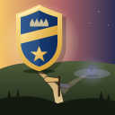
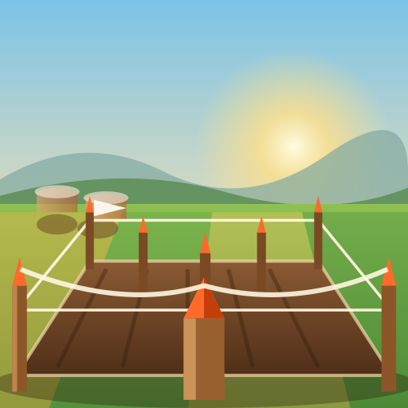
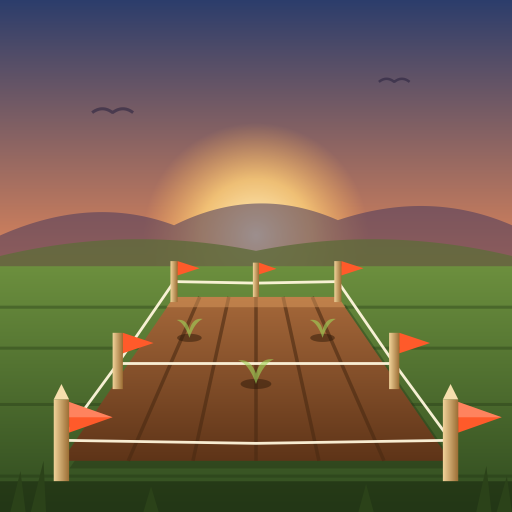
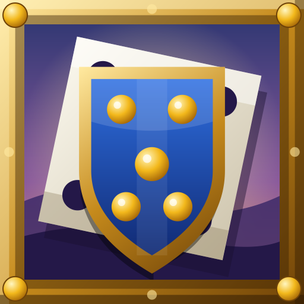
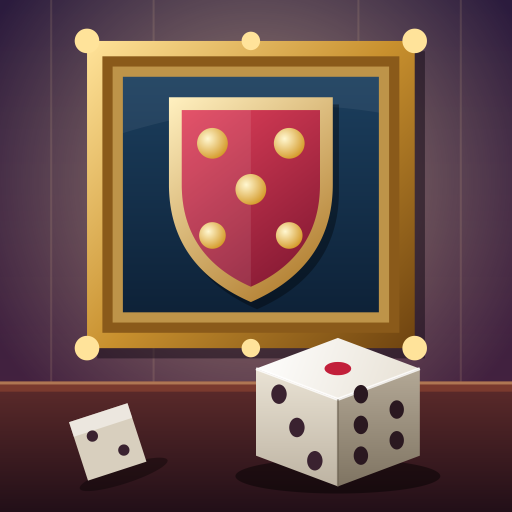
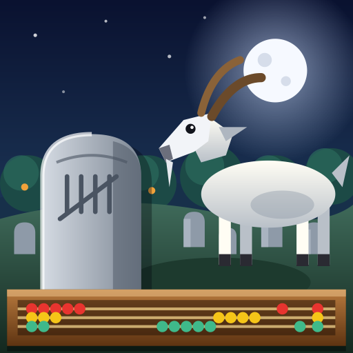
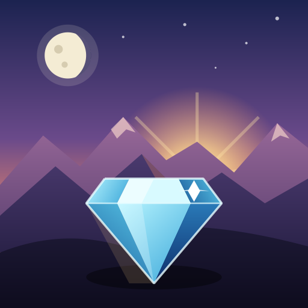
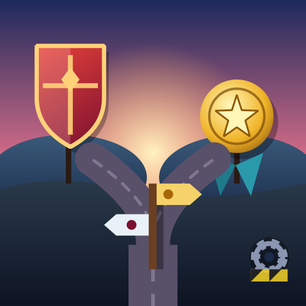

# Badges round 1: the sample sheet

Step 8 (gd-0WVnaI8q4z) of plan gd-pQZO9ie11D, *Badges from arms*. Twenty real beads are drawn in two
styles (`line-art-bold`, the bold sticker, and `poster`, the large picture), each by two current
models (Claude Sonnet 5.5 and Claude Opus 5.5). That is 80 pictures. Each one is shown at 128 and
512 px beside the bead's arms and short title. The owner picks the style and model in decision
gd-zqkw2TUnp7, and the verdict is recorded at the end of this page.

## How the pictures were drawn

The pictures are model-authored (Tier 2) through the generator's own prompts and its own validation
and raster. Only the transport differs from `gb badge`:

1. **Arms.** Each bead's arms were resolved the way `gb badge` resolves them (`resolveBadgeArms`).
   The walk takes the bead's own arms, else follows the first parent-child edge upward
   ([`tools/resolve.py`](samples/badges-round-1/tools/resolve.py)).
2. **Prompts.** The prompt for each bead and style is `buildPrompt(style, title, description, arms)`
   from `gardenio/controller/internal/badge/model.go` on main at 1512b37e (`PromptVersion` 1), with
   the description cut to 2000 bytes as `authorSVG` cuts it.
3. **Models.** Each prompt was answered in one shot by a Claude Code subagent pinned to Sonnet 5.5 or
   Opus 5.5, through the in-cluster LiteLLM (`gardenio-litellm:4000`). Each answer was one reply,
   with no preview and no revision.
4. **Validation and raster.** Every reply went through `sanitizeSVG` (8 KB cap for line art, 24 KB for
   a poster) and `Badge.Rasterize` at 128 and 512. The harness is
   [`tools/harness_test.go.txt`](samples/badges-round-1/tools/harness_test.go.txt), a throwaway test
   in package `badge`.

**Why not `gb badge` itself.** `gb badge` cannot reach a model from an agent pod today (escalation
gd-RVxAB11KFa, to the owner):

- Every Claude model group on the in-cluster LiteLLM forwards the caller's credential upstream.
  LiteLLM has no Anthropic key of its own, so a call with the pod's virtual key alone gets upstream
  401 `x-api-key header is required`.
- The only upstream credential in a crew pod is Claude Code's subscription OAuth token. Anthropic
  answers 429 when that token is used outside Claude Code, and agents must not work around that.

So `gb badge` falls back to Tier-0 everywhere in-cluster. The subagents are a legitimate Claude Code
use of the same models. The one difference from a direct `/v1/messages` call is Claude Code's own
system prompt and default thinking around the request. The prompt text, the models, the validation
and the raster are the generator's own.

## Results at a glance

- **80 of 80 passed `sanitizeSVG`.** No reply fell back to Tier-0.
- **Size.** Line art is about 0.6 KB median (largest 1.1 KB). Posters are 4.0 KB (Sonnet) and 4.6 KB
  (Opus) median, largest 6.6 KB. Every picture is far under its cap.
- **Raster fidelity.** No poster used a construct the raster ignores (filters, masks, clip paths,
  text), so the poster prompt's render rules held. Three bold pictures use `<clipPath>`, which the
  line-art prompt does not forbid and the raster drops: Sonnet and Opus `gd-EJGA3zDGCk`, and Opus
  `gd-veuI2XnkA1`. Their PNGs can differ from the SVG in a browser. If bold is chosen, the line-art
  prompt should carry the poster's render rules too.

What the pages show (one reviewer's reading, for the owner to overrule):

- **Bold** reads at 128 as a clean sticker, and both models stay inside the 24 px rules. Neither
  is memorable at 512: it is a flat glyph scaled up.
  - Opus often drops a charge to keep the glyph simple (no paintbrush on `gd-pQZO9ie11D`).
  - Sonnet keeps every charge but misreads more (a bull for the goat on `gd-ZsV0W4qKLy`).
- **Poster** is the memorable one at 128 and 512.
  - Both models build a lit scene with depth from shapes and gradients alone.
  - Opus's posters are darker and more held together around one silhouette (the medal, the truck,
    the goat, the diamond).
  - Sonnet's are brighter, with more elements, and one or two crowd (Lands public plots,
    `gd-X07JyIHEzl`).
- **Inherited arms work.**
  - A task drawn from its plan's arms gets a picture of the same charges, so it reads as kin: compare
    `gd-RcmmFKWytW` with its plan `gd-pQZO9ie11D`, and `gd-veuI2XnkA1` with `gd-EJGA3zDGCk`.
  - The title still steers the composition: the reading-the-plan task puts a sign in its plan's field.
- **No arms.** The decision (`gd-eThga7vg3I`) and the project (`gd-Ui9jl00KfA`) have no arms in
  their line, so they are drawn from title and description.
  - The project's sprout is strong in every cell.
  - The decision's pictures are the weakest on the sheet in both styles: an abstract fork with no
    subject. This argues for arms on decisions, or for drawing a decision from the bead it decides.
- **A bug the sheet found.** `gd-6vGD02rgka` sits under phase `gd-ucrYuPOljl` (📊💵🚢), but its first
  parent-child edge is the Commons thread that filed it, which has no arms. The walk stops there, so
  the task is drawn without arms. Filed as gd-NgFx1XzPAL.

## The sheet at 128 px

Columns: Sonnet 5.5 bold, Opus 5.5 bold, Sonnet 5.5 poster, Opus 5.5 poster. Click any picture for
its 512 px PNG. Each SVG sits beside its PNGs under
[`samples/badges-round-1/`](samples/badges-round-1/), one folder per model and style.

| Bead | Arms | Short title | Sonnet · bold | Opus · bold | Sonnet · poster | Opus · poster |
|---|---|---|---|---|---|---|
| `gd-pQZO9ie11D` plan | 🏅🖌️🔎 | Badges from arms: a memorable large… |  |  |  |  |
| `gd-2RdeAx8nnW` plan | 🪵🧶📐 | stake out asked plans in the fields |  |  |  |  |
| `gd-UZKZ9H25UD` plan | 🏷️🚚📦 | release record, truck and release page |  |  |  |  |
| `gd-ZsV0W4qKLy` plan | 🐐🐦🎨 | upscale the birds and goats |  |  |  |  |
| `gd-EJGA3zDGCk` plan | 💎🌄🌖 | Gardenio splash in 3D |  |  |  |  |
| `gd-N6I3Oa7uDg` plan | 🎲🛡️🖼️ | Heraldry: arms for a bead |  |  |  |  |
| `gd-X07JyIHEzl` plan | 🚪📜🏡🛂🎉 | Lands: public plots (Track B) |  |  |  |  |
| `gd-jGv3zMSMUk` phase | 🐐🪦🧮 | phase 3: the pen and the graveyard |  |  |  |  |
| `gd-ucrYuPOljl` phase | 📊💵🚢 | 2. Costs in the garden for operators… |  |  |  |  |
| `gd-efsF2kfrGk` phase | 📊🌡️🦾 | 4. Beyond costs: Lands SLO and agent… |  |  |  |  |
| `gd-T3dRz02upp` phase | 🔀🪪🚢 | Identities and rollout |  |  |  |  |
| `gd-mnDfHWSfHR` phase | 🕰️⏪ | Time-lapse scrubber (parked) |  |  |  |  |
| `gd-sA2jOarxCh` phase | 🛡️🗣️📢 | P5 Heraldry acceptance |  |  |  |  |
| `gd-RcmmFKWytW` task (inherits) | 🏅🖌️🔎 (from `gd-pQZO9ie11D`) | 6. A large, memorable size: the poster… |  |  |  |  |
| `gd-53IHFkfPLk` task (inherits) | 🪵🧶📐 (from `gd-2RdeAx8nnW`) | 3. Reading the plan from the plot… |  |  |  |  |
| `gd-veuI2XnkA1` task (inherits) | 💎🌄🌖 (from `gd-EJGA3zDGCk`) | 4. The stone and the mark: a weathered… |  |  |  |  |
| `gd-6vGD02rgka` task (line misses arms) | none in its line | entry points and goldens |  |  |  |  |
| `gd-kVKuWqIK1v` task (inherits) | 🐐🪦🧮 (from `gd-jGv3zMSMUk`) | build the goat pen for open wishes |  |  |  |  |
| `gd-eThga7vg3I` decision | none in its line | Heraldry vs plan badges: one path… |  |  |  |  |
| `gd-Ui9jl00KfA` project | none in its line | gardenio |  |  |  |  |
The same rows as two contact sheets, as posted to Slack:
[page 1](samples/badges-round-1/badges-r1-p1-128.png), [page 2](samples/badges-round-1/badges-r1-p2-128.png).
The four 512 px contact sheets (about 0.9 MB each) are in the Slack thread (gd-coB3jPlWbT) and are
not committed.

## The sheet at 512 px

Each bead in order: Sonnet bold, Opus bold, Sonnet poster, Opus poster.

### `gd-pQZO9ie11D` Badges from arms: a memorable large… — 🏅🖌️🔎

### `gd-2RdeAx8nnW` stake out asked plans in the fields — 🪵🧶📐

### `gd-UZKZ9H25UD` release record, truck and release page — 🏷️🚚📦

### `gd-ZsV0W4qKLy` upscale the birds and goats — 🐐🐦🎨

### `gd-EJGA3zDGCk` Gardenio splash in 3D — 💎🌄🌖

### `gd-N6I3Oa7uDg` Heraldry: arms for a bead — 🎲🛡️🖼️

### `gd-X07JyIHEzl` Lands: public plots (Track B) — 🚪📜🏡🛂🎉

### `gd-jGv3zMSMUk` phase 3: the pen and the graveyard — 🐐🪦🧮

### `gd-ucrYuPOljl` 2. Costs in the garden for operators… — 📊💵🚢

### `gd-efsF2kfrGk` 4. Beyond costs: Lands SLO and agent… — 📊🌡️🦾

### `gd-T3dRz02upp` Identities and rollout — 🔀🪪🚢

### `gd-mnDfHWSfHR` Time-lapse scrubber (parked) — 🕰️⏪

### `gd-sA2jOarxCh` P5 Heraldry acceptance — 🛡️🗣️📢

### `gd-RcmmFKWytW` 6. A large, memorable size: the poster… — 🏅🖌️🔎 (from `gd-pQZO9ie11D`)

### `gd-53IHFkfPLk` 3. Reading the plan from the plot… — 🪵🧶📐 (from `gd-2RdeAx8nnW`)

### `gd-veuI2XnkA1` 4. The stone and the mark: a weathered… — 💎🌄🌖 (from `gd-EJGA3zDGCk`)

### `gd-6vGD02rgka` entry points and goldens — none in its line

### `gd-kVKuWqIK1v` build the goat pen for open wishes — 🐐🪦🧮 (from `gd-jGv3zMSMUk`)

### `gd-eThga7vg3I` Heraldry vs plan badges: one path… — none in its line

### `gd-Ui9jl00KfA` gardenio — none in its line

## Verdict

**Poster, drawn by Claude Opus 5.5.** The owner chose `poster-opus` on decision gd-zqkw2TUnp7
(2026-10-27), with no changes asked for.

- **Pinned.** `gb badge --style` now defaults to `poster`, and `badge.DefaultModel` is
  `claude-opus-5-5`. `BADGE_MODEL` still overrides the model. `gb badge`'s help and
  [`badge-art-spec.md`](../badge-art-spec.md) say so.
- **Small slots.** A poster is never drawn below 128 px, so a caller filling a smaller slot passes
  `--style line-art-bold`. The badge package's own `Generator` still defaults to `line-art-bold`.
- **Still open.** `gb badge` draws these in-cluster only once it has a model credential (escalation
  gd-RVxAB11KFa). Until then every call falls back to Tier-0.
