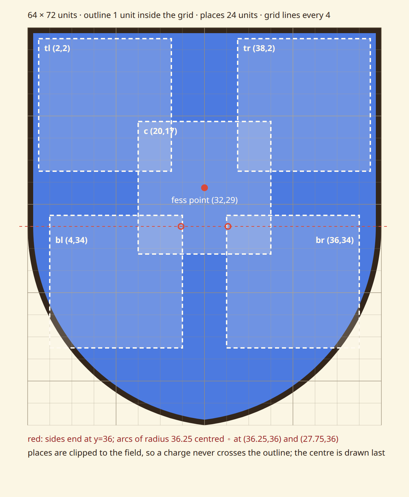
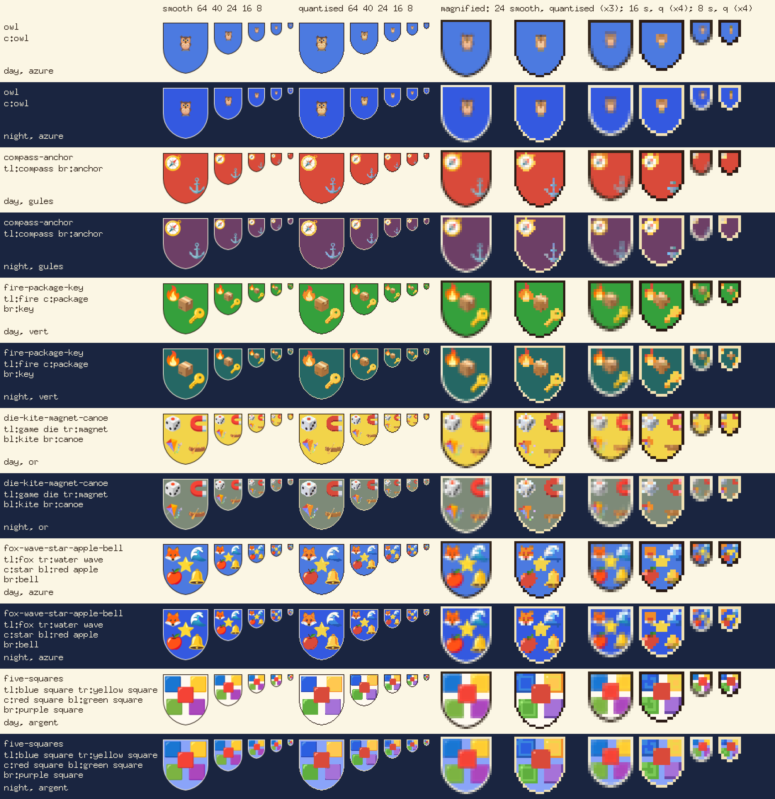

# Heraldry: the standard shield and the renderer prototype

> **History.** This records the first form of arms: one to five emoji placed like the five on a
> die on a shield of one tincture. The owner's verdict of 2026-10-26 20:45Z (thread gd-lvbRHMaXID)
> replaced it with three to five emoji in a row, shown the same way everywhere. Kept as history,
> not guidance: for the current form see [`README.md`](README.md) and [`rubric.md`](rubric.md).
> `shield.svg` and `shield-grid.svg` stay in the tree while `scripts/heraldry-proto`'s staleness
> test and the controller's `parity_test.go` still read them; step 5.4 (gd-yYpzqd0YJG) drops the
> controller's shield, after which they can go.

Phase 0 step 0.1 (gd-cAQGv3TAan) of the heraldry plan gd-N6I3Oa7uDg. Spec:
[`2026-10-25-heraldry-design.md`](../superpowers/specs/2026-10-25-heraldry-design.md) §6.
The library list (`library.md` in this directory) comes from 1.1a's generator
(gd-INpa3m02bc), not from this step.

| File | What it is |
|---|---|
| [`shield.svg`](shield.svg) | the drawing (spec §6.2): outline, field, and the five places as a clip group. `--heraldry-ink` and `--heraldry-field` restyle it. |
| [`shield-grid.svg`](shield-grid.svg) | the same drawing on its 64×72 design grid, for people ([PNG](samples/0.1/shield-grid.png)) |
| [`samples/0.1/`](samples/0.1/) | the prototype's sample sheets and the oksvg survey |
| [`scripts/heraldry-proto`](../../../scripts/heraldry-proto/) | the throwaway renderer prototype that draws all of the above |

Both SVGs are generated from `scripts/heraldry-proto/shield.go`, so nobody edits
them by hand; `make test-heraldry-proto` fails if they are stale.

## The shield

- **Grid** 64×72 units, as the spec gives it (so 1:1.125, not the 1:1.15 the
  spec also states; the grid won). One unit is one pixel at 64 px.
- **Shape**: a classical heater. A flat top, straight sides down to y = 36,
  then two circular arcs of radius 36.25 that meet in the point at (32, 72).
  Each arc is centred on the y = 36 line at the far side ((36.25, 36) for the
  left arc, (27.75, 36) for the right), which makes it leave the side
  tangentially, so the edge has no corner where the curve begins.
- **Outline**: 1 unit of ink, inside the grid. The field is the same shape
  inset by 1: the arcs keep their centres and lose 1 from the radius, which is
  an exact parallel offset. **The renderer never draws it thinner than 1 px.**
  Below 64 px a 1-unit line is a fraction of a pixel, and on its own it
  disappears: argent on the day surface showed no edge at all.
- **Places**: 24-unit squares at the die positions, top-left corners
  tl (2,2), tr (38,2), c (20,17), bl (4,34), br (36,34). The centre place is
  centred on (32,29), the fess point. That is a little above the shield's area
  centroid (y ≈ 32), because the point adds area at the bottom that the
  charges cannot use. The corners are 18 across and 15 up from the centre, and
  16 across and 17 down. The bottom pair sits 2 units further in, where the
  arcs narrow the shield.
- **Clearances**: a typical round Noto charge (radius ≈ 10.7 units in its
  24-unit place) clears the outline by ≥ 2.0 units (2.33 at the top corners, 2.00 at the bottom) and its neighbours by
  ≥ 1.9. The prototype's tests hold the geometry to ≥ 1 and ≥ 1.5.
- **The squares overlap**: there is no other way to fit them. Five 24-unit
  squares in a die layout need 72 units of width to stay apart, and the shield
  has 64. Each top corner square shares a 6×9-unit corner with the centre square, and each bottom one an 8×7-unit corner.
  Round artwork never touches; square artwork does (see `five-squares` on the
  sheet). Two rules keep that tidy. **Charges are clipped to the field**, so
  the outline is always whole and the bottom places can extend past the arcs.
  **The centre is drawn last**, on top.

## Prototype findings

Every sample here was rendered by `scripts/heraldry-proto` from Noto Emoji
**v2026-09-24-unicode18_0** (commit e20cbc2), the release 1.1a pins.

### The PNG path wins; oksvg is not an option

The spec's §6.4 already chose this; the survey confirms it. Every
single-codepoint Noto SVG that could be a charge (1,402 of them: flags,
skin-tone modifiers, keycap bases and hair components left out) went through
oksvg at 72 px and was compared with the release's own 72-px PNG
([survey](samples/0.1/oksvg-survey.md), [side by side](samples/0.1/oksvg-compare.png)):

| | SVGs |
|---|---|
| fail to parse (`&ns_extend;` entity in the Illustrator namespace header) | 114 |
| parse only by dropping elements (`clipPath` unsupported) | 66 |
| render within 2% of the PNG | 821 (59%) |
| render 2–8% off (visible at 64 px) | 235 |
| render more than 8% off (wrong) | 232 |

Most of the wrong ones lose their gradients: 🔥, 🌊 and the owl's breast come
out solid black, and 🌫 and 🌁 come out almost empty. So the product takes the
72-px PNGs, resampled with `golang.org/x/image/draw` Catmull-Rom (the kernel
widens on downscale), with no SVG rasteriser and no CGo. For the inline SVG
form (§6.4) step 2.1 can embed the charge PNGs, or reference the Noto SVGs,
which browsers draw correctly; nothing needs to rasterise an SVG server-side.

### What survives at each size

The sheet shows six sample arms (no theme glyphs, R4), day and night, at all
five sizes, smooth and quantised, with 24, 16 and 8 magnified
([1× original](samples/0.1/sheet.png)).

- **64, 40**: charges legible, as §6.3 says.
- **24**: charges read as shapes (the fox, the star, the key).
- **16**: coloured marks on a shield, as §6.3 predicts.
- **8** (8×9 px): each charge is a 3×3-pixel square, and the 1-px outline
  eats into the corner ones. A single-charge shield at 8 px (`owl`,
  `compass-anchor`) can hardly be told from an empty one. §6.3's "five 2×2
  colour cells" does not come out of scaling the drawing; it would need a
  pixel rule just for 8 px: five fixed 2×2 cells, each in its charge's
  dominant palette colour, inside the silhouette. **For 0.3's sheet**: show
  both. The 8-px uniqueness test (§6.6, step 2.1) will drop many more charges
  against the scaled 3×3 tiles than against 2×2 cells of one colour each.

### Quantised

Coverage and charge alpha snap at 50%, and each opaque pixel snaps to the
nearest colour in art.js's palette: the DAY letters plus their `night()`
forms, by redmean distance. Both pictures, by day and by night, use that one
union. So a night picture keeps bright charges (spec: "the charges are the
same") and its field is exact. Thresholding the smooth masks left gaps in the
outline along the arcs, so the quantised outline is the silhouette's edge
pixels, which closes it at every size (a test pins this). Smooth gradients
band: the blue square's highlight becomes a second square.

### Field colours: two questions for the sheet

- **There is no project accent yet.** §6.2 paints the field in "the project's
  accent", but no such value exists in the read model or the theme, so the
  prototype uses heraldic tinctures from art.js's palette (azure `i`, gules `e`,
  vert `l`, or `Y`, purpure `v`, argent `j`). Before Phase 2, someone has to
  decide where a project's colour comes from.
- **The rule of tincture still holds.** On or, the yellow star nearly
  disappears ([tinctures](samples/0.1/tinctures@3x.png)). Old heraldry forbids
  colour on colour for this reason. A field picker may want to warn when a
  charge's dominant colour is close to the field.
- **Night fields go muddy.** art.js's `night()` turns or into olive-grey and
  gules into plum. The World dims everything this way, so it fits there; a DOM
  surface in dark mode may want to keep the day field and change only the
  outline.

### Noto layout note (for 1.1a and 2.1)

Since the Unicode 18 release, the per-codepoint assets live under `2D/`:
`2D/png/72/emoji_u<cp>[_<cp>…].png` and `2D/svg/…`, named without U+FE0F.
`2D/svg/LICENSE` is the Apache 2.0 text to vendor beside the assets. The
release has 1,449 single-codepoint files. A sparse, blob-filtered checkout of
just `2D/svg` and `2D/png/72` is 66 MB and takes a few seconds
(`scripts/heraldry-proto/fetch-noto.sh`).
