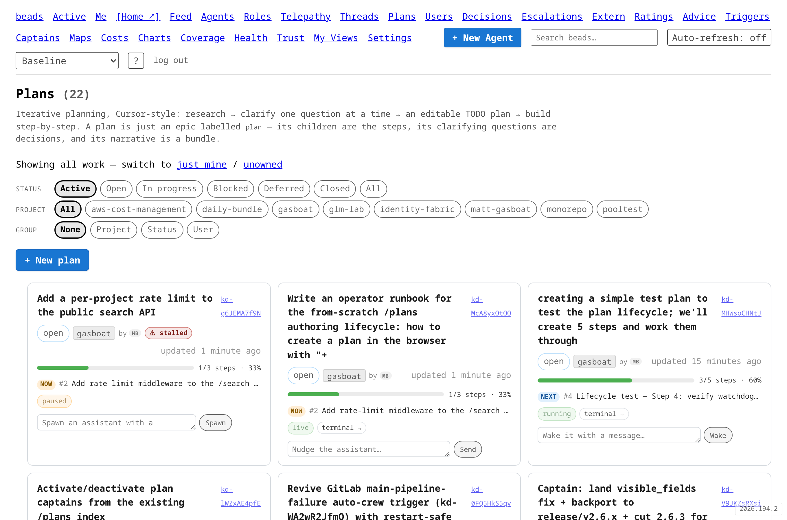
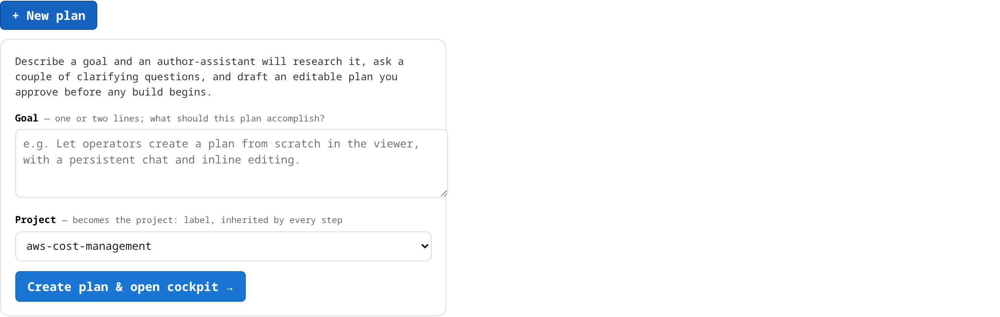
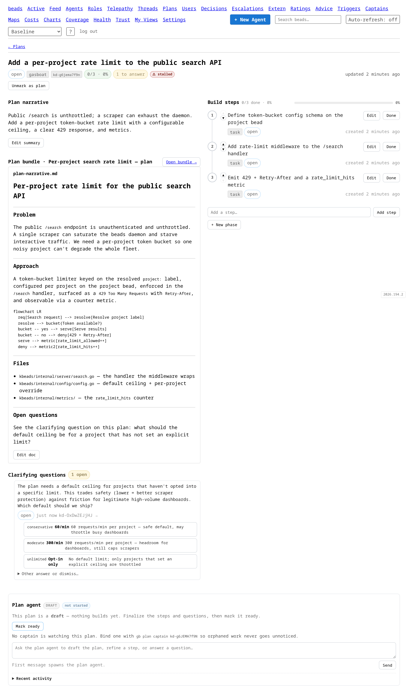
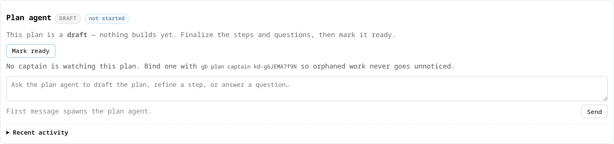
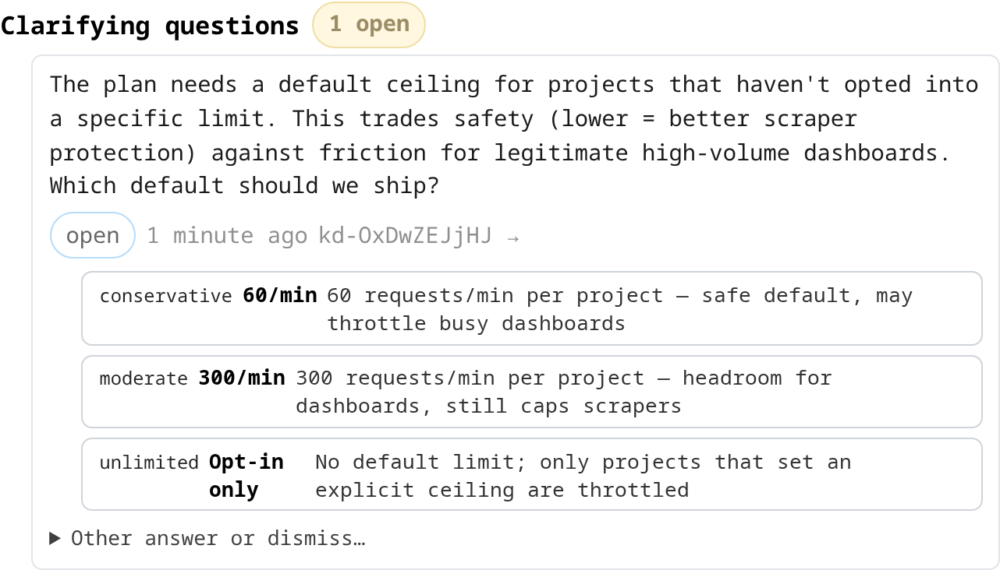
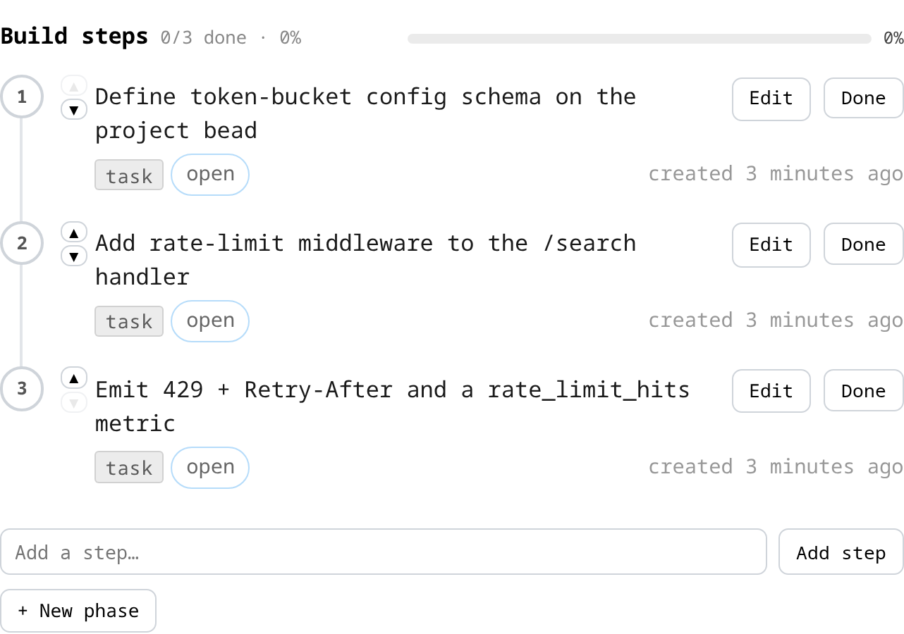
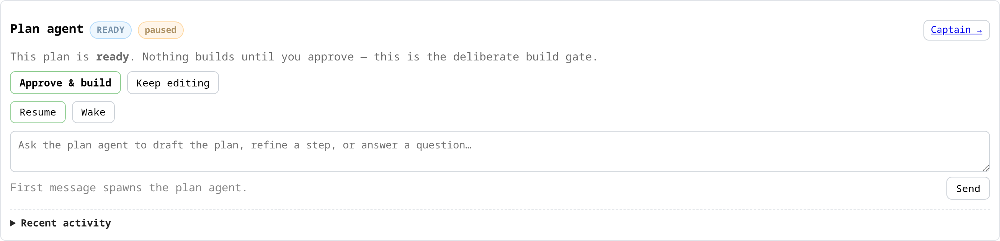
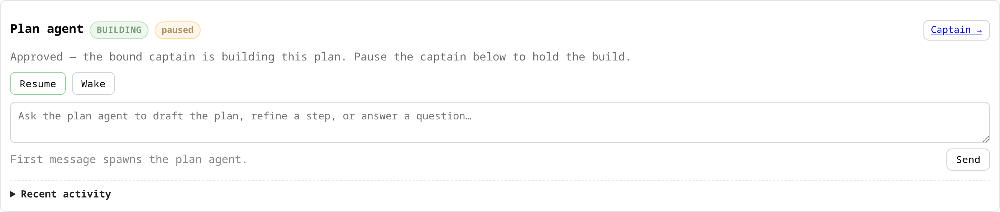
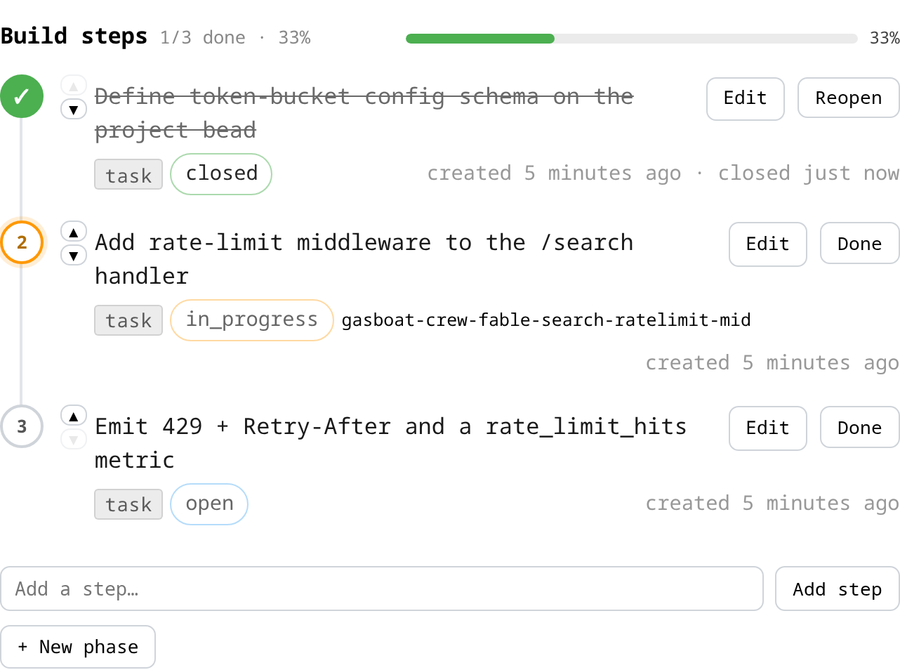
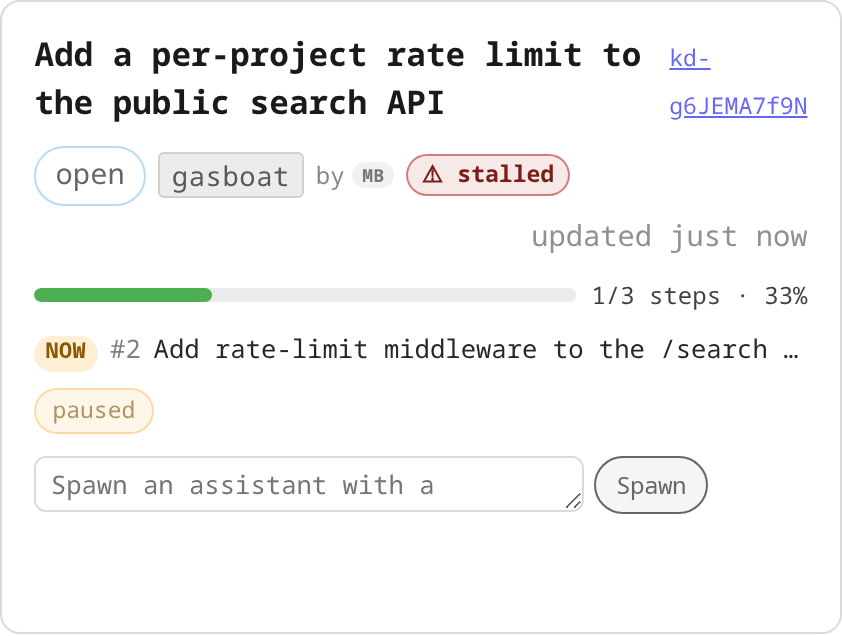

# Plan authoring runbook (operator-facing)

How to author a plan **from scratch** in the browser — the gardenio answer to
Cursor's Plan Mode. You describe a goal, an author-assistant researches it and
asks you a couple of clarifying questions, you shape an editable step list, and
you move the plan through **draft → ready → "Approve & build"**. Nothing builds
until you deliberately approve.

This runbook is for the **operator** (the human driving `/plans` in the
browser). For the agent-side gardener loop that runs *after* you approve, see
[`gardener-loop-runbook.md`](gardener-loop-runbook.md).

> **The plan is beads, not markdown.** A "plan" is an ordinary `type=epic`
> carrying the `plan` label. Its TODO steps are `task` children; its narrative
> is a `type=bundle` doc; its clarifying questions are `type=decision` children.
> The `/plans` cockpit is a view over those beads — everything you do in the UI
> is a real, immediate bead write (write-through; there is no hidden draft
> buffer).

> **Where the machinery lives (the three-layer split).** A plan is no longer a
> beads-viewer convention with all its rules baked into the HTML handlers. Since
> epic `ka-0000000187` the plan concept is split across three layers, and this
> runbook points you at the right one throughout:
>
> | Layer | Owns | Source |
> |---|---|---|
> | **kbeads daemon** | Plan **STATE + invariants** — legal `plan_state` transitions, the "can't enable a gardener on a draft" gate, atomic `phase_order`/`step_order` ops, the born-on-labels create+verify, and the first-class `beads.plan.step.added` signal | `kbeads/internal/server/plan_state_validation.go`, `gardener_enable_gate.go`, `kbeads/internal/events/events.go` |
> | **controller reactor** | **REACTIVE collaboration** — one debounced seam that nudges a live plan-agent / wakes a parked one / spawns a fresh one when a step is added, from *either* the CLI or the browser, behind one durable per-plan debounce | `internal/planagent/` (the lifted engine); `gardenio/controller/cmd/beads-viewer/plan_step_reactor.go` (the single reactive seam) |
> | **beads-viewer** | **RENDER + read, plus thin browser write-PROXIES** — the `/plans` index, cockpit, board, timelines render live over SSE. It owns no plan **invariant** (the daemon does); but because the browser cannot reach the daemon directly (`unifiedHost` off in every env, no browser daemon-bearer), it keeps thin write-proxy handlers that forward each browser plan write to the daemon on the viewer's own bearer — the same composition `gb plan` performs daemon-direct. **No viewer-OWNED plan-write logic remains** (carve-out `ka-0000004319`) | `gardenio/controller/cmd/beads-viewer/plans*.go` |
>
> The practical upshot for you: every `gb plan` write verb (and the browser
> equivalents) originates against the **daemon**, so a headless gardener can drive
> a plan end-to-end on `BEADS_AUTH_TOKEN` alone — the old viewer-POST 401 in the
> Keycloak-OIDC deploy (`ka-0000006389`) is gone. Adding a step fires exactly one
> reactive nudge no matter who added it, because a single reactor owns the
> debounce. See the [Reference](#reference) for the full layer map.

> **A plan asked for in a Commons thread takes the card path, not this one**
> (step 9.11, gd-igAyMerw44). The thread agent writes the plan as markdown and
> runs `gb lands plan write <project> --file plan.md`, the same verb a Lands
> steward uses (duty 2 in [`lands/steward.md`](lands/steward.md)). In the home
> garden (the operator land on the Commons; its owner is the person the project
> bead names as `operated_by`) that writes the epic, bearing the arms from the
> markdown's `Arms: <emoji>` line under the title, and one task per step, sets
> `plan_state=ready`, and files one owner decision, "Plan <id>: <title> - run
> it?", with approve / change / drop. The owner answers the card on the Commons
> (or on the plan's Nursery pot on `/garden`, 9.11b). The answer respawns the
> thread agent, which runs `gb lands plan answer <project> <decision>`: approve
> moves the plan to `building`, binds and enables its plan gardener
> (`plangardener.Start`) and fires the gardener's first cycle, so a crew is on
> the first step with no operator command. A step body under 200 characters is
> refused by `write` and by approve, and the error names the step. The cockpit
> flow below stays for plans an operator authors on `/plans` by hand.
>
> **A plan the owner asks for in their own thread skips the card** (P8.7, owner
> ruling 3 on gd-7qUpu15BBK). When the home garden's owner opened the thread
> (the head's `created_by`) and the thread's own agent writes the plan there,
> `write` stamps the plan's `thread_id`, moves it straight to `building`, binds
> and starts its gardener, and replies with a "change or drop" notice instead of
> filing the decision. The daemon seals that gardener to the owner from the same
> facts (`kbeads/internal/server/spawn_lineage_thread_ask.go`). `--propose` files
> the card anyway for a plan that is the agent's own idea; tenant lands always
> get the card.
>
> **The server applies the answer too (gd-Dl88Htipuq).** The beads-viewer's plan
> answer reactor (`cmd/beads-viewer/plan_answer_reactor.go`) sweeps the `ready`
> plans every 30 seconds and applies an answer the daemon stamped as an
> operator-lane human's (`resolver_admin=true`), on a decision of the plan's land
> whose `requesting_task` / `requesting_plan` name the plan, answered within the
> last 24 hours (`steward.FindRuling`). It runs the same `steward.AnswerPlan` and,
> on a home-garden approve, `plangardener.Start`; the daemon seals the gardener
> from the approval, so its triggers spawn the first cycle. So the owner clicks once:
> nobody files a `beads_admin_write` escalation to apply a plan ruling. The thread
> agent's own `gb lands plan answer` afterwards changes nothing, and if it fails
> on a bead it cannot write, it says the server applies the answer. A dismissed
> card or words with no option apply nothing; an answer relayed by a bridge or
> machine, or older than a day, is left to `gb lands plan answer` as before.

---

## TL;DR

| Step | Where | What happens |
|---|---|---|
| 1. Start | `/plans` → **+ New plan** | Mints the plan epic + spawns the author-assistant on your goal |
| 2. Research & clarify | `/plans/{id}` chat + **Clarifying questions** | Assistant drafts the plan and asks you questions one at a time |
| 3. Edit steps | `/plans/{id}` → **Build steps** | Add / edit / reorder / close TODO steps inline |
| 4. Mark ready | Plan-agent panel → **Mark ready** | `draft → ready`; still nothing builds |
| 5. Approve & build | Plan-agent panel → **Approve & build** | `ready → building`; enables the bound gardener to dispatch crew |
| 6. Mark complete | Plan-agent panel / peek drawer → **Mark complete** | `building → complete`; closes the plan epic + disables the gardener (**Reopen** undoes it) |

The single hard gate is **"Approve & build"** (ExitPlanMode-analogous): it is the
*only* transition that lets a gardener start building. `draft` and `ready` both
keep the build blocked. **"Mark complete"** is the terminal gate at the other
end — the *only* one-click way to retire a plan (see [Stage 6](#stage-6--mark-the-plan-complete)).

---

## The lifecycle at a glance

```text
                 + New plan             Mark ready           Approve & build          Mark complete
   (nothing) ──────────────▶  draft  ──────────────▶  ready  ──────────────▶  building ──────────────▶  complete
                               ▲                         │                        │  ▲                      │
                               └───── Keep editing ──────┘                        │  └─────── Reopen ───────┘
                                                                                  │
                                        (pause the gardener to hold the build) ◀───┘
```

- **draft** — the assistant is still researching / clarifying; steps are being
  drafted. **The gardener build is BLOCKED.**
- **ready** — the plan is finalized and awaiting your deliberate "Approve &
  build". **The gardener build is still BLOCKED.**
- **building** — you approved; the bound gardener loop is enabled and dispatching
  crew step by step. The gardener toggle is unblocked (pause / resume).
- **complete** — the terminal state: the plan is done. **Mark complete** closes
  the plan epic (`status=closed`) and disables the bound gardener so its loop
  stops firing. **Reopen** is the inverse (`status=open`, `plan_state=building`,
  gardener left paused). Source: `plans_lifecycle.go` (`handlePlanComplete` /
  `handlePlanReopen`).

The state lives on the plan epic's `plan_state` field. A browser-created plan is
born `plan_state=draft`; a legacy or hand-marked epic has no `plan_state` and is
treated as *ungated* (it behaves exactly as plans did before the lifecycle
existed). Source: `plans_lifecycle.go`.

---

## The `/plans` index

Open `/plans`. This is the control room: every plan-labelled epic, newest
first, each card showing status, project, creator, a step-progress bar, open
clarifying-question count, and the bound agent's state. Filter by
status / project / user with the chip rows, and group with **GROUP**.



The **+ New plan** button (top-left, operator-only) is the cold-start. A
read-only viewer does not see it.

---

## Stage 1 — Start a plan with "+ New plan"

Click **+ New plan**. Describe your goal in one or two lines and pick the
project. The project becomes the `project:` label, inherited by every step.



Click **Create plan & open cockpit →**. On submit the viewer:

1. Mints a `type=epic` with the `plan` and `project:<project>` labels **born-on
   in one atomic write** (so the plan can never exist-but-be-invisible), stamps
   `plan_state=draft`, and verifies it reads back as a discoverable plan.
2. **Spawns the author-assistant** with your goal as its first prompt, so the
   research/draft loop is already waking as you land in the cockpit.
3. Redirects you (POST-redirect-GET) to the live cockpit at `/plans/{id}`.

Source: `plans_create.go` (`handleCreatePlan` → `createPlanEpic` →
`spawnPlanAuthorAssistant`).

### CLI equivalent

`gb plan create` mints the plan epic **daemon-direct** — same born-on labels +
`plan_state=draft` + verify-before-return contract as the browser create, but
composed straight against the beads daemon (no viewer round-trip), so it works
from an agent pod under `BEADS_AUTH_TOKEN`:

```sh
gb plan create --goal "Add a per-project rate limit to the public search API" --project gardenio
```

It prints the new plan id. Use this when scripting or when you prefer the
terminal; the browser form is the interactive path. Note the CLI `create` mints
the plan but does **not** auto-spawn the author-assistant the way the browser
create does — the controller reactor deliberately never cold-spawns off the
passive dependency stream (cold-spawn-on-create parity is its tracked
end-state). To engage the assistant on a CLI-created plan, open it in the
cockpit and send a first message, or add a step to a plan that already has a
bound agent.

---

## Stage 2 — Collaborate with the author-assistant

You land in the cockpit at `/plans/{id}`. Three regions, all live (they
re-render over SSE as beads change — no reload):

- **Plan narrative** (left) — the assistant's prose + Mermaid diagram + file
  refs, stored as a `type=bundle` doc.
- **Build steps** (right) — the editable TODO timeline.
- **Plan agent** (full-width, bottom) — the lifecycle chip, the state levers,
  and the chat box to the assistant.



### The chat box

The **Plan agent** panel carries the conversation. Type in the box ("Ask the
plan agent to draft the plan, refine a step, or answer a question…") and click
**Send**. Behaviour depends on the assistant's state:

- **live** — your message is delivered to the running session now (sub-second
  nudge).
- **parked** — your message is queued and delivered when it wakes.
- **none** — the *first* message spawns the assistant (same as the auto-spawn on
  create; if that spawn ever failed silently, your first message recovers it).

A transient acknowledgment line tells you which of the three actually happened,
so a message never disappears into the void. Source:
`plans_assistant_prompt.go`.



### Answering clarifying questions

The assistant asks the **single most decision-relevant question at a time** (not
a wall of questions). Each one appears in the **Clarifying questions** section as
a decision card with concrete options. Answer it in place — pick an option, or
expand **Other answer or dismiss…** to write a free-text answer or dismiss the
question. Your answer wakes the assistant, which folds it into the plan and asks
the next question if it has one.



Keep going until the plan reads unambiguous: the narrative captures the
approach, the steps are right, and the "1 open" question badge is gone.

### Answering clarifying questions from the CLI (headless gardener)

A clarifying question is a `type=decision` bead auto-parented onto the plan
epic, and **answering or dismissing it is a plain daemon write** — `POST
/v1/decisions/{id}/resolve` / `/cancel`, which carry **no OIDC gate** (attribution
is derived from the authenticated token, not the request body). The browser's
inline Answer / Dismiss buttons are thin wrappers that delegate to exactly those
daemon endpoints. The answer/dismiss surface was daemon-direct from the start,
and as of epic ka-0000005932 the *other* plan write verbs (`create`, `add-step`,
`add-phase`, `reorder-phase`, `complete`, `reopen`) are daemon-direct too — so a
headless plan-gardener **can drive every plan write with only `BEADS_AUTH_TOKEN`**
(the old viewer-POST 401 against an OIDC-gated viewer, ka-0000006389, is gone).
To answer a plan question there are two ways:

```sh
# Plan-scoped sugar (recommended): validates the decision belongs to THIS plan,
# then answers/dismisses it daemon-direct — no --viewer-url needed.
gb plan answer  <plan-epic-id> <decision-id> --select <option-id>
gb plan answer  <plan-epic-id> <decision-id> --text "free-text answer"
gb plan dismiss <plan-epic-id> <decision-id> --reason "why"

# Generic decision verbs (same daemon write, no plan-membership check):
gb decision respond <decision-id> --select <option-id>
gb decision cancel  <decision-id> --reason "why"
```

> **Nuance — prefer `gb plan answer` over `gb decision respond` for plan
> questions.** `gb plan answer` routes through `POST /v1/decisions/{id}/resolve`,
> which fires the daemon's full answer path: the `DecisionAnswer` event, the
> privileged-dibs agent rebind (the answering assistant inherits the responder's
> `operated_by`), and the `report_required` gate. `gb decision respond` instead
> closes the bead via the generic close endpoint — the Slack bridge still wakes
> the assistant (it backfills `chosen` from the closed bead) and the cockpit
> still re-renders live over SSE, so the plan stays *correct* either way, but the
> generic path skips that daemon-side `DecisionAnswer`/rebind. For behavioral
> parity with a browser answer, use `gb plan answer` / `gb plan dismiss`.

The cockpit updates in place either way: the `#plan-decisions` section re-renders
over SSE on the decision's close event regardless of who wrote it (a human
clicking, or a gardener via CLI).

---

## Stage 3 — Edit the step list

The **Build steps** section is the editable TODO timeline. Steps are numbered
1..N in a stable display order (they do not renumber as steps close). Each row
shows the step, its type, its status, its assignee once building, and any linked
MR or open blocker.



Operator controls (operator-only):

- **Add a step…** — type a title and click **Add step**. The browser only mints
  and links the step; the *reactive nudge* — collaborate on the new step, or
  wake/spawn an assistant if none is live — is fired by the **single controller
  reactor**, not by the browser handler itself. A CLI `gb plan add-step` reaches
  the exact same reactor, so an add from either surface nudges exactly once,
  behind one durable per-plan debounce that coalesces a burst of adds. (Source:
  `plan_step_reactor.go` — the sole reactive seam since `ka-0000002533`.)
- **Edit** — rename a step in place.
- **▲ / ▼** — reorder a step within its group; the arrows disable at the
  boundaries.
- **Done / Reopen** — close or reopen a step.
- **+ New phase** — group steps into phases for a larger plan (phase steps are
  grandchildren under a phase sub-epic; the timeline renders them grouped).
  The same phase moves are available from the CLI: `gb plan add-phase`,
  `gb plan reorder-phase`, and `gb plan add-step --phase <phase-epic-id>` to add
  a step directly into a phase (see the CLI reference below).

### Emplacing a formula pour as a phase

A phase does not have to be hand-authored one step at a time. If a **formula**
already captures the shape of a chunk of work (a reusable, variable-substituted
step graph), you can **pour it directly into the plan** and it lands as a
first-class phase — the poured molecule is the phase, and its step children are
the phase's steps.

- **Browser:** open the formula's pour form (`/formulas/{id}/pour`, the operator
  **Pour** button), fill in the formula's variables, put the plan's epic id in
  the new **Emplace into plan** field, and pour. A blank field pours a normal
  freestanding molecule (the pre-existing behavior); a plan id emplaces the pour
  as a phase and redirects you to the plan cockpit so you see the new phase in
  context. The plan cockpit's own **Pour a formula** control does the same thing
  scoped to the plan you're already in: it POSTs to `/plans/{id}/pours` (the
  plan-cockpit write-proxy), which pours with `target_plan` fixed to that plan.
  A dry-run (Preview) returns the step tree the pour would create without writing
  anything; a real pour returns the emplaced molecule's bead id.
- **CLI (headless gardener):**

  ```bash
  gb plan pour <plan-epic-id> --formula <formula-id> --var k=v [--force] [--ephemeral] [--position N]
  ```

  This composes **daemon-direct** (like every other `gb plan` write verb): the
  daemon instantiates the formula, parents the resulting molecule under the plan,
  and appends its id to the plan's `phase_order` in one request — so it renders as
  a phase immediately. `--force` overrides the duplicate-molecule guard;
  `--ephemeral` pours a wisp instead of a persistent molecule.

  **Positional emplacement (`--position`, the "target cell").** By default the
  poured phase lands at the **end** of `phase_order`. `--position N` emplaces it
  at a chosen 0-based slot instead — `--position 0` makes it the plan's first
  phase, `--position 2` slots it third, shifting the rest right. `N` must be in
  `[0, current-phase-count]` (a slot past the end is rejected, not silently
  clamped, so a stale index surfaces as an error rather than landing somewhere
  unexpected); `N == count` is exactly the default tail append. The browser pours
  accept the same knob as an optional `position` field on `/plans/{id}/pours`
  (and the daemon request field is `target_position`). Emplacement is
  append-if-absent: re-pouring a molecule already in `phase_order` is a no-op and
  never relocates it.

The container stays a **`type=molecule`** (keeping its `/molecule` execution
view, `kd mol` verbs, wisp GC, the dedup guard, and formula lineage) — the plan
cockpit's `isPhaseContainer` predicate accepts a molecule wherever it accepts an
epic, so it renders, counts, and reorders like any other phase. Emplacing a phase
this way is treated as a *phase add*, so — like the browser's **+ New phase** — it
does **not** fire the reactive plan-assistant nudge; the molecule's own steps
nudge normally once you start working them.

You (and the assistant) shape the list together throughout `draft`. Because the
cockpit is write-through, every edit is a real bead mutation the moment you make
it — the assistant sees your edits on its next turn, and you see its edits live.

> **The plan is a living document.** You are not locked into the first draft —
> keep iterating narrative + steps + questions until the plan is right. The
> lifecycle gate below is about *when a gardener may start building*, not about
> freezing the plan.

### Painted-door check for speculative platform surface

For any step that proposes **new gardenio platform surface with unproven demand**
— a new `/plans`-style viewer page, a new `gb` subcommand, a new gardener
archetype/role — apply the **painted-door prompt** before you keep it:

> **Is there a painted-door version of this step?** Can we ship the *interface*
> (the page, the flag, the command, the archetype) over a **no-op or minimal
> backend**, instrument who actually uses it, and build the real backend only
> once the usage is there?

The move (from `lopopolo/harness-engineering`): put the door on the wall, count
who tries the handle, and only build the room behind it once the traffic proves
the room is wanted. A painted-door step is one you can ship in a fraction of the
effort and that *pays for itself in evidence* — real usage numbers replace a
guess about demand.

This prompt is a **filter, not a veto**. It applies only to speculative *new
surface* — skip it for bug fixes, for reworking surface that already has proven
users, and for steps whose demand is already established. When it does apply,
either (a) rewrite the step as its painted-door version (ship the interface,
instrument it, gate the full build on evidence), or (b) record in the narrative
*why* this step earns a full build now (e.g. a named operator already blocked on
it). Don't silently drop the prompt — a step that skips it should say so.

Full policy + rationale: advice `gb advice show ka-0000004688` (or search
`kd search "painted-door discipline"`).

### No bake-in steps (owner rule, 2026-11-02)

No step says "bake", "soak" or "wait N hours/days, then". A step's gate is an event or
evidence: the first occurrence, N successes, one measurement, a test that trips. The next step
starts as soon as the gate holds; if it goes wrong, revert or fix forward. Measuring after a
change is fine when nothing waits on it, a shim is removed when no caller uses it (not on a
date), and a deadline or time box is not a wait. Only the owner can ask for a waiting period.
See "No bake-in periods" in the root `CLAUDE.md`.

---

## Stage 4 — Mark the plan ready

When the plan is finalized — steps are right, questions answered — click **Mark
ready** in the plan-agent panel. This flips `draft → ready`.

`ready` means "finalized and awaiting deliberate approval". **Nothing builds
yet** — this is deliberately a two-step finalize-then-approve so the build
never starts as a side effect of finishing the draft. To reopen a ready plan for
more editing, click **Keep editing** (flips `ready → draft`).



### Bind a gardener before you can build

"Approve & build" starts the plan's **bound gardener** — the looping agent that
dispatches one crew per ready step. If no gardener is bound yet, the ready panel
tells you to bind one:

```sh
gb plan gardener <plan-epic-id>
```

This mints a `type=trigger` gardener pinned to the plan (by a `gardener-epic:<id>`
label) with a self-terminating loop spec (run budget + drain-when-epic-empty).
Once bound, the **Approve & build** button becomes active. Source:
`plans_gardener.go`, `cmd/gb/gardener.go`.

When the engine later closes a building plan's gardener (a spent budget, a hard
stop), re-arm the same trigger rather than binding a new one:

```sh
gb plan rearm <plan-epic-id>    # reopen + enable the last engine-closed gardener, seal kept
```

The home steward runs it itself on each wake (row `steward-rearm`,
`kbeads/docs/ownership-grants.md`). It refuses a gardener closed by hand or carrying no
valid seal; bind a new one with `gb plan gardener` then.

---

## Stage 5 — Approve & build

Click **Approve & build**. This is the single deliberate build gate
(ExitPlanMode-analogous). In one gesture it:

1. Flips `ready → building`, and
2. Enables the bound gardener loop.

You are asked to confirm ("Approve this plan and start the gardener building it,
step by step?") because this is the point where agents start doing real work
against your plan.

Once building, the plan-agent panel shows the **BUILDING** chip and the gardener
controls (**Pause / Resume**, **Wake**). Pause the gardener any time to hold the
build; the plan stays `building` but the loop stops spawning new iterations.



The gardener now walks the plan: it spawns one crew agent per ready step
(throttled, ~2–3 concurrent), and the timeline updates live as steps move to
`in_progress` and then close. The progress bar and per-step assignee + MR links
tell you who is on what.



Back on the `/plans` index, the card summarizes the same state — progress bar,
the current ("NOW") step, the gardener state, and any warning badges:



> **Watch for ⚠ stalled / ⛔ blocked-by-escalation badges.** A `⚠ stalled` badge
> means there is open work with nothing watching it (gardener paused/none, or a
> step in-progress under a dead agent) — resume the gardener or re-spawn the
> step. A `⛔ blocked by escalation` badge means a privileged operator action is
> gating the plan; act on the escalation to unblock it. These are the signals
> that catch orphaned plan work.

The plan is done when every step is closed. The gardener loop is self-terminating
(it goes dormant when the epic drains), and the bound gardener completes the plan
and tells you — see the next stage for the criteria and how to reopen.

### Firing mode & cadence — how often the gardener wakes

The gardener panel exposes two related controls that decide *when* the gardener
fires, both editable from the cockpit (no trip to `/gardener/{id}` needed):

- **Firing mode** (the *Firing mode ▾* menu). Two modes:
  - **⏱ Timed** — fires on a fixed **cron schedule**. Simple and predictable;
    the gardener wakes on the clock whether or not anything changed.
  - **⚡ Event** — wakes on **activity inside the plan's subtree** (a step
    created / updated / closed), debounced so a burst coalesces into one fire.
    This is the mode every new plan gardener is born in (Approve & build's
    auto-bind, the *Enable gardener* button and `gb plan gardener` all bind it
    this way, gd-gsvlS6YDj3): it reacts the moment a step closes rather than
    waiting for the next tick. Timed plan gardeners ran 779 times a day with at
    least 80% of runs dispatching nothing, which is why the clock is opt-in.
- **Cadence** (the *Cadence ▾* editor). What "cadence" means depends on the mode:
  - In **timed** mode the field is the **cron schedule** itself. It cannot be
    blank — a timed gardener with no cron never fires.
  - In **event** mode the field is an optional **fallback-watchdog cron** — a
    slow floor that bounds staleness if the event stream (SSE) ever drops.
    **Leave it blank to run the gardener purely on events, with no clock floor
    at all.** A newly bound plan gardener starts with a **daily** watchdog,
    staggered from the plan id, so a plan never goes fully silent; a gardener
    flipped to event mode by hand (`gb gardener mode --event`) gets **no
    default cron**, and you dial in a watchdog only if you want that floor.

Whichever cron you set is validated before it is saved, and the plan's
open-work pre-flight gate (fire only while a step is still open) is carried onto
the fallback watchdog automatically — so a fallback fire never spawns an idle
iteration after every step has closed.

> **First cycle after Approve & build.** A sealed event-mode plan gardener that
> has never run is fired once by the trigger engine as soon as it loads the
> enabled gardener (within a few engine ticks), provided the plan still has an
> open step (gd-Vk2ADepJZ2). The same max_concurrent, one-spawn-at-a-time and
> spawn-lineage checks as any fire apply. A gardener that has run before is not
> re-fired on Resume, and an unsealed one is not fired at all; use **Wake** (or
> `gb gardener fire-now <plan>`) for those.

> **Blank event cadence ⇒ purely event-driven.** The trade-off: with no fallback
> cron, an SSE outage means the gardener stays dark until the next real subtree
> event (or a manual **Wake**). Set a slow watchdog (e.g. daily) if you want a
> guaranteed floor; leave it blank for the leanest, no-idle-fire behavior.

The equivalent CLI is `gb gardener mode <plan-epic> --event`
(`--no-fallback-cron` to author it with no watchdog, or `--fallback-cron '<expr>'`
to set one explicitly; a hand flip of a plan gardener defaults to none). To bind
a new plan gardener on the clock instead, use `gb plan gardener <plan> --timed`
(staggered 30m) or `--cron '<expr>'`; `--fallback-cron '<expr>'` overrides the
daily watchdog of the default event-mode bind.

---

## Stage 6 — Mark the plan complete

A building plan has no *terminal* state of its own until you retire it. When the
work is done, **Mark complete** (in the plan-agent panel while `building`, and in
the board's peek drawer) is the one-click finish. It:

1. Stamps `plan_state=complete`,
2. Closes the plan epic (`status=closed`) — the board moves it to the **Closed**
   lane, and
3. Disables the bound gardener so its loop stops firing.

If open steps remain, the button warns first ("N steps still open — mark this
plan complete anyway?"), so you can retire a plan that has intentionally-abandoned
steps without closing them one by one. To undo, click **Reopen**: it reopens the
epic (`status=open`) and restores `plan_state=building`, leaving the gardener
**paused** — you resume it deliberately (reopening never silently restarts the
loop).

### When should a plan be marked complete? (formal close criteria)

The plan-gardener completes its own plan when the criteria hold and tells you;
you reopen it if you disagree (owner ruling 1 on `gd-7qUpu15BBK`, which reverses
the propose-and-confirm of `ka-0000004595`). Its playbook checks the same three
criteria you apply before clicking **Mark complete**. A plan is ready to complete
when **all three** hold:

1. **All transitive open children are closed** — `gb open-children <plan>` prints
   nothing. Every step, phase, and sub-epic is done (or intentionally retired).
2. **No open decision or escalation is gating the plan** — nothing in the plan
   subtree is waiting on a human, and the gardener owns no unresolved decision.
3. **The bundle/narrative has converged to its final status** — the plan's
   attached bundle reads at VP altitude ("what happened, where it landed"), with
   durable history pushed down into the epics/tasks.

When all three are met, the gardener comments the evidence for each criterion on
the plan, runs `gb plan complete <plan>`, posts one line to the plan's channel and
stops. No decision card is filed. If you disagree, run `gb plan reopen <plan>`. If
only some criteria hold, the gardener comments which are still open and keeps
working the plan.

### CLI equivalent

```sh
gb plan complete <plan-epic-id>    # closes the plan + disables the gardener
gb plan reopen   <plan-epic-id>    # inverse: status=open, plan_state=building
```

Both compose **daemon-direct** (like every `gb plan` write verb): `complete`
disables the bound gardener, stamps `plan_state=complete`, and closes the plan
epic; `reopen` reopens it and restores `plan_state=building`. They run on behalf
of the `--operated-by` operator under `BEADS_AUTH_TOKEN` — no viewer URL — so a
gardener steering on an operator's behalf completes a plan the way the UI button
does, even in the OIDC-gated deploy.

---

## Marking an existing epic as a plan

Any epic can become a plan without the New-plan flow: open it at `/plans/{id}`
and use the operator **mark as plan** affordance (it adds the `plan` label).
Such a hand-marked plan starts *ungated* (no `plan_state`); the first **Mark
ready** click opts it into the lifecycle. New browser-created plans are gated
from birth.

---

## Reference

### The three-layer source map

A plan's behavior is split across three layers (epic `ka-0000000187`). When you
need to read the code, go to the layer that owns the concern — not to the viewer
for everything:

- **kbeads daemon — plan STATE + invariants** (`kbeads/internal/server/`):
  - `plan_state_validation.go` — the `draft → ready → building → complete`
    state machine; illegal transitions are **rejected at the daemon**, not
    in the viewer.
  - `gardener_enable_gate.go` — the "can't enable a gardener on a draft" gate.
  - atomic `phase_order` / `step_order` append + reorder primitives (compare-and-swap /
    server-side splice) that kill the concurrent-writer clobber.
  - `internal/events/events.go` (`beads.plan.step.added`) + `internal/eventbus/`
    (`PLAN_EVENTS` durable JetStream stream, dedupe window) — the first-class,
    server-resolved, fail-closed step-added signal.
- **controller reactor — REACTIVE collaboration**:
  - `internal/planagent/` — the lifted spawn/wake/prompt engine + closed-plan
    backstop, byte-identical to what the viewer used to run inline.
  - `gardenio/controller/cmd/beads-viewer/plan_step_reactor.go` — the **single**
    reactive seam. It observes the new step edge and fires the nudge/wake/spawn
    behind a **durable** per-plan debounce (`fields.last_nudge_at` on the epic),
    so a CLI add and a browser add both collaborate through *one* path — the
    fork/double-spawn risk is gone by construction (`ka-0000002533`). The engine
    is already lifted into the reusable `internal/planagent` package; this thin
    seam currently runs inside the viewer process (observing the daemon
    dependency stream), and the tracked end-state is to move it into the
    controller consuming the first-class `beads.plan.step.added` signal directly
    (a clean lift — the engine already lives in its own package). Either way it
    is the single reactive layer, distinct from render.
- **beads-viewer — RENDER + read, plus thin browser write-proxies**
  (`gardenio/controller/cmd/beads-viewer/`):
  - `plans.go` — the index + cockpit + step-editing render handlers.
  - `plans_create.go`, `plans_lifecycle.go`, `plans_gardener.go`,
    `plans_assistant_prompt.go` — the render + read surfaces for create, the
    lifecycle chip/levers, the bound-gardener panel, and the in-cockpit chat
    lane.
  - **The browser write-PROXIES are retained, not deleted** (carve-out
    `ka-0000004319`, chosen=carveout). The browser cannot reach the daemon
    directly — `unifiedHost` is off in every committed env and the browser holds
    no daemon operator bearer — so a browser plan write MUST land through a
    same-origin viewer `POST` (create, add-step, add/reorder phase, step
    retitle/reorder/close/reopen, the `state`/`build`/`complete`/`reopen`/`mark`
    lifecycle levers), which the viewer forwards to the daemon on its own bearer +
    `X-Operated-By`. These proxies own **no plan invariant** — each is the
    byte-for-byte SAME composition the matching `gb plan` verb performs
    daemon-direct, and the daemon (P1) rejects any illegal write regardless of
    caller — so the exit criterion is **"no viewer-OWNED plan-write logic
    remains"** (no invariant), not "no write *path* remains". The canonical
    carve-out banner lives in `plans_lifecycle.go`; every proxy handler points at
    it. The clarifying-question resolve/dismiss proxies
    (`handlePlanResolveDecision` / `handlePlanDismissDecision` in `plans.go`) carry
    the same carve-out (sibling task `ka-0000002574`): each only forwards the form
    to `daemon.ResolveDecision` / `daemon.CancelDecision` (the daemon's
    `POST /v1/decisions/{id}/resolve|cancel`) and re-renders `#plan-decisions` — the
    same daemon endpoint `gb decision respond/cancel` and `gb plan answer/dismiss`
    hit daemon-direct — so they own no decision-write logic either.

> **Historical note.** Before epic `ka-0000000187` this section read "source of
> truth: `beads-viewer/plans*.go`" — the viewer *enforced* the state machine, grew
> the order arrays by read-modify-write, and fired the reactive spawn from its own
> `POST /plans/{id}/steps` handler. That coupling is what the three-layer split
> retired: the viewer POST handlers still exist as the browser's write *path*
> (the browser can't reach the daemon directly), but the state machine, the
> race-safe order-array ops, and the reactive spawn all moved to the daemon +
> reactor, so the handlers now own no plan invariant — they compose the same
> daemon primitives `gb plan` does.

- **CLI:** `gb plan create`, `gb plan add-step` (`--phase` to target a phase),
  `gb plan add-phase`, `gb plan reorder-phase`, `gb plan pour` (emplace a formula
  pour as a phase), `gb plan complete`, `gb plan reopen`, `gb plan gardener`
  (`cmd/gb/`). Every one of those write verbs is
  **daemon-direct**: it composes against the beads daemon through the helpers in
  `cmd/gb/plan_write.go` (the write-side twin of `plan_read.go`), needing only
  `BEADS_AUTH_TOKEN` and taking no `--viewer-url`, so they work from an agent pod
  in the OIDC-gated deploy where the old viewer-POSTing path 401'd
  (ka-0000006389, epic ka-0000005932). The mint/link/grow logic and the daemon
  invariants above keep CLI and browser writes equivalent (same field keys, caps,
  and race-safe ordering primitives).
  - `gb plan show` (read) and `gb plan answer` / `gb plan dismiss` (answer or
    dismiss a clarifying-question decision) are daemon-direct too. See
    "Answering clarifying questions from the CLI" above.
  - **Reactive collaboration** on an add-step now fires from the single controller
    reactor (above), reached identically by the CLI write and the browser add —
    it is no longer a browser-only seam.
- **Related runbooks:**
  [`gardener-loop-runbook.md`](gardener-loop-runbook.md) (the gardener loop that
  runs after approval),
  [`beads-viewer-dev.md`](beads-viewer-dev.md) (running the viewer locally).

> The screenshots in this runbook were captured against the real beads-viewer
> using a throwaway fixture plan driven through each lifecycle state, then
> deleted. To refresh them, seed a plan, drive it draft → ready → building
> (without enabling a gardener, so nothing actually builds), and capture
> `/plans` + `/plans/{id}` at each state.
