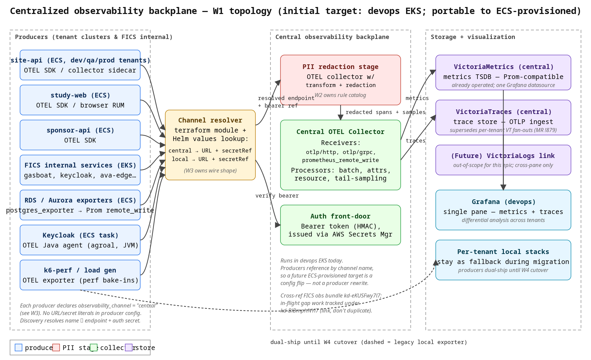

# W1: Centralized observability backplane — topology design

Status: research / design (Phase 0)
Operator: @matthewbaker
Epic: ka-0000001783
Task: ka-0000006336
Sibling workstreams: W2 PII stage, W3 producer-side abstraction, W4 migration plan
Cross-ref (do not duplicate):
- ACME observability architecture bundle: ka-0000003601
- Active perf observability gap epic (site-deployment level): ka-0000004697
- Prior tactical fan-out: MR !879 (closed), bead ka-0000002996

## TL;DR

We will run **one OTEL Collector pool** as the central backplane. It accepts
OTLP/HTTP, OTLP/gRPC, and Prometheus remote_write; redacts PII as the first
in-process stage; then writes to a **VictoriaMetrics + VictoriaTraces** pair
(same family we already operate). All producers reference the backplane by
a logical **channel name** (e.g. `central`) — not a URL, not a secret name.
A small terraform module + a Helm values lookup resolves the channel to an
endpoint and a bearer-token secret reference. That keeps the producer side
location-agnostic so the future move from devops EKS to an ECS-provisioned
target is a config flip, not a refactor.



Source: [`obs-centralization-w1-topology.svg`](obs-centralization-w1-topology.svg)

## Hard constraints (from operator @matthewbaker)

| # | Constraint | Where it lands in the design |
|---|---|---|
| 1 | One stack for metrics + traces (single pane of glass). | Single central OTEL Collector pool + a single Grafana pair of datasources (VM + VT). |
| 2 | PII-stripping stage MUST sit in front of the common collector. | First processor in the central pipeline; producers cannot bypass it because they only ever talk to that pipeline. |
| 3 | Initial target = devops EKS cluster. | The collector pool ships as a Helm chart, deployed into devops EKS now. |
| 4 | No hard EKS dependency in producer-side configuration. | Discovery by **channel name**; resolver lives in one terraform module + one Helm values lookup; producers reference `observability_channel = "central"` and never know the destination is EKS. |

## 1. Where the central collector lives

**Initial location:** devops EKS cluster (the cluster that already runs
VictoriaMetrics / VictoriaTraces / VictoriaLogs for shared signals).

**Future location:** "ECS-provisioned stack, name TBD." We explicitly do
**not** pick that target in this design — picking it is downstream of an
infra decision the operator has flagged as in-flight.

**Portability requirement (constraint #4):** the producer never encodes
where the collector lives. Three properties make the design portable:

1. Producers reference the destination by a logical channel name (`central`).
   The resolver — a tiny shared terraform module + a Helm values lookup —
   is the only place a URL appears. See W3 for the wire shape of that
   resolver.
2. The auth mechanism is **bearer + secret manager**, not IAM-based SigV4
   nor cluster-issued mTLS, both of which would couple producers to the
   identity plane of whatever cluster the collector happens to live in.
3. The collector pool is fronted by a stable DNS name (e.g.
   `obs-central.app.devops.acme.example` today; a new CNAME on the day we move)
   and a public-facing TLS endpoint. Moving the collector to a different
   cluster is a DNS + secret-rotation operation, not a code change.

## 2. Wire formats accepted

The central collector accepts all three of the wire formats currently in
use across ACME producers. Forcing all producers to converge on one
format is a separate epic; the central front door has to accept the
union so producers can migrate independently of the backplane.

| Wire format | Receiver | Primary producers today | Notes |
|---|---|---|---|
| **OTLP/HTTP** | `otlphttp` | site-api, sponsor-api, study-web, ECS sidecars | Easiest fit for ECS task sidecars (no gRPC keepalive complications behind NLBs). The "tactical" fan-out in MR !879 used this. |
| **OTLP/gRPC** | `otlp` | ACME internal services in EKS (gardenio, ava-edge) | Lower overhead in-cluster. Same proto, just different transport — same redaction pipeline downstream. |
| **Prometheus remote_write** | `prometheusremotewrite` | Exporters that don't speak OTLP (postgres_exporter, RDS exporter, node_exporter) | Keeps the "RDS metrics from ka-0000004697" workstream pluggable without forcing every exporter to grow an OTLP shim. |

**What we do not accept (yet):** Prometheus scrape pull, Loki push,
Datadog wire. Producers that emit those formats are expected to put a
local OTEL Collector in front (already the pattern in site-deployment).

**Why not narrow to one wire format:** the existing producer fleet is
heterogeneous and the centralization epic is supposed to be migratable
incrementally. Picking one wire format here would mean either rewriting
every producer first (gating the whole epic on something orthogonal) or
shipping a parallel pre-collector (defeats single-stack constraint #1).
Accepting all three at the front door is the cheaper invariant to hold.

## 3. Per-tenant routing: discovery by name

Producers MUST NOT contain literal URLs, secret ARNs, or cluster
references to the central backplane. They reference an
`observability_channel` name. The full wire shape and per-language /
per-framework knobs for this abstraction are owned by W3; this section
nails down only the contract the topology design depends on.

### Contract

A producer declares:

```hcl
observability_channel = "central"   # or "local", or "central+local" during dual-ship
```

A single shared module (one in terraform, one in Helm — same name
mapping) resolves that channel to two things:

```hcl
endpoint   = "https://obs-central.app.devops.acme.example"
secret_ref = "obs-central-bearer-credentials"
```

Producers consume only `endpoint` and `secret_ref`. The mapping table
lives in **exactly one place per orchestrator** (one terraform module,
one Helm values file). Changing the mapping is the operation we perform
to move the backplane to a different cluster or to point a class of
tenants at a different backplane.

### Why "by name" (and not "by URL with a sane default")

If producers know the URL — even just as a default with an override —
then every producer that's slow to roll forward becomes part of the
migration scope on the day we re-home the collector. Beads, terraform
plans, and Helm releases multiply. Channel-name indirection turns the
re-home operation into one module bump.

### Dual-ship for migration

W4 owns the migration plan, but the topology already supports
dual-shipping by allowing the channel value `central+local`. The
resolver returns both endpoints; the producer fan-outs to both
exporters. This is what we did tactically in MR !879 but generalized
across all tenants and all signals, gated by a per-tenant config flip.

## 4. Auth strategy: bearer token from secret manager

**Recommendation:** Bearer token in an `Authorization` header on every
request, with the token value stored in AWS Secrets Manager and fetched
by the producer at start-up (and on rotation). The central collector
verifies the bearer against a shared HMAC key (or against a small set of
issued tokens, one per producer class).

### Why bearer + secret manager (and not SigV4 / mTLS)

| Mechanism | Works in ECS | Works in EKS (ACME internal) | Cluster coupling | Rotation story | Verdict |
|---|---|---|---|---|---|
| **SigV4** | Yes (task role) | Awkward (needs IRSA + an STS exchange to a non-EKS identity) | Couples producer to AWS account / IAM role topology | AWS-managed | Asymmetric: smooth on ECS, painful for K8s-native producers and for the day the collector moves out of EKS. |
| **mTLS (cluster-issued)** | Heavy: every ECS task needs a cert + rotation | Native in EKS via cert-manager | High — issuance authority lives wherever the collector lives | cert-manager / acme + each-producer-side hook | Re-homing the collector means re-issuing every client cert. Violates constraint #4. |
| **Bearer + secret manager** | Yes (Secrets Manager + KMS) | Yes (External Secrets Operator / SOPS / IRSA fetch) | None — the token is an opaque string | Rotate secret value; producers re-fetch on TTL expiry | Symmetric across ECS/EKS, agnostic to where the collector lives. |

Bearer is the only option that scores well on **all four** of (ECS
support, EKS support, cluster-decoupling, rotation operability). The
trade-off is that we are responsible for token rotation cadence and for
revoking tokens on producer-class compromise; both are routine.

### What the collector verifies

The central OTEL Collector runs an `auth` extension that validates the
bearer. Token classes are coarse-grained (e.g. one token per producer
class: `site-api`, `sponsor-api`, `study-web`, `acme-internal`,
`exporters`). The collector tags incoming spans/metrics with the
producer class derived from the bearer, so dashboards and PII rules
(W2) can scope by producer class.

### Future option, not chosen now

mTLS layered **in addition to** bearer is the long-term hardening
target — the bearer remains the producer-portable identity, and mTLS
becomes a perimeter property of the collector's ingress. We do not
require it for Phase 1.

## 5. Backing TSDB / trace store

**Recommendation:** Stay on the **VictoriaMetrics + VictoriaTraces**
family.

### Why stay

1. **One pane of glass already works.** A single Grafana with a VM
   datasource and a VT datasource already produces correlated
   metrics+traces views — that's exactly the single-pane requirement
   from the operator framing. We do not need to introduce Mimir or
   Tempo to satisfy constraint #1.
2. **Operational fluency.** Devops already operates VM and VT for
   internal signals. Centralization is about producers; doubling the
   storage layer's complexity in the same epic is gratuitous risk.
3. **OTLP and Prometheus remote_write are both first-class.** Same
   write paths from the collector — no extra translation layer.
4. **Single-tenant write path with multi-tenant labels.** VM's tenant
   model (`vm_account_id` / `vm_project_id`) lets us slice per
   producer class or per ACME tenant when we need it, without standing
   up multiple stores.

### Why not Mimir / Tempo / Grafana Cloud

| Option | Why we're not picking it here |
|---|---|
| Mimir | Would replace VM. Larger ops surface (object store, ingesters, queriers, compactor). No clear win for the differential-analysis use case the operator named. |
| Tempo | Would replace VT. Similar story; we'd be migrating the trace store at the same time we're migrating the topology, doubling failure modes. |
| Grafana Cloud (hosted) | New vendor relationship, new compliance review (PHI), data egress. Out of scope for a research-only phase. |

### Re-evaluation triggers

We commit to revisiting the storage choice if, after migration, we hit
any of: VM ingestion lag at sustained > N spans/sec we cannot scale
horizontally; cross-tenant query isolation forces sharding gymnastics;
or PHI compliance review surfaces a blocker that VM cannot mitigate at
the storage layer. None of these are predicted but the design does not
preclude swapping the store underneath the collector — exporters are
the only thing that change.

## 6. PII-stripping stage: where it plugs in

**W2 owns the rule catalog and detection details.** This doc fixes only
**where** in the topology PII redaction happens, since that's a
topology-level decision.

### Decision: redact inside the central collector, as the first processor

The PII redaction stage is implemented as OTEL Collector processors
(`transform` + `redaction`) running in the same collector pool, **before
any sampling, batching, or exporter** in the pipeline. Producers cannot
bypass it because there is no other ingress path to the storage layer.

### Why not at the producer

Two reasons.

1. **Centralized rule catalog.** If we put the redactor at every
   producer, then every change to the PHI/PII catalog is a rolling
   redeploy across N tenants — and the slowest tenant gates the safety
   property. Centralizing redaction makes catalog updates a single
   deploy.
2. **Auditability.** A central redactor can keep a redaction-count
   metric per rule per producer class without leaking the redacted
   values. Distributed redactors make this audit story hard.

### Why not a separate pre-collector

A "pre-collector" tier (one collector pool for redaction, then a second
pool for everything else) doubles the operational surface — two helm
charts, two scaling stories, two alert sets — for no clear benefit.
Redaction processors in the same pool are deterministic and idempotent;
running them as the first processor gives us the same safety property
with one moving piece.

### Where W2 is going to need a hook

The redactor is conceptually one processor stage but we expect W2 to
need a small handful of processors composed (PII attribute drop,
PHI hash, free-text scrubber). The topology design leaves room for
that composition by making PII the first **stage**, not the first
**processor** — the stage may be several processors stacked.

## 7. Topology summary diagram

See `obs-centralization-w1-topology.png` (rendered) and
`obs-centralization-w1-topology.svg` (source) committed alongside this
doc.

The diagram shows:

- Producers (site-api / study-web / sponsor-api / ACME internal /
  Keycloak / RDS exporters / k6-perf) all referencing the backplane by
  `observability_channel`.
- A channel resolver (one terraform module + one Helm values lookup)
  turning the channel name into endpoint + bearer secret reference.
- The central OTEL Collector pool in devops EKS, with the PII redaction
  stage as the first processor.
- Auth verification (bearer) at the collector front door.
- VictoriaMetrics and VictoriaTraces as the central stores, fronted by
  one Grafana for differential analysis.
- A dashed dual-ship edge (legacy per-tenant local exporter), used
  during W4 migration only.

## 8. Open questions / explicit non-decisions

Items intentionally **not** decided in W1; flagged so reviewers see the
seams.

1. **Future ECS-provisioned target's name.** Out of scope per operator
   framing.
2. **Token issuance/rotation cadence and class granularity.** Bearer
   strategy is fixed; the precise number of tokens (one global vs
   one-per-producer-class vs one-per-tenant) is a small ops decision
   downstream of W3.
3. **Collector pool autoscaling profile.** We start with a static
   replica count sized for current dev.acme.example trace volume; scaling
   policy lands when W4 cuts over the first qa tenant.
4. **Tail-based sampling rules.** The topology supports tail sampling
   (processor slot exists between PII and export); the rule set is
   owned by whichever workstream tunes for storage cost.
5. **Logs.** Out of scope per epic non-goals.

## 9. Risks

| Risk | Likelihood | Mitigation |
|---|---|---|
| Bearer-token leak from one producer compromises the backplane. | Low | One token per producer class; rotate on suspected leak. Collector tags traffic by class so we can rate-limit / revoke per class. |
| The central collector becomes a SPOF. | Medium | The producer-side dual-ship path during W4 doubles as a fallback: a "channel = central+local" config flip restores local stack reception in minutes. We will keep that knob alive past W4 for at least one quarter. |
| PII redaction rule regression silently leaks fields. | Medium | W2 owns rule design + audit metrics. The topology gives W2 the central enforcement point so a fix is one deploy, not N. |
| Re-homing the collector (EKS → ECS-provisioned) still drags producers. | Low (by design) | The channel resolver indirection makes this a DNS + secret rotation. We will validate with a dry-run swap of a non-production tenant before declaring the abstraction sound. |

## 10. Definition of done for W1

- This doc merged at `gardenio/docs/research/obs-centralization-w1-topology.md`.
- Diagram (PNG + SVG source) committed alongside.
- MR description trailer cites operator `@matthewbaker` per advice
  ka-0000004244.
- Cross-references to bundle ka-0000003601 and gaps epic ka-0000004697
  via link, not duplication.
- W4 (migration plan) is unblocked: it has a stable topology contract
  to plan cutovers against.
