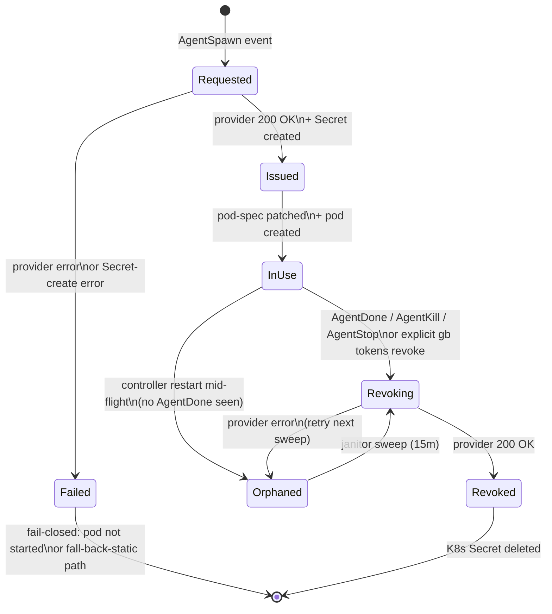

# Per-Agent Tokens — Lifecycle Design (T4)

**Status:** Research / ADR draft (no implementation).
**Tracks:** Epic [ka-0000004236](https://beads-viewer.gardenio.e2e.example.com/ka-0000004236) — per-agent tokens.
**Bead:** [ka-0000005384](https://beads-viewer.gardenio.e2e.example.com/ka-0000005384).
**Predecessors:** `gardenio/docs/research/per-agent-tokens-codebase-state.md` (T0) and `gardenio/docs/research/per-agent-tokens-gitlab.md` (T1).
**Sibling (in flight):** T2 GitHub survey (ka-0000000783), T3 providers inventory (ka-0000007455).
**Author:** gardenio-t4-token-lifecycle-95c.
**Date:** 2026-04-26.

This ADR designs the **lifecycle** of per-agent upstream tokens
(GitLab + GitHub for v1) in the gardenio controller: when a token is
issued, where it is stored, how it reaches the agent pod, when it is
revoked, what audit operators see, and how we migrate from today's
shared-token world. It is **provider-agnostic** — T1's GitLab-specific
issuance path and T2's GitHub-specific issuance path both plug into
this lifecycle frame.

## TL;DR

**Recommendation (issuance):** Issue per-agent upstream tokens
**at pod creation time** (the existing
`provisionAgentToken` call site, `main.go:803`), not at agent-bead
creation time and not at project-provision time. This mirrors the
existing per-agent beads-daemon-token pattern and avoids wasted
upstream API calls for agents that never spawn (intake-triaged beads
that are closed, deferred, or canceled before a pod is created).

**Recommendation (storage):** **K8s Secret per (agent-bead, provider),
labelled `gardenio.io/type: agent-token`,
`gardenio.io/provider: <gitlab|github>`,
`gardenio.io/bead: <beadID>`,** named
`agent-<provider>-token-<beadID>`. This generalises the existing
`agent-token-<beadID>` shape (`agenttoken.go:32–39`). Reject Vault and
KMS-backed-encrypted-store-in-controller for v1: K8s Secret etcd
encryption-at-rest already covers the threat model that matters
(node-level disk theft), and Vault adds an availability dependency
to the agent spawn path that the existing pattern does not have.

**Recommendation (plumb-through):** Reuse the existing
`spec.GitCredentialsSecret` / `spec.GitlabTokenSecret` plumbing in
`applyCommonConfig` (`podspec.go:602–606, :674–679`). The controller
mutates these fields to point at the per-agent Secret it just
provisioned **after** project- and role-secret application, so the
per-agent Secret takes precedence over the shared one without
touching `initclone.go` at all. No changes to the init-clone script;
it already reads `GITLAB_TOKEN` / `GIT_TOKEN` from whichever Secret
the spec field names.

**Recommendation (revocation):** Synchronous revoke on
`AgentDone` / `AgentKill` / `AgentStop`
(`main.go:835`) — the call sites already exist for the beads token —
plus a **15-minute janitor sweep** (new) that looks for K8s Secrets
labelled `gardenio.io/type: agent-token` whose backing agent bead is
closed and revokes any orphaned tokens upstream + deletes the Secret.
**Target SLO: 95% revoked within 5 minutes of agent stop, 99% within
60 minutes (the next janitor sweep).** Best-effort upstream revoke is
the existing pattern; the janitor catches the
controller-restart-during-revoke and the upstream-rate-limit cases.

**Recommendation (audit):** Add `gb tokens list / revoke / rotate`
backed by a beads-daemon HTTP endpoint that lists registered fleet
tokens of `Type=agent-token-<provider>`, joined against
`gardenio.io/bead`-labelled K8s Secrets. The minimal data model lives
in the K8s Secret labels + the beads-daemon fleet-token table; no new
storage subsystem.

**Recommendation (migration):** Reuse the existing `PER_AGENT_TOKENS`
flag, with **per-provider sub-flags** (`PER_AGENT_TOKENS_GITLAB`,
`PER_AGENT_TOKENS_GITHUB`) so each provider can ship independently.
Default `false` for one release post-merge; staging rollout flips
`_GITLAB=true` first (since T1 is ahead of T2), `_GITHUB=true` next.
The legacy `gardenio-gitlab-token` / `gardenio-github-token` shared
Secrets stay provisioned during the cutover and remain the
fall-through when a provider sub-flag is `false`. Rollback is the
sub-flag flip plus a janitor pass to clean up dangling per-agent
Secrets.

**Recommendation (failure-mode default):** **Fail-closed in prod, fall-back-to-static in staging with a loud metric.** If the upstream
provider returns an error at issuance time and the failure-mode flag
is `fail_closed`, the controller does not start the pod and reports
the error to the agent bead. If the flag is `fall_back_static`, the
controller starts the pod with the shared Secret and increments
`gardenio_agent_token_provision_fallback_total{provider="…"}`. The
existing controller code path already has this branch — it logs and
falls back unconditionally today (`main.go:805–810`). T6 should add
the flag.

The two open decisions T4 surfaces (in addition to T1's seven):
**(a) revocation-SLO target** — is "95% within 5min, 99% within
60min" right? (sec/ops trade-off); **(b) janitor-sweep ownership** —
controller, a new sidecar, or the existing reconciler? They are
filed in §8.

## 1. Constraints carried in from T0 / T1

From `per-agent-tokens-codebase-state.md` §2 and §6 and
`per-agent-tokens-gitlab.md` §1, §3, §5:

1. The controller already has a working pattern for per-agent
   tokens: generate → register upstream as a project-scoped fleet
   token → store as `Secret/agent-token-<beadID>` → plumb via
   `secretKeyRef` → revoke best-effort on `AgentDone/Kill/Stop`. The
   GitLab/GitHub lifecycle should fit this shape exactly so the
   issuer code is one abstraction with three providers, not three
   bespoke pipelines.
2. The existing call sites are `main.go:803,835,865,870`. They run
   inside the SSE / NATS event loop that already handles agent
   spawn / despawn / restart, so we have a single chokepoint for
   issuance and revocation per provider. We do **not** need to wire
   into the bead-create event, the project-bead-update event, or the
   reconciler's periodic loop for the happy-path lifecycle — only for
   the orphan sweep.
3. Init-clone already reads `GIT_TOKEN` / `GIT_USERNAME` from
   `spec.GitCredentialsSecret` and `GITLAB_TOKEN` from
   `spec.GitlabTokenSecret` via `secretKeyRef`. The lifecycle plan
   inherits this consumer; the design just changes which Secret name
   those fields point at. Init-clone code does **not** change.
4. T1's open question §6.3 (**per-spawn token TTL**) interacts with
   the lifecycle directly: TTL bounds the "blast radius" if the
   janitor never gets to run. T4 picks a default (`24h`) and surfaces
   it as a knob, but the actual decision lives with the operator.
5. T1's open question §6.4 (**failure-mode policy**) is a lifecycle
   concern, not a GitLab-specific one. T4 picks the default and
   describes the per-environment override.

## 2. State machine

The lifecycle of a single per-agent token, from a single provider's
point of view, is six states. The diagram below uses the existing
controller event vocabulary (`AgentSpawn`, `AgentDone`, etc.) so it
maps 1:1 onto today's `main.go` event loop.



State semantics:

- **Requested** — `provisionAgentToken` (or its provider-typed
  successor) has been called but has not yet returned. Existence is
  in-memory only (the controller's call stack); no Secret, no
  upstream registration. Crash here = nothing leaks.
- **Issued** — Upstream provider has registered the token; K8s Secret
  exists with labels `gardenio.io/type=agent-token`,
  `gardenio.io/provider=<gitlab|github>`,
  `gardenio.io/bead=<beadID>`. The token is **valid upstream** but is
  not yet attached to a running pod.
- **InUse** — Pod has been created with `DaemonTokenSecret` (for
  beads) / `GitlabTokenSecret` / `GitCredentialsSecret` pointing at
  the per-agent Secret. The agent process is reading from the
  Secret-mounted env vars.
- **Revoking** — The despawn event has fired. `revokeAgentToken`
  (provider-typed) has called the upstream revoke endpoint and is
  about to delete the Secret. Best-effort: an upstream-revoke error
  here transitions to **Orphaned**; a Secret-delete error logs and
  returns (the next `provisionAgentToken` for the same `beadID`
  short-circuits on `IsAlreadyExists`, which is the existing
  behavior).
- **Revoked** — Upstream is gone, K8s Secret is gone. The bead's
  audit trail records the revoke event.
- **Orphaned** — A token exists upstream and/or in K8s but no live
  pod refers to it, and the controlling agent bead is closed (or
  doesn't exist). The janitor reconciler is responsible for
  transitioning this back to **Revoking**.

The existing `revokeAgentToken` already has the right
"best-effort + log" shape; T4's only addition is the **Orphaned**
recovery path.

## 3. Issuance

### 3.1 Trigger: at pod creation, not at bead creation

The candidate triggers and their trade-offs:

| Trigger | Pros | Cons |
|---|---|---|
| **Pod creation (RECOMMENDED)** | Mirrors existing pattern; one chokepoint per spawn; no wasted upstream calls for beads that never spawn; failure semantics already wired at the controller | Token life starts when the agent's K8s pod is scheduled, not when the bead enters the queue — first agent action is delayed by one upstream API round-trip (typically <1s, well under spawn time) |
| Bead creation (pre-pod) | Token ready before pod starts, hides the API latency | Wasted upstream calls for the >50% of beads that are intake-closed, deferred, or never picked up (T0 §7.7 shows ~28% of all beads come from agents at all — most beads aren't spawn-bound); needs a separate revoke pathway when the bead is closed without ever spawning |
| Project provisioning | Token is ready for any agent in the project | Defeats per-agent attribution — every agent under a project shares one token (this is exactly today's behavior, just with a per-project rather than global token); not "per-agent" in any meaningful sense |
| First upstream API call (lazy) | Zero waste | Adds an in-pod dependency on a controller endpoint to "give me my token now"; first MR/git-push pays the latency; opens a new cross-pod auth surface (the agent has to authenticate to the controller to get its token) |

**Decision: pod-creation trigger.** Same call site as the existing
beads-token issuer. The latency cost is small (one 200-ms-class HTTP
call to the provider) and is paid in parallel with the K8s
`CreateAgentPod` call, not added to it.

### 3.2 Issuance flow (per provider)

For provider `P ∈ {gitlab, github}`, on `AgentSpawn` event for bead
`B`, project `proj`, namespace `ns`:

1. Resolve target upstream resource (project ID for GitLab, repo
   slug for GitHub) from the bead's project/role config. T2 will
   specify the GitHub-side resolution; T1 §3 specifies GitLab.
2. Generate the upstream token (per-provider issuance path —
   T1's `POST /api/v4/projects/<id>/access_tokens`, T2's GitHub-App
   installation-token mint, etc.).
3. Create K8s Secret `agent-<P>-token-<B>` in `ns` with labels:
   - `app.kubernetes.io/managed-by=gardenio-controller`
     (`podmanager.LabelApp` / `podmanager.LabelAppValue`)
   - `gardenio.io/type=agent-token`
   - `gardenio.io/provider=<P>`
   - `gardenio.io/bead=<B>`
   - `gardenio.io/project=<proj>`
   and keys:
   - `token` — the bearer string the init-clone consumes
   - `username` — the upstream identity (bot-user name, e.g.
     `project_NNNN_bot_xxxx` for GitLab) so the agent can set
     `git config user.name` / `user.email` to it
   - `provider_id` — the upstream tid (numeric for GitLab project
     access tokens, opaque string for GitHub) so revoke knows which
     token to delete
   - `expires_at` — RFC3339 timestamp for janitor pre-emptive
     cleanup if the controller misses the despawn event
4. On Secret-create failure, roll back the upstream registration
   (existing pattern, `agenttoken.go:84–88`).
5. Patch `spec.GitCredentialsSecret` (P=github) or
   `spec.GitlabTokenSecret` (P=gitlab) to point at this Secret.
6. Pod gets created with the per-agent Secret references.

Implementation note: in the existing
`buildAgentPodSpec → applyCommonConfig` chain, the per-project / per-role
`Secrets[]` is applied first (`podspec.go:585–624, :638–691`). T6
should call `provisionAgentToken<P>` **after** `applyCommonConfig`
returns (so per-agent tokens override per-project / per-role secrets,
which override defaults). This is the same precedence as today's
PER_AGENT_TOKENS for the beads-daemon token at `main.go:803`.

### 3.3 Idempotence

`provisionAgentToken` already short-circuits on
`apierrors.IsAlreadyExists` for the K8s Secret create
(`agenttoken.go:84–89`). For the upstream side, T6 should treat
"token with this name already exists" as a soft conflict (re-fetch
the existing token's `provider_id` from the K8s Secret if present,
otherwise revoke-and-reissue). This makes restart-mid-spawn safe.

### 3.4 Concurrency

Two `AgentSpawn` events for the same bead-id within a short window
(controller restart, queue redelivery) must not result in two live
upstream tokens. The K8s Secret create with
`metav1.CreateOptions{}` provides the lock: the second creator gets
`AlreadyExists` and short-circuits. T6 should preserve this property
(do not switch to `Update` semantics). Provider-side, the
`name="agent-<beadID>-<P>"` PAT name acts as a soft de-dupe (T1
§3 step 2 — the name is `agent-<beadID>`).

## 4. Storage

### 4.1 Why K8s Secrets, not Vault, not controller-local KMS

| Option | Threat-model coverage | Availability impact | Lift |
|---|---|---|---|
| **K8s Secret per agent (RECOMMENDED)** | Etcd encryption-at-rest covers node-disk theft. RBAC restricts read access to the agent pod's serviceaccount (already configured today for the shared `gardenio-gitlab-token`). Same posture as today's shared secret. | None — already the dependency surface. | ~0; we already do this. |
| Vault per agent | Same etcd posture isn't required (Vault holds the bytes). Adds dynamic-secret features we don't need yet (lease renewal, audit-log append). | Adds Vault as a critical-path dependency for every spawn. Vault outage → no agent spawns. | High: deploy Vault, transit-secret-engine config, Vault Agent sidecar in pods, RBAC against Vault, secrets-store-csi or analogous. |
| Controller-local KMS-encrypted store | Centralises the secret material in the controller's storage. Removes etcd as a leak vector but adds the controller's storage as one. | Controller storage corruption / restart → tokens lost; same as Vault but in-house. | Medium: SQLite / postgres column with KMS-encrypted blob, decrypt-and-mount sidecar, plus all the K8s plumbing we'd otherwise skip. |

**Decision: K8s Secret per agent.** The existing pattern is the
operationally-tested baseline; v1 should not introduce a second
secret-store dependency. If the audit trail later demands
short-leased / cryptographic-attested secret retrieval, Vault is the
right next step — but T4 calls that v2.

### 4.2 Secret naming & labels (already partly present)

```yaml
apiVersion: v1
kind: Secret
metadata:
  name: agent-gitlab-token-<beadID>     # or agent-github-token-<beadID>
  namespace: <agent-pod-namespace>
  labels:
    app.kubernetes.io/managed-by: gardenio-controller
    gardenio.io/type: agent-token         # NB: same label as today's beads-token
    gardenio.io/provider: gitlab          # NEW — disambiguates per-provider
    gardenio.io/bead: <beadID>
    gardenio.io/project: <projectName>
type: Opaque
stringData:
  token: "<bearer string>"
  username: "<upstream-bot-username>"    # NEW for upstream tokens
  provider_id: "<upstream-token-id>"     # NEW; needed for revoke
  expires_at: "<RFC3339>"                # NEW; janitor uses this
```

The existing `agenttoken.go:73` writes
`gardenio.io/type=agent-token` for the beads-daemon token. **Do not
change that label** — instead, add `gardenio.io/provider` and have
the existing beads issuer set `gardenio.io/provider=beads`. That way a
single label-selector, `gardenio.io/type=agent-token`, finds every
per-agent token across providers, which is what `gb tokens list`
needs.

### 4.3 Per-agent vs per-(agent,provider) secret

We pick **per-(agent, provider)** — three Secrets per agent (beads,
gitlab, github) rather than one — because:

- Provider-typed lifecycle: a GitHub-side rate-limit error at issuance
  must not also block the GitLab token. Separate Secrets means
  separate provision/revoke paths.
- Init-clone consumes them via separate `secretKeyRef` blocks already
  (`initclone.go:127–161`); merging into one Secret would force a
  refactor of the consumer and would not save much.
- Easier to RBAC and audit per provider.

Storage cost: 3N Secrets where N is concurrent active agents. At
gardenio-rwx peak the order of magnitude is hundreds; etcd has no
practical issue at this volume.

### 4.4 Secret expiry / TTL alignment

Each provider has its own native TTL (T1 §4: GitLab caps at ~365d on
SaaS; T2 will specify GitHub-App installation-token TTL, typically
~1h with auto-rotation). The controller picks **min(provider-max,
24h)** as the issuance TTL by default. The K8s Secret has no native
expiry; the janitor reads `expires_at` from the Secret and treats any
Secret older than `expires_at` as eligible for sweep.

## 5. Plumb-through

### 5.1 No init-clone changes required

`initclone.go:127–161` already reads `GIT_USERNAME`/`GIT_TOKEN` from
`spec.GitCredentialsSecret` and `GITLAB_TOKEN` from
`spec.GitlabTokenSecret`. Both are populated from
`applyCommonConfig` → `applyRoleSecrets` per the rules in
`podspec.go:600–606, :673–679`. The lifecycle plan reuses these
fields **as-is**: T6 patches them to the per-agent Secret name after
`applyCommonConfig` returns, before `pods.CreateAgentPod`.

Concretely, T6 inserts (sketch, not committed code):

```go
spec := buildAgentPodSpec(cfg, event)

// Per-agent beads token (existing)
if cfg.PerAgentTokens && agentBeadID != "" { ... }

// Per-agent GitLab token (new in T6)
if cfg.PerAgentTokensGitLab && agentBeadID != "" {
    secretName, err := provisionAgentTokenGitLab(...)
    if err != nil {
        // failure-mode policy: fail-closed in prod, fall-back-static in staging
        if cfg.PerAgentTokensFailMode == FailClosed {
            return fmt.Errorf("provision gitlab token: %w", err)
        }
        // else fall-back-static: leave spec.GitlabTokenSecret unchanged
        metrics.AgentTokenProvisionFallback.Inc("gitlab")
    } else {
        spec.GitlabTokenSecret = secretName  // overrides project/role default
    }
}

// Per-agent GitHub token (new in T6, mirrors above)
if cfg.PerAgentTokensGitHub && agentBeadID != "" { ... }

if err := pods.CreateAgentPod(ctx, spec); err != nil { ... }
```

Init-clone reads from whichever Secret name is in
`spec.GitlabTokenSecret`. No change to `initclone.go`.

### 5.2 Main-container side: `gb agent start`

The main container's `gb agent start` re-writes
`~/.git-credentials` and `git config user.name/user.email` from the
same env vars the init container saw (T0 §1.3). This means
**commit-author attribution falls out for free**: T1 §3.3 already
notes the auto-issued bot username can be written into
`git config user.email` if `agent_k8s_workspace.go:33,57` reads from
the per-agent Secret instead of constructing
`<role>@gardenio.local`.

T9 (codebase-state §4.5 "Phase 0") does the small `git config
user.email` rename. It can ship before T6, in which case T6 just
re-points the same env-var path at the bot user's email instead of
the synthetic one. The plumb-through path is unaffected.

## 6. Revocation

### 6.1 Triggers

| Trigger | Source event | Today's behavior | T4 behavior |
|---|---|---|---|
| Agent done | `AgentDone` SSE event | beads-token revoked at `main.go:835` | Same call site, plus per-provider revoke |
| Agent killed | `AgentKill` SSE event | beads-token revoked | Same |
| Agent stopped | `AgentStop` SSE event | beads-token revoked | Same |
| Agent stuck → restart | `AgentStuck` (`main.go:865,870`) | revoke-then-reissue | Same; reissue gets a fresh upstream token to keep history clean |
| Agent bead closed (no live pod) | beads-daemon close event (not currently subscribed by agenttoken) | none — unhandled today | **Janitor sweep** picks up the orphan within 15 min |
| Explicit operator | `gb tokens revoke <bead-id>` | none — does not exist | New CLI calls a new beads-daemon endpoint that calls `revokeAgentToken<P>`; effective immediately |
| TTL expiry | `expires_at` in Secret labels | none | Janitor sweep deletes the Secret; upstream is already expired |

The first four are the existing call sites; T6 generalises them per
provider. The last three are new in this design.

### 6.2 SLO

**Recommendation:**

- **95% of revokes complete within 5 minutes** of the despawn event.
  This is the happy path — the controller observes the SSE event and
  calls `revokeAgentToken<P>` synchronously.
- **99% within 60 minutes** — the next janitor sweep catches the
  controller-restart-mid-revoke and the upstream-rate-limited cases.

The 60-minute outer bound is a function of the janitor cadence (15
min) and the upstream-revoke retry budget (4 sweeps before alerting).
Operator can dial it tighter (`5min` cadence, `15min` outer bound) if
they accept higher controller load.

§8 surfaces this as an open decision because the right answer
depends on the security review's threshold for "stale credential is
acceptable for N minutes". For comparison: today's shared GitLab
token rotates manually on the order of months, so any per-agent SLO
is a strict improvement.

### 6.3 Janitor / orphan sweep

**Why we need it:** the existing `revokeAgentToken` is best-effort
(`agenttoken.go:103, :108`). If the upstream provider is rate-limited
or down at the moment of revoke, the K8s Secret is still deleted and
the upstream token is **not** revoked — it remains valid until its
TTL expires. We need a second pass.

**Where it lives:** add a goroutine to the controller, parallel to
`reconciler.SyncAll`, ticking every 15 min:

1. List K8s Secrets in the agent namespace with selector
   `gardenio.io/type=agent-token`. Build set `S = { (provider, beadID, expires_at) }`.
2. For each `(provider, beadID)`, look up the agent bead via beads-daemon.
   If the bead is closed/done OR `expires_at < now`, the token is
   eligible for sweep.
3. For each eligible token, call `revokeAgentToken<provider>(beadID)`.
   Best-effort; failures log and are retried next sweep.
4. After 4 consecutive failed sweeps (~1 hour) for the same token,
   alert (publish a `gardenio_agent_token_revoke_lag` metric and an
   operator-facing log line).

**Why janitor lives in controller, not as a separate sidecar:** the
controller already holds the K8s, beads-daemon, and provider creds.
A separate sidecar duplicates them.

**Why janitor is not part of `reconciler.SyncAll`:** the reconciler's
job is desired-vs-actual *pod state*. The janitor reconciles
*token state* — different invariant, different cadence (the
reconciler runs every 30s today, way too aggressive for revoke
retries that hit upstream rate limits). They share the
event-loop infra (slog logger, daemon client) but should be
separate functions.

§8 surfaces "where does the janitor live" as a small open question
because it could plausibly be a new top-level subsystem
(`internal/tokenjanitor/`) or a method on the existing reconciler
(`reconciler.SweepOrphanedTokens`). Pick one and document.

### 6.4 Revoke order: K8s Secret last

Always revoke upstream **before** deleting the K8s Secret. If we
delete the Secret first and upstream-revoke fails, the K8s state has
lost the `provider_id` we need to make the revoke call. The existing
`revokeAgentToken` (`agenttoken.go:102–110`) gets this right; T6
should preserve it.

## 7. Audit surface

### 7.1 `gb tokens` CLI

| Subcommand | Behavior | Backed by |
|---|---|---|
| `gb tokens list [--project P] [--provider X]` | Show all live per-agent tokens: bead ID, agent name, provider, upstream username, expires_at, last_used (if available), revoked status | beads-daemon HTTP `GET /api/v1/agent-tokens` joined with K8s Secret labels |
| `gb tokens show <bead-id>` | Per-bead detail, all providers | Same |
| `gb tokens revoke <bead-id> [--provider X]` | Revoke one or all per-agent tokens for a bead. Calls the same code path as despawn. | beads-daemon HTTP `POST /api/v1/agent-tokens/<id>/revoke` |
| `gb tokens rotate <bead-id> [--provider X]` | Issue a new token, mount via Secret update + pod restart, revoke the old token | New flow; v1.1 candidate |

`list` and `revoke` are v1; `rotate` is v1.1 (rotation is a
nice-to-have for a long-lived agent — most agents finish in <24h, so
TTL-based expiry covers the common case).

### 7.2 Data model

The minimal data the audit surface needs is already in two places:

- **K8s API** (label-selectable): bead ID, provider, project,
  expires_at, secret name. One list call returns the inventory.
- **Beads-daemon fleet-token table** (already exists for the beads
  per-agent token): fleet name (encodes bead ID), project scope,
  registered_at. T6 generalises this to per-provider rows by adding
  a `provider TEXT NOT NULL DEFAULT 'beads'` column and registering
  GitLab/GitHub fleet-equivalent rows there.

**No new database.** The join key is the bead ID + provider.

### 7.3 last_used

Provider-side last_used is the only authoritative source (the
controller does not see the agent's GitLab/GitHub API calls). GitLab
PATs expose `last_used_at` via `GET
/api/v4/projects/:id/access_tokens/:tid`; GitHub installation tokens
do not (they refresh hourly). For v1, `last_used` is best-effort:
populate from GitLab where available, omit for GitHub. T2 may have
an opinion.

### 7.4 What ends up in the audit log

Every issuance and revocation generates a beads-daemon audit-log
entry (existing pattern: the daemon already audits fleet-token
register/revoke calls). The `Subject` of these entries is the
controller's identity (`controller`-after-§7.7-of-codebase-state lands)
or `static` today. The bead's audit timeline shows
"token-provisioned" and "token-revoked" events tied to the bead ID.

## 8. Open decisions

(In addition to T1's seven open decisions, which still apply.)

1. **Revocation SLO.** Is "95% within 5 min, 99% within 60 min" the
   right target? Tighter (15 min outer bound, 5 min cadence) costs
   more controller QPS against the providers and risks rate-limit
   pressure at peak; looser (4-hour outer bound) leaves stale
   credentials live longer.
2. **Janitor home.** New subsystem (`internal/tokenjanitor/`) or
   method on the existing reconciler? Recommend a new subsystem;
   surface the call.
3. **Failure-mode default per-environment.** Recommendation
   "fail-closed in prod, fall-back-static in staging" assumes a
   single bool flag (`PER_AGENT_TOKENS_FAIL_MODE=fail_closed|fall_back_static`).
   Operator may want this per-provider (`fail_closed` for GitLab,
   `fall_back_static` for GitHub during the GitHub-App rollout). T6
   should surface a per-provider override.
4. **Per-spawn TTL default.** Recommendation 24h matches T1 §6.3.
   Confirm or override.
5. **Bridges and the controller itself.** The bridges
   (`gitlab-bridge`, `slack-bridge`, etc.) hold the shared service
   token, not a per-agent token. They are out of scope for *this*
   epic, but the SetActor cleanup work surfaced in T0 §7.7 should
   ship before the per-agent token rollout so the audit log doesn't
   change shape twice.
6. **TTL of orphan-sweep retry alert.** Recommendation: 4 consecutive
   failures (1 hour) → metric + log. Below the threshold the
   janitor is silent. Confirm.

## 9. Migration

### 9.1 Flag plan

Today: `PER_AGENT_TOKENS=true|false`, default `false`
(`config.go:552`).

Proposed: keep `PER_AGENT_TOKENS` as the umbrella switch (controls
the beads-daemon per-agent token, as it does today), and add two
**per-provider** sub-flags:

| Flag | Default | Effect |
|---|---|---|
| `PER_AGENT_TOKENS` (existing) | `false` | beads-daemon per-agent fleet token |
| `PER_AGENT_TOKENS_GITLAB` (new) | `false` | per-agent GitLab PAT issuance |
| `PER_AGENT_TOKENS_GITHUB` (new) | `false` | per-agent GitHub installation-token issuance |
| `PER_AGENT_TOKENS_FAIL_MODE` (new) | `fall_back_static` | `fail_closed` to refuse pod start on issuance failure |

Sub-flags can be flipped independently. Helm values in
`gardenio/helm/gardenio/values.yaml` mirror them as
`agents.perAgentTokens.beads`, `.gitlab`, `.github`, `.failMode`.

### 9.2 Cutover steps

Per-provider, in order:

1. **Provision the issuer's caller credential.** The controller
   needs an upstream identity with `Maintainer`+ on the target
   projects (GitLab) or a GitHub App installation (GitHub). This is
   a one-time secret-creation step (`gardenio-gitlab-issuer-token`,
   `gardenio-github-app-private-key`). Independent of the rollout.
2. **Land T6 (issuer code) behind sub-flag, default off.** Build
   passes; e2e suite still uses the shared token because sub-flag is
   off.
3. **Flip sub-flag to `true` in staging (gardenio-rwx).** Watch
   `gardenio_agent_token_provision_*` and `_revoke_*` metrics. Check
   that MRs/PRs from staging agents show the bot-user attribution.
4. **Bake for one release cycle.** Validate failure modes by
   simulating provider rate-limit (drop traffic from controller IP
   to the provider for 60s; watch fall-back path).
5. **Flip in prod.** Default `PER_AGENT_TOKENS_FAIL_MODE=fail_closed`
   in prod values. Watch revoke-lag metric; expect it to be < 1m on
   the happy path.

GitLab → GitHub order (T1 is ready first; T2 in flight). The two
provider flips are independent; if T2 lands later, GitHub stays on
the shared token until then.

### 9.3 Rollback

Revert the sub-flag to `false`. New spawns get the shared Secret
again. Existing live agents with per-agent Secrets continue to work
until they despawn — no need to evict or reschedule. After all
live per-agent agents have despawned, run the janitor manually to
sweep stale Secrets:

```sh
kubectl -n <ns> delete secret -l gardenio.io/type=agent-token,gardenio.io/provider=<P>
# upstream tokens already TTL-out within 24h
```

Optionally, run a one-shot `gb tokens list --provider <P>` to
inventory orphaned upstream tokens and `gb tokens revoke` them.

### 9.4 In-flight MRs/PRs (codebase-state §5)

In-flight MRs/PRs authored by the legacy shared identity stay
authored by it. The cutover does not retroactively re-attribute
them. The shared service-account user must stay registered upstream
for at least one release cycle past the flip so it can continue to
edit its own pre-existing MRs. After that, it can be demoted to
`Reporter` (still able to comment, can't approve or merge) and
eventually deactivated.

## 10. Failure modes (catalog)

| Failure | Detection | Default action | Recovery |
|---|---|---|---|
| Provider 5xx at issuance | `provisionAgentToken<P>` returns error | Per `PER_AGENT_TOKENS_FAIL_MODE` (recommend `fail_closed` prod / `fall_back_static` staging) | Operator retries spawn; sub-flag flip if the provider is down for hours |
| Provider rate-limited at issuance | 429 from provider | Same — error path | Backoff + retry not in v1; pod fails-closed and the user retries |
| K8s Secret create fails (etcd hiccup) | `Create` returns error | Roll back upstream registration (existing pattern) → fail-closed | Pod respawn next event; existing reconciler retries |
| K8s Secret already exists for `beadID` | `IsAlreadyExists` | Use existing secret (existing pattern) | None needed |
| Controller crashes between upstream-register and Secret-create | No state in K8s, but registered upstream | Janitor sees a registered upstream token with no matching Secret next sweep | Janitor calls `RevokeFleetToken<P>` (provider-typed); sweep at most 15 min later |
| Controller crashes between Secret-create and `CreateAgentPod` | Secret exists, no pod ever started | Janitor sees a Secret with no matching pod (and the bead never reaches `InUse`) | Janitor revokes upstream + deletes Secret on next sweep |
| Provider 5xx at revoke | `RevokeFleetToken<P>` returns error | Log warning (existing pattern); leave Secret in place | Janitor retries every 15 min for up to ~1h, then alerts |
| `AgentDone` event lost (controller missed SSE) | No despawn observed; pod terminates by other means | Janitor sees orphan + bead closed → revokes | ≤15 min lag |
| Bead closed without ever spawning | No issuance occurred | None — no token was issued | N/A |
| TTL expires while pod still running | `expires_at < now` and pod alive | Init-clone has the token but it's now-expired upstream; agent's `git push` / `glab` will 401 | Pod-level retry / restart triggers re-issuance via `AgentStuck` flow |
| Provider revokes the token out-of-band (manual `gb tokens revoke`) | Agent's API calls 401; controller does not re-discover until next janitor sweep | Agent pod gets 401s on its next API call, is expected to crash or report stuck | Operator follow-up; v1.1 could add a "rotate on 401" agent-side hook |
| Etcd encryption-key compromise | Out-of-scope; same threat model as today's shared Secret | N/A | Rotate etcd encryption key; rotate **all** Secrets including the shared ones |

## 11. Pointers

| Topic | Where |
|---|---|
| Existing per-agent token issuer | `gardenio/controller/cmd/controller/agenttoken.go` |
| Issuer call sites (issuance + revoke) | `gardenio/controller/cmd/controller/main.go:803, :835, :865, :870` |
| Common-config / project-secret plumb-through | `gardenio/controller/cmd/controller/podspec.go:585–624, :638–691` |
| Init-clone token consumption (do not change) | `gardenio/controller/internal/podmanager/initclone.go:109–161` |
| `PER_AGENT_TOKENS` flag | `gardenio/controller/internal/config/config.go:189, :552` |
| Helm values for sub-flags | `gardenio/helm/gardenio/values.yaml` (`agents.perAgentTokens`) |
| Reconciler (sibling to janitor) | `gardenio/controller/internal/reconciler/` |
| beads-daemon fleet-token registration | `gardenio/controller/internal/beadsapi/client.go` (`RegisterFleetToken`, `RevokeFleetToken`) |
| Predecessor: codebase-state | `gardenio/docs/research/per-agent-tokens-codebase-state.md` |
| Predecessor: GitLab survey | `gardenio/docs/research/per-agent-tokens-gitlab.md` |
| Sibling (in flight): GitHub survey | `ka-0000000783` (file: `per-agent-tokens-github.md`, expected) |
| Sibling (in flight): providers inventory | `ka-0000007455` (file: `per-agent-tokens-providers.md`, expected) |
| Parent enablement plan | `gardenio/docs/per-agent-tokens-enablement-plan.md` |

## 12. What this ADR does NOT decide

- The **issuance API call** for each provider — those are T1
  (GitLab, done) and T2 (GitHub, in flight). T4's flow assumes both
  return a `(token, username, provider_id, expires_at)` tuple.
- The **`gb tokens` CLI implementation** — that is T10, gated on
  this ADR being approved. The data model in §7.2 is the contract
  T10 will satisfy.
- The **`SetActor` rollout for bridges** — covered in T0 §7.7 and is
  a separate, smaller decision the epic should file independently
  (`gb decision`-shaped).
- The **commit-author attribution** flow (T9 / Phase-0). The
  lifecycle plan accommodates it (the per-agent Secret carries a
  `username` key) but T9 ships independently.
- Whether `rotate` is in v1. Recommendation: **no**, ship `list` +
  `revoke` only.
